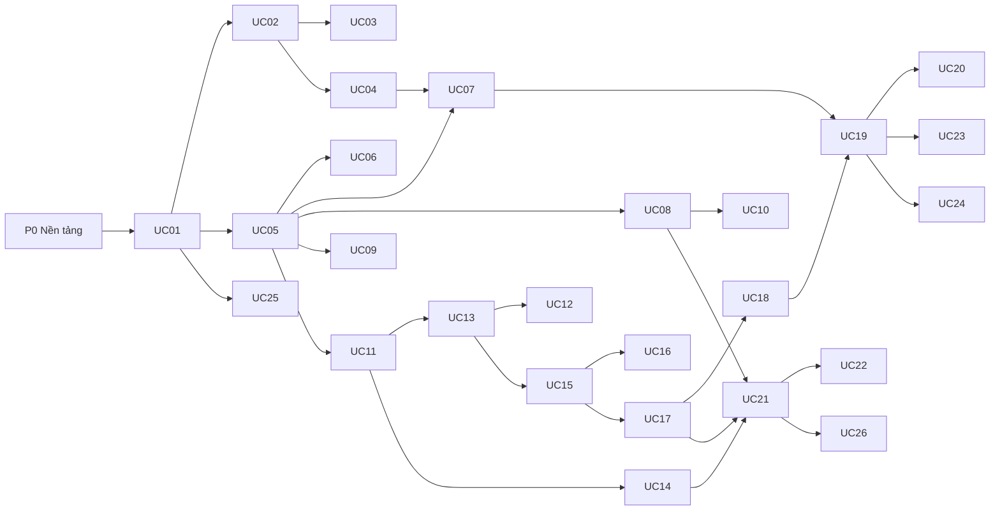

# task.md – Danh sách task cho agent phát triển DAVS

> Trước khi bắt đầu: đọc `context.md` (bối cảnh, kiến trúc, quyết định) và `skill.md` (cách làm).
> Yêu cầu nghiệp vụ gốc: SRS (`SRS_DAVS_…_v1.0.docx`). Task dưới đây đã trích sẵn luồng, quy tắc, mã lỗi và điều kiện hợp lệ của từng use case.

## 0. Cách dùng

**Trạng thái:** `[ ]` chưa làm · `[~]` đang làm · `[x]` xong (đạt DoD ở skill S17) · `[!]` bị chặn (ghi `BLOCKED:` + câu hỏi).

**Quy trình một task:** (1) chọn task đầu tiên có trạng thái `[ ]` mà mọi phụ thuộc đã `[x]` → (2) đổi sang `[~]` → (3) làm theo skill S1 → … → (4) chạy DoD (S17) → (5) tích `[x]`, điền *Ghi chú hoàn thành*.

**Quy tắc đặt tên task:** `T-0xx` nền tảng/hoàn thiện · `T-UCxx-BE` backend · `T-UCxx-FE` frontend. Hai task BE/FE của cùng UC có thể giao cho hai agent chạy song song (FE dùng dữ liệu giả theo hợp đồng API).

### Mẫu prompt giao việc cho một agent

```text
Bạn là lập trình viên fullstack trên dự án DAVS (Spring Boot, React+Canvas+Tailwind, PostgreSQL, MinIO, Docker).
1. Đọc context.md và skill.md ở thư mục gốc.
2. Thực hiện task <ID> trong task.md (đã kiểm tra các task phụ thuộc đều [x]).
3. Làm đúng skill được nêu trong task; không thêm tính năng ngoài task; không đổi hợp đồng API
   mà không cập nhật docs/contracts/ trong cùng PR.
4. Viết test cho từng dòng "Tiêu chí chấp nhận"; chạy mvn verify và npm test; chạy docker compose up --build.
5. Khi xong: tích [x], điền "Ghi chú hoàn thành". Nếu bị chặn: đặt [!] và ghi BLOCKED: <câu hỏi cụ thể>.
```

## 1. Tổng quan giai đoạn và thứ tự

| GĐ | Nội dung | Task |
|---|---|---|
| **P0** | Nền tảng: repo, Docker, khung backend/frontend, lỗi, bảo mật, quyền, nhật ký, MinIO, email/job, engine Canvas, CI | T-001 → T-015 |
| **P1** | Xác thực và quản trị | UC01 → UC02 → UC03, UC04 |
| **P2** | Dự án và nội dung | UC05 → UC07, UC06, UC08 → UC10, UC09 |
| **P3** | Dữ liệu | UC11 → UC13 → UC12, UC14 |
| **P4** | Dựng biểu đồ và dashboard | UC15 → UC16, UC17 → UC18 |
| **P5** | Xem, khám phá, xuất bản, chia sẻ | UC19 → UC20, UC23, UC24; UC21 → UC22 |
| **P6** | Tích hợp | UC25, UC26 |
| **P7** | Hoàn thiện: RLS, hiệu năng, bảo mật, tiếp cận, e2e, triển khai, đối chiếu SRS | T-101 → T-108 |

**MVP (giữ chắc nếu trễ):** UC01–UC06, UC08, UC11–UC13, UC15–UC19, UC21, UC22. Có thể lùi: UC09, UC10, UC20, UC26, UC25, phần Blend của UC13, các loại biểu đồ ngoài cột/đường/tròn.



---

## 2. P0 – Nền tảng

### T-001 · Khởi tạo monorepo  `[x]`
- **Phụ thuộc:** không. **Kỹ năng:** S16
- **Làm:** tạo cấu trúc thư mục theo `context.md` mục 3.1; `README.md` (cách chạy, cấu trúc, liên kết 3 tệp tài liệu); `.gitignore`, `.editorconfig`; thư mục `docs/{contracts,decisions}`; sao chép SRS vào `docs/`.
- **Chấp nhận:** clone sạch → đọc README biết chạy được bằng một lệnh; cấu trúc đúng mục 3.1.

**Ghi chú hoàn thành** (agent điền)
- Nhánh/PR: `feature/T-001-init-monorepo`
- Tệp chính: `README.md`, `.gitignore`, `.editorconfig`, `docs/contracts/README.md`, `docs/decisions/README.md`, `docs/SRS_DAVS_He_thong_Phan_tich_va_Truc_quan_hoa_du_lieu_v1.0.docx`, khung thư mục `backend/`, `frontend/`, `infra/`, `docs/` theo `context.md` mục 3.1.
- Quyết định: Đặt `.gitkeep` trong các thư mục module rỗng để Git theo dõi đầy đủ cấu trúc; sao chép tệp SRS gốc (`SRS_He_Thong_Phan_Tich_Va_Truc_Quan_Hoa_Du_Lieu_Tableau.docx`) vào `docs/` đồng thời tạo bản sao theo đúng tên chuẩn `SRS_DAVS_He_thong_Phan_tich_va_Truc_quan_hoa_du_lieu_v1.0.docx` được tham chiếu trong `context.md`.
- Đã chạy: Kiểm tra cây thư mục khớp `context.md` mục 3.1 và tài liệu `README.md`.
- Còn lại / lưu ý: Các tệp thực thi của Docker (`T-002`), Backend (`T-003`) và Frontend (`T-012`) sẽ được hiện thực ở các task tiếp theo.

### T-002 · Docker Compose và Dockerfile  `[x]`
- **Phụ thuộc:** T-001. **Kỹ năng:** S15
- **Làm:** `infra/docker-compose.yml` (+ `.dev.yml`) cho `postgres:16`, `minio`, `backend`, `frontend` (Nginx), `mailhog`; `healthcheck`; volume; `.env.example` đủ biến ở `context.md` mục 3.2; `backend.Dockerfile`, `frontend.Dockerfile` đa tầng; `nginx.conf` proxy `/api` → `backend:8080`; tạo bucket MinIO (`workbooks`, `datasets`, `exports`, `attachments`) khi khởi động.
- **Chấp nhận:** `docker compose up --build` từ máy sạch → `http://localhost:3000` mở được trang khung; `GET /actuator/health` = UP; console MinIO vào được; backend chạy bằng người dùng không phải root.

**Ghi chú hoàn thành** (agent điền)
- Nhánh/PR: `feature/T-002-docker-infra`
- Tệp chính: `infra/docker-compose.yml`, `infra/docker-compose.dev.yml`, `infra/.env.example`, `infra/backend.Dockerfile`, `infra/frontend.Dockerfile`, `infra/nginx.conf`, cùng bộ khung khởi chạy tối thiểu tại `backend/{pom.xml,DavsApplication.java,application.yml}` và `frontend/{package.json,vite.config.ts,tailwind.config.ts,src/app/App.tsx}` để image build được ngay.
- Quyết định: Dùng dịch vụ one-shot `minio-init` (`minio/mc`) phụ thuộc `minio` (`service_healthy`) để tự động tạo 4 bucket (`workbooks`, `datasets`, `exports`, `attachments`); `backend.Dockerfile` chạy JRE 21 Alpine với user không phải root (`davs:davs`, UID/GID `10001`); `nginx.conf` cấu hình `client_max_body_size 1024M` và proxy `/api/`, `/actuator/` sang `backend:8080`.
- Đã chạy: `docker-compose -f infra/docker-compose.yml config -q` (xanh), `docker-compose -f infra/docker-compose.yml -f infra/docker-compose.dev.yml config -q` (xanh).
- Còn lại / lưu ý: Các thư viện phụ thuộc đầy đủ của Backend (JPA, Security, Flyway, MinIO SDK, Testcontainers...) và bộ component đầy đủ của Frontend sẽ được mở rộng chi tiết tại `T-003` và `T-012`.

### T-003 · Khung backend Spring Boot  `[x]`
- **Phụ thuộc:** T-001. **Kỹ năng:** S2, S3
- **Làm:** dự án Maven (Java 21, Spring Boot 3.3+): web, security, data-jpa, validation, actuator, flyway, postgresql, mail, MinIO client, springdoc-openapi, MapStruct, Lombok, Testcontainers; tạo các package module rỗng theo mục 3.1; `application.yml` (đọc biến môi trường); Flyway `V1__baseline.sql` (extension `pgcrypto`, `users` cơ bản, `system_settings`, `audit_logs`, `jobs`); cấu hình OpenAPI tại `/api/docs`; Checkstyle/Spotless.
- **Chấp nhận:** `mvn verify` xanh trên Testcontainers; ứng dụng khởi động, Flyway chạy; `/api/docs` hiển thị.

**Ghi chú hoàn thành** (agent điền)
- Nhánh/PR: `feature/T-003-backend-skeleton`
- Tệp chính: `backend/pom.xml`, `backend/checkstyle.xml`, `backend/src/main/resources/application.yml`, `backend/src/main/resources/messages_vi.properties`, `backend/src/main/resources/db/migration/V1__baseline.sql`, `backend/src/main/java/com/davs/common/config/{OpenApiConfig.java,SecurityBaselineConfig.java}`, 23 tệp `package-info.java` cho từng module, `backend/src/test/resources/docker-java.properties`, `backend/src/test/java/com/davs/DavsApplicationTests.java`.
- Quyết định: Khởi tạo `V1__baseline.sql` với extension `pgcrypto` và 4 bảng nền tảng (`users`, `system_settings`, `audit_logs`, `jobs`) kèm unique index không phân biệt hoa/thường `ux_users_email_ci`; cấu hình `api.version=1.44` trong `docker-java.properties` để Testcontainers tương thích với Docker Engine 29.8+; đặt `management.health.mail.enabled: ${MAIL_HEALTH_ENABLED:false}` để `/actuator/health` không bị lỗi `503` khi chạy độc lập ngoài MailHog.
- Đã chạy: `mvn -B verify` (Checkstyle 0 lỗi, 3/3 test tích hợp trên Testcontainers `postgres:16-alpine` xanh, Spotless 27/27 tệp sạch).
- Còn lại / lưu ý: `SecurityBaselineConfig` sẽ được mở rộng thành `SecurityConfig` đầy đủ (JWT filter, BCrypt, phiên 30 phút, rate limit) tại `T-005`.

### T-004 · Khung lỗi và mã lỗi  `[x]`
- **Phụ thuộc:** T-003. **Kỹ năng:** S6
- **Làm:** `enum ErrorCode` chứa **toàn bộ** mã ở `context.md` Phụ lục A (mã, HTTP status, mẫu thông báo tiếng Việt, tham số thay thế); `DavsException`; `GlobalExceptionHandler` (cả lỗi Jakarta Validation → `fieldErrors`, lỗi chưa biết → `ERR-SYS-01` + `traceId`); `messages_vi.properties`.
- **Chấp nhận:** test duy nhất cho từng mã: ném `DavsException` → JSON đúng định dạng mục 7; không lộ stack trace; mỗi `ErrorCode` có test tham chiếu.

**Ghi chú hoàn thành** (agent điền)
- Nhánh/PR: `feature/T-004-error-handling`
- Tệp chính: `backend/src/main/java/com/davs/common/error/{ErrorCode.java,DavsException.java,ApiErrorResponse.java,FieldErrorItem.java,ValidationErrorCode.java,GlobalExceptionHandler.java}`, `backend/src/main/resources/messages_vi.properties`, `backend/src/test/java/com/davs/common/error/ErrorHandlingTests.java`.
- Quyết định: Khai báo đầy đủ 46 mã lỗi từ Phụ lục A trong `ErrorCode` kèm phương thức `formatMessage(Object... args)` thay thế theo vị trí cho các biến `{x}`, `{n}`, `{r}`, `{id}`, `{nền tảng}`; cung cấp annotation `@ValidationErrorCode` kết hợp suy luận theo URI để ánh xạ lỗi Jakarta Validation (`MethodArgumentNotValidException`, `BindException`, `ConstraintViolationException`) về đúng mã tổng quát của UC kèm danh sách `fieldErrors`; mọi lỗi chưa xác định quy về `ERR-SYS-01` (HTTP 500) kèm `traceId` và tuyệt đối không lộ stack trace hay chi tiết nội bộ.
- Đã chạy: `mvn -B test -Dtest=ErrorHandlingTests` (50/50 test xanh: 46 test tham số hóa cho từng `ErrorCode` + 4 test hợp đồng/validation/fallback), `mvn -B checkstyle:check spotless:check` (xanh).
- Còn lại / lưu ý: không.

### T-005 · Lõi bảo mật  `[ ]`
- **Phụ thuộc:** T-003, T-004. **Kỹ năng:** S3, S18
- **Làm:** `SecurityConfig` (JWT filter, stateless, CORS theo cấu hình, CSRF cho endpoint cookie, header bảo mật), `DavsUser` (principal), `JwtService` (access 15 phút), `PasswordEncoder` BCrypt, lọc kiểm tra `last_activity` (phiên 30 phút – đọc từ `SettingsService`), giới hạn tốc độ cho `/auth/**`. Chưa làm endpoint đăng nhập (thuộc UC01).
- **Chấp nhận:** endpoint không công khai trả 401 khi thiếu/hết hạn token (`ERR-AUTH-05`); test JWT sai chữ ký/hết hạn; `/actuator/health` công khai.

### T-006 · Lõi phân quyền (PermissionService)  `[ ]`
- **Phụ thuộc:** T-003, T-004, T-005. **Kỹ năng:** S4
- **Làm:** enum `SiteRole` (có thứ bậc), `Capability`, `Effect`; migration `permission_rules`; `PermissionService.require/can/requireRole/effective(user, resource)` theo `context.md` mục 6 (vai trò site → chủ sở hữu → DENY → ALLOW nhóm+cá nhân → từ chối mặc định; dự án `LOCKED`); `ResourceRef` (project/workbook/datasource/dashboard); cho phép module khác đăng ký bộ nạp "chủ sở hữu/cha" của tài nguyên.
- **Chấp nhận:** bộ test bảng quyết định (≥ 25 tổ hợp: vai trò × ALLOW/DENY × nhóm × chủ sở hữu × khóa) đều đúng; DENY thắng ALLOW; VIEWER không bao giờ có WEB_EDIT (BUS-PRJ-08).

### T-007 · Nhật ký kiểm toán  `[ ]`
- **Phụ thuộc:** T-003, T-005. **Kỹ năng:** S5
- **Làm:** `AuditService.log(AuditEvent)` ghi cùng transaction; bảng `audit_logs` chỉ INSERT (migration `REVOKE UPDATE, DELETE`); API `GET /api/v1/audit-logs` (chỉ SITE_ADMIN, lọc theo người/hành động/thời gian, phân trang); che trường nhạy cảm.
- **Chấp nhận:** sửa/xóa bản ghi bằng SQL thường bị từ chối; không có mật khẩu/token trong bản ghi; truy vấn có phân trang ≤ 2 giây với 1 triệu bản ghi (dữ liệu giả).

### T-008 · Cấu hình hệ thống (SettingsService)  `[ ]`
- **Phụ thuộc:** T-003. **Kỹ năng:** S2
- **Làm:** `system_settings` + `SettingsService` (cache, đọc có kiểu) với mặc định: `session.idleMinutes=30`, `login.maxFailures=5`, `login.lockMinutes=15`, `upload.maxBytes=1GB`, `workbook.maxVersions=25`, `export.maxRows=500000`, `export.maxBytes=100MB`, `chart.maxMarks=100000`, `trash.retentionDays=30`, `audit.retentionMonths=12`, `import.maxUsersPerFile=1000`, `refresh.maxConcurrent=4`, `refresh.pauseAfterFailures=5`, `comment.editWindowHours=24`, `share.maxRecipients=100`, `project.maxDepth=5`, `publish.publicEnabled=false`; API `GET/PUT /api/v1/admin/settings` (SITE_ADMIN).
- **Chấp nhận:** đổi giá trị có hiệu lực không cần khởi động lại; không còn hằng số số liệu trong code nghiệp vụ (grep kiểm tra).

### T-009 · Lớp lưu trữ MinIO  `[ ]`
- **Phụ thuộc:** T-003, T-002. **Kỹ năng:** S7
- **Làm:** `StorageService` (put/get/delete/exists/presignGet), enum `Bucket`, tự tạo bucket, làm sạch tên tệp, kiểm tra magic bytes, giao diện `VirusScanner` (+ `NoopScanner`, cờ bật), giới hạn dung lượng theo `SettingsService`.
- **Chấp nhận:** test Testcontainers MinIO: ghi/đọc/xóa/presign; tên tệp độc hại (`../../x`) bị làm sạch; tệp giả đuôi bị từ chối.

### T-010 · Công việc nền và email  `[ ]`
- **Phụ thuộc:** T-003, T-008. **Kỹ năng:** S10
- **Làm:** `JobRunner` (`jobs`, `FOR UPDATE SKIP LOCKED`, thử lại 3 lần), `NotificationService.send(template, to, model)` bằng `JavaMailSender` (MailHog khi dev) với mẫu: thư mời, cảnh báo làm mới thất bại, chia sẻ, @nhắc, kết quả nhập người dùng.
- **Chấp nhận:** hai runner chạy song song không xử lý trùng một job; email dev hiển thị ở MailHog; job lỗi thử lại đúng 3 lần rồi `FAILED`.

### T-011 · Dữ liệu khởi tạo (seed)  `[ ]`
- **Phụ thuộc:** T-003, T-006. **Kỹ năng:** S2
- **Làm:** migration/seed: nhóm "All Users", dự án "Default", `license_pools` mặc định, tài khoản SITE_ADMIN đầu tiên tạo từ biến `ADMIN_EMAIL`/`ADMIN_INITIAL_PASSWORD` (buộc đổi mật khẩu lần đầu — cờ trên `users`); cấm seed chạy lại ghi đè.
- **Chấp nhận:** môi trường mới có đúng một quản trị viên; chạy lại không tạo trùng; mật khẩu không xuất hiện trong log.

### T-012 · Khung frontend  `[ ]`
- **Phụ thuộc:** T-001. **Kỹ năng:** S11, S12
- **Làm:** Vite + React 18 + TS strict; Tailwind với token màu (S12); React Router (route bảo vệ `RequireAuth/RequireRole`); `http` client (axios, gắn token, làm mới token, chuyển ERR-AUTH-05 về `/login`); `applyApiError`; TanStack Query; Zustand (`auth` store); i18n (vi, sẵn khung en); layout (thanh trên, điều hướng trái theo vai trò – DIS-AUTH-01, nội dung); thư viện component dùng chung: `Button, Input, Select, Textarea, Checkbox, Radio, FormField, Table (phân trang), Dialog, Toast, ConfirmDialog, Skeleton, EmptyState, Badge, Tabs`; ESLint + Prettier + Vitest.
- **Chấp nhận:** trang khung chạy; điều hướng trái chỉ hiện mục phù hợp vai trò (test); mỗi component có test cơ bản + Storybook hoặc trang demo `/dev/components`; đạt tiêu chí a11y cơ bản (nhãn, focus).

### T-013 · Engine Canvas (lõi)  `[ ]`
- **Phụ thuộc:** T-012. **Kỹ năng:** S13
- **Làm:** `canvas/engine/*` theo `context.md` mục 5.1: `ChartEngine` (mount/setData/render/destroy, HiDPI, ResizeObserver), `scales` (linear, band, time, ordinal-color ổn định theo giá trị), `axes`, `legend`, `theme`, `hit` (rect/arc/point), `events`; renderer **cột** làm mẫu; `<ChartCanvas/>` và `<Tooltip/>`.
- **Chấp nhận:** test thuần hàm cho scale/layout/hit; trang demo vẽ cột 100.000 điểm trong ≤ 3 giây (đo `performance.now`, ghi kết quả vào *Ghi chú*); cùng giá trị → cùng màu; hover hiện tooltip đúng điểm.

### T-014 · CI  `[ ]`
- **Phụ thuộc:** T-003, T-012. **Kỹ năng:** S16
- **Làm:** workflow CI (backend `mvn verify`, frontend `npm ci && npm run lint && npm test && npm run build`, build Docker image, quét phụ thuộc); chặn gộp khi đỏ.
- **Chấp nhận:** PR kiểm thử chạy đủ các bước và báo trạng thái.

### T-015 · Khung e2e (Playwright)  `[ ]`
- **Phụ thuộc:** T-002, T-012. **Kỹ năng:** S14, S15
- **Làm:** cấu hình Playwright chạy với `docker compose`; fixture đăng nhập bằng tài khoản seed; helper tạo dữ liệu qua API; một test khói mở trang đăng nhập.
- **Chấp nhận:** `npm run e2e` chạy xanh trên môi trường compose mới.

---

# Các use case

> Mỗi use case gồm: khối **Đặc tả** (trích từ SRS) và hai task **BE/FE**. Chi tiết wireframe: SRS mục 2.6.n.


## UC01 – Đăng nhập hệ thống

**Giai đoạn:** P1 (Xác thực & quản trị) · **SRS:** mục 2.6.1 · FR-AUTH-01 · URD-01 · màn hình SCR-01 (Màn hình đăng nhập) · **Tác nhân:** Mọi người dùng (Quản trị viên, Người sáng tạo, Người khám phá, Người xem)

**Mô tả:** Cho phép người dùng đã được cấp giấy phép đăng nhập bằng email và mật khẩu (hoặc SSO nếu tổ chức bật) để truy cập chức năng theo vai trò. Lần đăng nhập đầu tiên người dùng phải đồng ý điều khoản sử dụng và kích hoạt tài khoản (Activate my trial đối với tài khoản dùng thử).

**Sự kiện kích hoạt:** Người dùng truy cập trang đăng nhập hoặc bị chuyển hướng do phiên làm việc hết hạn.  
**Tiền điều kiện:** Tài khoản đã được tạo (UC02) hoặc đã được cấp giấy phép; trình duyệt thuộc danh sách hỗ trợ (mục 3.4).  
**Hậu điều kiện:** Phiên làm việc được tạo; nhật ký đăng nhập thành công/thất bại được ghi; người dùng ở trang chủ.

**Luồng chính (phải chạy đúng từng bước):**

1. *Người dùng*: Truy cập địa chỉ trang đăng nhập của hệ thống.
2. *Hệ thống*: Hiển thị màn hình SCR-01 gồm ô Email, Mật khẩu, tùy chọn "Ghi nhớ đăng nhập" và nút "Đăng nhập".
3. *Người dùng*: Nhập email, mật khẩu và chọn "Đăng nhập".
4. *Hệ thống*: Kiểm tra định dạng dữ liệu theo điều kiện hợp lệ ở bảng dữ liệu.
5. *Hệ thống*: Xác thực thông tin; kiểm tra trạng thái tài khoản và giấy phép.
6. *Hệ thống*: Nếu là lần đăng nhập đầu: hiển thị điều khoản sử dụng, hộp chọn đồng ý và nút "Kích hoạt tài khoản".
7. *Người dùng*: Tích chọn đồng ý điều khoản và chọn "Kích hoạt tài khoản".
8. *Hệ thống*: Tạo phiên làm việc, ghi nhật ký đăng nhập, chuyển đến trang chủ theo vai trò (DIS-AUTH-01).

**Luồng thay thế → mỗi dòng là một test bắt buộc:**

- `[4a]` *Hệ thống*: Email hoặc mật khẩu sai định dạng: hiển thị lỗi ngay tại trường, không gửi yêu cầu xác thực.
- `[5a]` *Hệ thống*: Sai email/mật khẩu: hiển thị ERR-AUTH-01, tăng bộ đếm sai, quay lại bước 2.
- `[5b]` *Hệ thống*: Sai liên tiếp 5 lần: khóa đăng nhập 15 phút, hiển thị ERR-AUTH-03.
- `[5c]` *Hệ thống*: Tài khoản bị vô hiệu hóa, giấy phép hết hạn hoặc hết chỗ: hiển thị ERR-AUTH-04.
- `[7a]` *Người dùng*: Không đồng ý điều khoản (nút Kích hoạt bị khóa) hoặc chọn "Hủy": hiển thị ERR-AUTH-02, kết thúc phiên.

**Quy tắc nghiệp vụ / hiển thị:**

- BUS-AUTH-01: Mỗi tài khoản đăng nhập bằng một email duy nhất.
- BUS-AUTH-02: Khóa đăng nhập 15 phút sau 5 lần sai liên tiếp.
- BUS-AUTH-03: Phiên hết hạn sau 30 phút không hoạt động (cấu hình được); khi hết hạn xử lý theo ERR-AUTH-05.
- BUS-AUTH-04: Đăng nhập lần đầu bắt buộc đồng ý điều khoản sử dụng.
- DIS-AUTH-01: Trang chủ chỉ hiển thị các mục menu phù hợp vai trò (Viewer không thấy "Người dùng", "Nhóm", "Cài đặt").

**Trường dữ liệu và điều kiện hợp lệ** (kiểm tra ở cả client – zod, và server – Jakarta Validation):

| Mã | Trường | Bắt buộc | Điều kiện hợp lệ | Ví dụ |
|---|---|---|---|---|
| VAL-AUTH-01 | Email | Có | Đúng định dạng email, tối đa 254 ký tự | an.nguyen@congty.vn |
| VAL-AUTH-02 | Mật khẩu | Có | 8–64 ký tự; che ký tự khi nhập | •••••••• |
| VAL-AUTH-03 | Ghi nhớ đăng nhập | Không | Tối đa 14 ngày | Không chọn |
| VAL-AUTH-04 | Đồng ý điều khoản | Có (lần đầu) | Phải chọn thì mới kích hoạt được | Đã chọn |

**Phi chức năng:** NFR-PERF-01 (đăng nhập ≤ 3 giây); NFR-SEC-01, NFR-SEC-02, NFR-SEC-07.

### T-UC01-BE · Backend Đăng nhập hệ thống  `[ ]`

- **Phụ thuộc:** T-003, T-004, T-005, T-006, T-008, T-011
- **API:**
  - `POST /api/v1/auth/login {email,password,rememberMe}`
  - `POST /api/v1/auth/accept-terms`
  - `POST /api/v1/auth/refresh`
  - `POST /api/v1/auth/logout`
  - `GET /api/v1/auth/me`
- **Bảng dữ liệu (Flyway migration mới):** `users`, `login_attempts`, `refresh_tokens`
- **Package:** `com.davs.auth` (controller → service → repo → domain)
- **Lưu ý triển khai:** Khóa 15 phút sau 5 lần sai tính theo tài khoản **và** IP; trả ERR-AUTH-03 kèm thời điểm mở khóa. Phiên hết hạn (30 phút không hoạt động) → 401 `ERR-AUTH-05`, frontend chuyển về `/login` giữ lại đường dẫn cũ. Mật khẩu so khớp bằng BCrypt, thời gian phản hồi lỗi sai-email và sai-mật-khẩu như nhau (chống dò tài khoản).
- **Tiêu chí chấp nhận:** mọi bước *Hệ thống* của luồng chính được hiện thực; **mỗi** luồng thay thế ở trên có test trả đúng mã lỗi (nếu có `ERR-…`) và đúng mã HTTP; quy tắc nghiệp vụ nêu trên được cưỡng chế ở máy chủ; có test được/bị từ chối quyền; nhật ký kiểm toán ghi theo skill S5.
- **Kiểm thử gợi ý (từ SRS):** Đúng/sai mật khẩu; sai 5 lần liên tiếp → khóa 15 phút; lần đầu không tích điều khoản; phiên hết hạn sau 30 phút; tài khoản bị vô hiệu hóa.
- **Kỹ năng cần dùng:** S2, S3, S4, S5, S6

**Ghi chú hoàn thành** (agent điền khi xong): …

### T-UC01-FE · Giao diện Đăng nhập hệ thống  `[ ]`

- **Phụ thuộc:** T-UC01-BE (có thể làm song song bằng dữ liệu giả theo hợp đồng API), T-012
- **Route / vị trí:** `/login`
- **Thành phần:** `LoginPage`, `TermsActivationDialog`, useAuth (store), `RequireAuth/RequireRole`
- **Bố cục:** bám wireframe SCR-01 trong SRS (thẻ đăng nhập ở giữa trang, không có thanh điều hướng); dùng component dùng chung; Tailwind theo skill S12.
- **Tiêu chí chấp nhận:** luồng chính chạy được từ UI đến CSDL; hiển thị đúng thông báo lỗi `ERR-…` của từng luồng thay thế (lỗi trường đánh dấu tại trường); đủ trạng thái tải/rỗng/lỗi/thành công; ẩn/khóa điều khiển theo quyền (nếu có DIS-…); dùng được bằng bàn phím; kiểm tra hợp lệ phía client khớp bảng VAL ở trên.
- **Test:** Vitest cho form/hook; Playwright cho luồng chính + các lỗi quan trọng (UC01_<bước>_<mô-tả>).
- **Kỹ năng cần dùng:** S11, S12

**Ghi chú hoàn thành** (agent điền khi xong): …

---

## UC02 – Thêm người dùng

**Giai đoạn:** P1 (Xác thực & quản trị) · **SRS:** mục 2.6.2 · FR-USR-01 · URD-02 · màn hình SCR-02 (Màn hình thêm người dùng) · **Tác nhân:** Quản trị viên

**Mô tả:** Quản trị viên thêm người dùng vào site theo hai cách: (1) nhập từng tên tài khoản (Add Users by Username); (2) nhập hàng loạt từ tệp (Import Users from file). Chọn phương thức xác thực và vai trò (giấy phép) cho người dùng.

**Sự kiện kích hoạt:** Quản trị viên chọn "Người dùng" → "Thêm người dùng".  
**Tiền điều kiện:** Quản trị viên đã đăng nhập (UC01); site còn giấy phép khả dụng theo vai trò cần cấp.  
**Hậu điều kiện:** Tài khoản mới ở trạng thái "Chờ kích hoạt"; thư mời đã được gửi; hành động được ghi vào nhật ký kiểm toán.

**Luồng chính (phải chạy đúng từng bước):**

1. *Quản trị viên*: Chọn "Người dùng" ở thanh điều hướng trái, chọn "Thêm người dùng".
2. *Hệ thống*: Hiển thị hai lựa chọn: "Thêm theo tên tài khoản" và "Nhập từ tệp".
3. *Quản trị viên*: Chọn "Thêm theo tên tài khoản".
4. *Hệ thống*: Hiển thị màn hình SCR-02 (Phương thức xác thực, Tên tài khoản, Vai trò trên site).
5. *Quản trị viên*: Chọn phương thức xác thực, nhập một hoặc nhiều tên tài khoản (ngăn cách bằng dấu chấm phẩy), chọn vai trò, bấm "Thêm người dùng".
6. *Hệ thống*: Kiểm tra dữ liệu, kiểm tra trùng tài khoản và số giấy phép còn lại (BUS-USR-01).
7. *Hệ thống*: Tạo tài khoản, gửi thư mời kích hoạt, hiển thị kết quả (số tài khoản thành công/thất bại).

**Luồng thay thế → mỗi dòng là một test bắt buộc:**

- `[3a]` *Quản trị viên*: Chọn "Nhập từ tệp": chọn phương thức xác thực, bấm "Chọn tệp", chọn tệp CSV theo mẫu, bấm "Nhập người dùng".
- `[3b]` *Hệ thống*: Đọc tệp, kiểm tra từng dòng; dòng hợp lệ được tạo, dòng lỗi được ghi vào báo cáo lỗi có thể tải về (ERR-USR-03).
- `[6a]` *Hệ thống*: Tên tài khoản sai định dạng: hiển thị ERR-USR-01.
- `[6b]` *Hệ thống*: Tài khoản đã tồn tại: hiển thị ERR-USR-02, bỏ qua bản ghi trùng và tiếp tục các bản ghi khác.
- `[6c]` *Hệ thống*: Vượt số giấy phép của vai trò: hiển thị ERR-USR-04, không tạo tài khoản vượt hạn mức.
- `[7a]` *Hệ thống*: Gửi thư mời thất bại: ghi trạng thái "Chưa mời", Quản trị viên có thể gửi lại (UC03).

**Quy tắc nghiệp vụ / hiển thị:**

- BUS-USR-01: Số người dùng theo từng vai trò không vượt giấy phép đã mua.
- BUS-USR-02: Mỗi người dùng chỉ có một vai trò site tại một thời điểm.
- BUS-USR-03: Tệp nhập tối đa 1.000 dòng mỗi lần.

**Trường dữ liệu và điều kiện hợp lệ** (kiểm tra ở cả client – zod, và server – Jakarta Validation):

| Mã | Trường | Bắt buộc | Điều kiện hợp lệ | Ví dụ |
|---|---|---|---|---|
| VAL-USR-01 | Phương thức xác thực | Có | Chọn từ danh sách đã cấu hình cho site | SSO |
| VAL-USR-02 | Tên tài khoản | Có (cách 1) | Email hợp lệ, ≤ 254 ký tự; tối đa 50 tên mỗi lần | an.nguyen@congty.vn; binh.tran@congty.vn |
| VAL-USR-03 | Vai trò trên site | Có | Chọn một giá trị | Explorer |
| VAL-USR-04 | Tệp người dùng | Có (cách 2) | Định dạng .csv, UTF-8, ≤ 1 MB, ≤ 1.000 dòng | nguoidung.csv |

**Phi chức năng:** NFR-PERF-06 (nhập 1.000 người dùng ≤ 60 giây); NFR-SEC-03; NFR-SEC-05.

### T-UC02-BE · Backend Thêm người dùng  `[ ]`

- **Phụ thuộc:** T-UC01-BE, T-010
- **API:**
  - `POST /api/v1/users {authMethod,usernames[],role}`
  - `POST /api/v1/users/import (multipart CSV) → 202 {jobId}`
  - `GET /api/v1/users/import/{jobId}`
  - `GET /api/v1/users/import/{jobId}/errors (CSV)`
  - `GET /api/v1/users/import-template`
- **Bảng dữ liệu (Flyway migration mới):** `users`, `license_pools`, `invitations`, `jobs`
- **Package:** `com.davs.usr` (controller → service → repo → domain)
- **Lưu ý triển khai:** Nhập CSV chạy bằng job nền (IMPORT_USERS); dòng lỗi gom vào báo cáo lỗi tải được (ERR-USR-03). Tài khoản mới trạng thái `PENDING`, gửi thư mời (token một lần, hết hạn 7 ngày). Kiểm tra giấy phép: `license_pools.used + n ≤ total` theo vai trò (BUS-USR-01).
- **Tiêu chí chấp nhận:** mọi bước *Hệ thống* của luồng chính được hiện thực; **mỗi** luồng thay thế ở trên có test trả đúng mã lỗi (nếu có `ERR-…`) và đúng mã HTTP; quy tắc nghiệp vụ nêu trên được cưỡng chế ở máy chủ; có test được/bị từ chối quyền; nhật ký kiểm toán ghi theo skill S5.
- **Kiểm thử gợi ý (từ SRS):** Thêm 1 và nhiều tên; CSV 1.000 dòng và 1.001 dòng; tài khoản trùng; vượt giấy phép; email sai định dạng; thư mời gửi lỗi.
- **Kỹ năng cần dùng:** S2, S3, S4, S5, S6, S10

**Ghi chú hoàn thành** (agent điền khi xong): …

### T-UC02-FE · Giao diện Thêm người dùng  `[ ]`

- **Phụ thuộc:** T-UC02-BE (có thể làm song song bằng dữ liệu giả theo hợp đồng API), T-012
- **Route / vị trí:** `/admin/users/new`
- **Thành phần:** `AddUsersPage`, `ImportUsersPanel`, `ImportResultDialog`
- **Bố cục:** bám wireframe SCR-02 trong SRS (thanh trên + điều hướng trái + vùng nội dung); dùng component dùng chung; Tailwind theo skill S12.
- **Tiêu chí chấp nhận:** luồng chính chạy được từ UI đến CSDL; hiển thị đúng thông báo lỗi `ERR-…` của từng luồng thay thế (lỗi trường đánh dấu tại trường); đủ trạng thái tải/rỗng/lỗi/thành công; ẩn/khóa điều khiển theo quyền (nếu có DIS-…); dùng được bằng bàn phím; kiểm tra hợp lệ phía client khớp bảng VAL ở trên.
- **Test:** Vitest cho form/hook; Playwright cho luồng chính + các lỗi quan trọng (UC02_<bước>_<mô-tả>).
- **Kỹ năng cần dùng:** S11, S12

**Ghi chú hoàn thành** (agent điền khi xong): …

---

## UC03 – Quản lý người dùng và vai trò

**Giai đoạn:** P1 (Xác thực & quản trị) · **SRS:** mục 2.6.3 · FR-USR-02 · URD-02 · màn hình SCR-03 (Màn hình danh sách người dùng) · **Tác nhân:** Quản trị viên

**Mô tả:** Quản trị viên xem danh sách, tìm kiếm và lọc người dùng; thay đổi vai trò/giấy phép; vô hiệu hóa hoặc kích hoạt lại; gửi lại thư mời; xóa người dùng và chuyển quyền sở hữu nội dung.

**Sự kiện kích hoạt:** Quản trị viên chọn "Người dùng" ở thanh điều hướng.  
**Tiền điều kiện:** Quản trị viên đã đăng nhập; tồn tại ít nhất một người dùng khác.  
**Hậu điều kiện:** Thông tin người dùng được cập nhật; quyền hiệu lực thay đổi từ phiên đăng nhập kế tiếp; nhật ký ghi lại.

**Luồng chính (phải chạy đúng từng bước):**

1. *Quản trị viên*: Chọn "Người dùng" ở thanh điều hướng.
2. *Hệ thống*: Hiển thị SCR-03: danh sách người dùng (tên, email, vai trò, nhóm, lần đăng nhập cuối, trạng thái), phân trang 25 dòng/trang.
3. *Quản trị viên*: Tìm kiếm hoặc lọc theo tên, vai trò, nhóm, trạng thái.
4. *Quản trị viên*: Tích chọn một hoặc nhiều người dùng, chọn thao tác "Đổi vai trò".
5. *Hệ thống*: Hiển thị hộp thoại chọn vai trò mới và cảnh báo ảnh hưởng đến nội dung đang sở hữu.
6. *Quản trị viên*: Chọn vai trò mới, bấm "Lưu".
7. *Hệ thống*: Kiểm tra BUS-USR-01, BUS-USR-04; cập nhật vai trò, ghi nhật ký, hiển thị thông báo thành công.

**Luồng thay thế → mỗi dòng là một test bắt buộc:**

- `[4a]` *Quản trị viên*: Chọn "Vô hiệu hóa": hệ thống thu hồi phiên; người dùng không đăng nhập được (ERR-AUTH-04); dữ liệu giữ nguyên.
- `[4b]` *Quản trị viên*: Chọn "Xóa": hệ thống yêu cầu chọn người nhận quyền sở hữu nội dung; nếu bỏ qua hiển thị ERR-USR-05.
- `[4c]` *Quản trị viên*: Chọn "Gửi lại thư mời" đối với tài khoản đang Chờ kích hoạt.
- `[7a]` *Hệ thống*: Vai trò mới thấp hơn mức cần thiết của nội dung đang sở hữu: hiển thị ERR-USR-06, không thay đổi.
- `[7b]` *Hệ thống*: Thao tác làm site không còn Quản trị viên nào hoạt động: từ chối theo BUS-USR-05.

**Quy tắc nghiệp vụ / hiển thị:**

- BUS-USR-04: Không hạ vai trò Creator xuống thấp hơn nếu người đó còn sở hữu nguồn dữ liệu/workbook chưa chuyển quyền.
- BUS-USR-05: Site phải còn ít nhất 01 Quản trị viên đang hoạt động.
- BUS-USR-01: Áp dụng như UC02 khi nâng vai trò.

**Trường dữ liệu và điều kiện hợp lệ** (kiểm tra ở cả client – zod, và server – Jakarta Validation):

| Mã | Trường | Bắt buộc | Điều kiện hợp lệ | Ví dụ |
|---|---|---|---|---|
| VAL-USR-05 | Từ khóa tìm kiếm | Không | Tối đa 100 ký tự | nguyen |
| VAL-USR-06 | Bộ lọc vai trò | Không | Tất cả / Creator / Explorer / Viewer / Quản trị viên | Explorer |
| VAL-USR-07 | Vai trò mới | Có (khi đổi) | Khác vai trò hiện tại | Creator |
| VAL-USR-08 | Chủ sở hữu mới | Có (khi xóa) | Người dùng đang hoạt động, khác người bị xóa | trang.le@congty.vn |

**Phi chức năng:** NFR-PERF-04 (danh sách ≤ 2 giây); NFR-SEC-03; NFR-SEC-05.

### T-UC03-BE · Backend Quản lý người dùng và vai trò  `[ ]`

- **Phụ thuộc:** T-UC02-BE
- **API:**
  - `GET /api/v1/users?q&role&group&status&page&size`
  - `PATCH /api/v1/users/{id}/role {role}`
  - `POST /api/v1/users/{id}/deactivate | /activate`
  - `POST /api/v1/users/{id}/resend-invite`
  - `DELETE /api/v1/users/{id}?newOwnerId=`
- **Bảng dữ liệu (Flyway migration mới):** `users`, `license_pools`
- **Package:** `com.davs.usr` (controller → service → repo → domain)
- **Lưu ý triển khai:** Đổi vai trò hàng loạt (nhiều id) trong một transaction. Xóa người dùng: bắt buộc `newOwnerId` nếu còn sở hữu nội dung (ERR-USR-05); chuyển quyền sở hữu dùng service của module `project`/`workbook` (qua interface `OwnershipTransfer`, các module này đăng ký dần). Vô hiệu hóa thu hồi toàn bộ refresh token.
- **Tiêu chí chấp nhận:** mọi bước *Hệ thống* của luồng chính được hiện thực; **mỗi** luồng thay thế ở trên có test trả đúng mã lỗi (nếu có `ERR-…`) và đúng mã HTTP; quy tắc nghiệp vụ nêu trên được cưỡng chế ở máy chủ; có test được/bị từ chối quyền; nhật ký kiểm toán ghi theo skill S5.
- **Kiểm thử gợi ý (từ SRS):** Đổi vai trò đơn lẻ/hàng loạt; xóa người dùng đang sở hữu nội dung; xóa/vô hiệu hóa Quản trị viên cuối cùng; tìm kiếm, lọc, phân trang.
- **Kỹ năng cần dùng:** S2, S3, S4, S5, S6

**Ghi chú hoàn thành** (agent điền khi xong): …

### T-UC03-FE · Giao diện Quản lý người dùng và vai trò  `[ ]`

- **Phụ thuộc:** T-UC03-BE (có thể làm song song bằng dữ liệu giả theo hợp đồng API), T-012
- **Route / vị trí:** `/admin/users`
- **Thành phần:** `UsersListPage`, `RoleChangeDialog`, `DeleteUserDialog`, `UserFilters`
- **Bố cục:** bám wireframe SCR-03 trong SRS (thanh trên + điều hướng trái + vùng nội dung); dùng component dùng chung; Tailwind theo skill S12.
- **Tiêu chí chấp nhận:** luồng chính chạy được từ UI đến CSDL; hiển thị đúng thông báo lỗi `ERR-…` của từng luồng thay thế (lỗi trường đánh dấu tại trường); đủ trạng thái tải/rỗng/lỗi/thành công; ẩn/khóa điều khiển theo quyền (nếu có DIS-…); dùng được bằng bàn phím; kiểm tra hợp lệ phía client khớp bảng VAL ở trên.
- **Test:** Vitest cho form/hook; Playwright cho luồng chính + các lỗi quan trọng (UC03_<bước>_<mô-tả>).
- **Kỹ năng cần dùng:** S11, S12

**Ghi chú hoàn thành** (agent điền khi xong): …

---

## UC04 – Quản lý nhóm làm việc

**Giai đoạn:** P1 (Xác thực & quản trị) · **SRS:** mục 2.6.4 · FR-GRP-01 · URD-03 · màn hình SCR-04 (Màn hình thêm nhóm làm việc) · **Tác nhân:** Quản trị viên

**Mô tả:** Quản trị viên tạo nhóm làm việc, đặt vai trò đăng nhập tối thiểu, thêm/bớt thành viên, đổi tên và xóa nhóm để cấp quyền theo nhóm thay vì từng cá nhân.

**Sự kiện kích hoạt:** Quản trị viên chọn "Nhóm" → "Thêm nhóm".  
**Tiền điều kiện:** Quản trị viên đã đăng nhập; có người dùng để thêm vào nhóm.  
**Hậu điều kiện:** Nhóm tồn tại với danh sách thành viên mới; quyền theo nhóm có hiệu lực.

**Luồng chính (phải chạy đúng từng bước):**

1. *Quản trị viên*: Chọn "Nhóm" ở thanh điều hướng, chọn "Thêm nhóm".
2. *Hệ thống*: Hiển thị màn hình SCR-04.
3. *Quản trị viên*: Nhập tên nhóm, mô tả; chọn vai trò đăng nhập tối thiểu; bấm "Tạo".
4. *Hệ thống*: Kiểm tra tên nhóm (bắt buộc, không trùng), tạo nhóm và mở trang chi tiết nhóm.
5. *Quản trị viên*: Chọn "Thêm thành viên", tìm và chọn người dùng, bấm "Thêm".
6. *Hệ thống*: Gán thành viên; áp dụng vai trò tối thiểu (nâng vai trò nếu thấp hơn và còn giấy phép); ghi nhật ký.

**Luồng thay thế → mỗi dòng là một test bắt buộc:**

- `[4a]` *Hệ thống*: Tên nhóm trống hoặc trùng: hiển thị ERR-GRP-01.
- `[5a]` *Quản trị viên*: Chọn "Xóa thành viên": hệ thống gỡ khỏi nhóm, quyền theo nhóm mất hiệu lực ngay.
- `[5b]` *Quản trị viên*: Chọn "Xóa nhóm": hệ thống yêu cầu xác nhận; quyền đã cấp cho nhóm bị thu hồi.
- `[6a]` *Hệ thống*: Không đủ giấy phép để nâng vai trò thành viên: hiển thị ERR-USR-04, không thêm người đó.

**Quy tắc nghiệp vụ / hiển thị:**

- BUS-GRP-01: Tên nhóm duy nhất trong site (không phân biệt hoa/thường).
- BUS-GRP-02: Nhóm mặc định "All Users" không được xóa hoặc đổi tên.
- BUS-GRP-03: Quyền hiệu lực của người dùng là hợp của quyền cá nhân và quyền theo nhóm; "Từ chối" ưu tiên hơn "Cho phép".

**Trường dữ liệu và điều kiện hợp lệ** (kiểm tra ở cả client – zod, và server – Jakarta Validation):

| Mã | Trường | Bắt buộc | Điều kiện hợp lệ | Ví dụ |
|---|---|---|---|---|
| VAL-GRP-01 | Tên nhóm | Có | 3–100 ký tự, duy nhất trong site | Phòng Kinh doanh |
| VAL-GRP-02 | Mô tả | Không | Tối đa 500 ký tự | Nhân sự khối kinh doanh |
| VAL-GRP-03 | Vai trò đăng nhập tối thiểu | Có | Viewer / Explorer / Creator | Viewer |
| VAL-GRP-04 | Thành viên | Không | Người dùng đang hoạt động; tối đa 500 mỗi lần | binh.tran; trang.le |

**Phi chức năng:** NFR-PERF-04; NFR-SEC-03; NFR-SEC-05.

### T-UC04-BE · Backend Quản lý nhóm làm việc  `[ ]`

- **Phụ thuộc:** T-UC02-BE
- **API:**
  - `POST /api/v1/groups`
  - `GET /api/v1/groups?q`
  - `GET /api/v1/groups/{id}`
  - `PATCH /api/v1/groups/{id}`
  - `DELETE /api/v1/groups/{id}`
  - `POST /api/v1/groups/{id}/members {userIds[]}`
  - `DELETE /api/v1/groups/{id}/members/{userId}`
- **Bảng dữ liệu (Flyway migration mới):** `groups`, `group_members`
- **Package:** `com.davs.grp` (controller → service → repo → domain)
- **Lưu ý triển khai:** Nhóm mặc định "All Users" tạo bằng migration và không sửa/xóa được (BUS-GRP-02). Khi đặt `minRole`, thành viên có vai trò thấp hơn được nâng nếu còn giấy phép, nếu không trả ERR-USR-04 cho người đó và bỏ qua. Xóa nhóm thu hồi `permission_rules` có `subject_type=GROUP`.
- **Tiêu chí chấp nhận:** mọi bước *Hệ thống* của luồng chính được hiện thực; **mỗi** luồng thay thế ở trên có test trả đúng mã lỗi (nếu có `ERR-…`) và đúng mã HTTP; quy tắc nghiệp vụ nêu trên được cưỡng chế ở máy chủ; có test được/bị từ chối quyền; nhật ký kiểm toán ghi theo skill S5.
- **Kiểm thử gợi ý (từ SRS):** Tên nhóm trùng khác hoa/thường; thêm/xóa thành viên; nâng vai trò khi hết giấy phép; xóa nhóm đang có quyền; sửa nhóm All Users.
- **Kỹ năng cần dùng:** S2, S3, S4, S5, S6

**Ghi chú hoàn thành** (agent điền khi xong): …

### T-UC04-FE · Giao diện Quản lý nhóm làm việc  `[ ]`

- **Phụ thuộc:** T-UC04-BE (có thể làm song song bằng dữ liệu giả theo hợp đồng API), T-012
- **Route / vị trí:** `/admin/groups`
- **Thành phần:** `GroupsListPage`, `GroupFormPage`, `MemberPicker`, `GroupDetailPage`
- **Bố cục:** bám wireframe SCR-04 trong SRS (thanh trên + điều hướng trái + vùng nội dung); dùng component dùng chung; Tailwind theo skill S12.
- **Tiêu chí chấp nhận:** luồng chính chạy được từ UI đến CSDL; hiển thị đúng thông báo lỗi `ERR-…` của từng luồng thay thế (lỗi trường đánh dấu tại trường); đủ trạng thái tải/rỗng/lỗi/thành công; ẩn/khóa điều khiển theo quyền (nếu có DIS-…); dùng được bằng bàn phím; kiểm tra hợp lệ phía client khớp bảng VAL ở trên.
- **Test:** Vitest cho form/hook; Playwright cho luồng chính + các lỗi quan trọng (UC04_<bước>_<mô-tả>).
- **Kỹ năng cần dùng:** S11, S12

**Ghi chú hoàn thành** (agent điền khi xong): …

---

## UC05 – Tạo dự án

**Giai đoạn:** P2 (Dự án & nội dung) · **SRS:** mục 2.6.5 · FR-PRJ-01 · URD-04 · màn hình SCR-05 (Màn hình tạo dự án) · **Tác nhân:** Người sáng tạo, Quản trị viên

**Mô tả:** Tạo dự án (Project) làm thư mục chứa workbook và nguồn dữ liệu; hỗ trợ dự án con lồng nhau để phân chia theo phòng ban hoặc chủ đề.

**Sự kiện kích hoạt:** Người dùng chọn "Mới" → "Dự án".  
**Tiền điều kiện:** Đã đăng nhập; có quyền tạo dự án (Creator trở lên hoặc được cấp quyền).  
**Hậu điều kiện:** Dự án mới có chủ sở hữu và quyền ban đầu; hành động được ghi nhật ký.

**Luồng chính (phải chạy đúng từng bước):**

1. *Người sáng tạo*: Chọn "Mới" → "Dự án" ở giao diện chính.
2. *Hệ thống*: Hiển thị màn hình SCR-05.
3. *Người sáng tạo*: Nhập tên, mô tả; chọn dự án cha (nếu có) và mẫu quyền; bấm "Tạo".
4. *Hệ thống*: Kiểm tra dữ liệu theo điều kiện hợp lệ và quy tắc BUS-PRJ-01, BUS-PRJ-02.
5. *Hệ thống*: Tạo dự án, đặt người tạo là chủ sở hữu, áp mẫu quyền; hiển thị dự án trong danh sách và thông báo thành công.

**Luồng thay thế → mỗi dòng là một test bắt buộc:**

- `[4a]` *Hệ thống*: Tên trống, quá dài hoặc chứa ký tự không hợp lệ: hiển thị ERR-PRJ-02 tại trường.
- `[4b]` *Hệ thống*: Tên trùng trong cùng dự án cha: hiển thị ERR-PRJ-01.
- `[3a]` *Người sáng tạo*: Bấm "Hủy": không tạo dự án, quay lại trang trước.
- `[5a]` *Hệ thống*: Không có quyền tạo dự án: hiển thị ERR-PRJ-03 (mục "Dự án" vốn đã bị ẩn theo DIS-PRJ-01).

**Quy tắc nghiệp vụ / hiển thị:**

- BUS-PRJ-01: Tên dự án duy nhất trong cùng dự án cha.
- BUS-PRJ-02: Tối đa 5 cấp dự án lồng nhau.
- BUS-PRJ-03: Mẫu quyền "Kế thừa" lấy quyền từ dự án cha.
- DIS-PRJ-01: Mục "Mới → Dự án" chỉ hiển thị với người có quyền tạo dự án.

**Trường dữ liệu và điều kiện hợp lệ** (kiểm tra ở cả client – zod, và server – Jakarta Validation):

| Mã | Trường | Bắt buộc | Điều kiện hợp lệ | Ví dụ |
|---|---|---|---|---|
| VAL-PRJ-01 | Tên dự án | Có | 1–128 ký tự; không chứa / \ : * ? " < > | | Báo cáo bán hàng Q4 |
| VAL-PRJ-02 | Mô tả | Không | Tối đa 500 ký tự | Dashboard doanh số theo khu vực |
| VAL-PRJ-03 | Dự án cha | Không | Dự án mà người dùng có quyền ghi | (Gốc) |
| VAL-PRJ-04 | Mẫu quyền | Có | Kế thừa / Tùy chỉnh / Khóa | Kế thừa |

**Phi chức năng:** NFR-PERF-04; NFR-SEC-03.

### T-UC05-BE · Backend Tạo dự án  `[ ]`

- **Phụ thuộc:** T-UC01-BE, T-006
- **API:**
  - `POST /api/v1/projects {name,description,parentId,permissionMode}`
  - `GET /api/v1/projects/{id}`
- **Bảng dữ liệu (Flyway migration mới):** `projects`
- **Package:** `com.davs.project` (controller → service → repo → domain)
- **Lưu ý triển khai:** Dự án mặc định "Default" tạo bằng migration. Giới hạn 5 cấp lồng (BUS-PRJ-02) kiểm tra bằng độ sâu đường dẫn. Tên duy nhất trong cùng cha (không phân biệt hoa/thường) – unique index `(parent_id, lower(name)) WHERE deleted_at IS NULL`. Mục "Dự án mới" chỉ hiện khi `useCan(CREATE_PROJECT)` (DIS-PRJ-01).
- **Tiêu chí chấp nhận:** mọi bước *Hệ thống* của luồng chính được hiện thực; **mỗi** luồng thay thế ở trên có test trả đúng mã lỗi (nếu có `ERR-…`) và đúng mã HTTP; quy tắc nghiệp vụ nêu trên được cưỡng chế ở máy chủ; có test được/bị từ chối quyền; nhật ký kiểm toán ghi theo skill S5.
- **Kiểm thử gợi ý (từ SRS):** Tên 1, 128, 129 ký tự; ký tự cấm; tên trùng; lồng 5 và 6 cấp; người dùng không có quyền.
- **Kỹ năng cần dùng:** S2, S3, S4, S5, S6

**Ghi chú hoàn thành** (agent điền khi xong): …

### T-UC05-FE · Giao diện Tạo dự án  `[ ]`

- **Phụ thuộc:** T-UC05-BE (có thể làm song song bằng dữ liệu giả theo hợp đồng API), T-012
- **Route / vị trí:** `/projects/new`
- **Thành phần:** `ProjectCreatePage`, `ParentProjectSelect`
- **Bố cục:** bám wireframe SCR-05 trong SRS (thanh trên + điều hướng trái + vùng nội dung); dùng component dùng chung; Tailwind theo skill S12.
- **Tiêu chí chấp nhận:** luồng chính chạy được từ UI đến CSDL; hiển thị đúng thông báo lỗi `ERR-…` của từng luồng thay thế (lỗi trường đánh dấu tại trường); đủ trạng thái tải/rỗng/lỗi/thành công; ẩn/khóa điều khiển theo quyền (nếu có DIS-…); dùng được bằng bàn phím; kiểm tra hợp lệ phía client khớp bảng VAL ở trên.
- **Test:** Vitest cho form/hook; Playwright cho luồng chính + các lỗi quan trọng (UC05_<bước>_<mô-tả>).
- **Kỹ năng cần dùng:** S11, S12

**Ghi chú hoàn thành** (agent điền khi xong): …

---

## UC06 – Quản lý dự án

**Giai đoạn:** P2 (Dự án & nội dung) · **SRS:** mục 2.6.6 · FR-PRJ-02 · URD-04 · màn hình SCR-06 (Màn hình quản lý dự án) · **Tác nhân:** Người sáng tạo, Quản trị viên

**Mô tả:** Xem và quản lý dự án cùng nội dung bên trong qua menu "ba chấm": Chia sẻ, Thêm vào bộ sưu tập, Đổi tên, Di chuyển, Thêm quyền, Đổi chủ sở hữu và Xóa.

**Sự kiện kích hoạt:** Người dùng chọn "Khám phá" (Explore) hoặc "Quản lý dự án" (Manage Projects).  
**Tiền điều kiện:** Đã đăng nhập; tồn tại dự án mà người dùng có quyền.  
**Hậu điều kiện:** Thay đổi được áp dụng; nhật ký ghi lại hành động và người thực hiện.

**Luồng chính (phải chạy đúng từng bước):**

1. *Người sáng tạo*: Chọn "Khám phá" hoặc "Quản lý dự án" ở thanh điều hướng trái.
2. *Hệ thống*: Hiển thị SCR-06: danh sách dự án và nội dung người dùng có quyền xem, hỗ trợ tìm kiếm và sắp xếp.
3. *Người sáng tạo*: Chọn dự án cần thao tác.
4. *Người sáng tạo*: Chọn biểu tượng "ba chấm" cạnh tên dự án.
5. *Hệ thống*: Hiển thị menu thao tác theo quyền (DIS-PRJ-02).
6. *Người sáng tạo*: Chọn "Đổi tên", nhập tên mới và xác nhận.
7. *Hệ thống*: Kiểm tra tên theo BUS-PRJ-01; cập nhật; hiển thị thông báo thành công.

**Luồng thay thế → mỗi dòng là một test bắt buộc:**

- `[6a]` *Người sáng tạo*: Chọn "Di chuyển": chọn dự án đích; hệ thống kiểm tra quyền ở đích rồi chuyển nội dung (quyền theo dự án đích nếu đích bị khóa quyền).
- `[6b]` *Người sáng tạo*: Chọn "Đổi chủ sở hữu": chọn người nhận; nếu vai trò không đủ hiển thị ERR-USR-06.
- `[6c]` *Người sáng tạo*: Chọn "Xóa": hệ thống cảnh báo số workbook/nguồn dữ liệu bên trong, yêu cầu gõ lại tên dự án để xác nhận; nội dung chuyển vào thùng rác 30 ngày.
- `[6d]` *Người sáng tạo*: Chọn "Thêm vào bộ sưu tập": chọn hoặc tạo bộ sưu tập, xác nhận.
- `[7a]` *Hệ thống*: Tên mới trùng trong cùng cấp: hiển thị ERR-PRJ-01.
- `[5a]` *Hệ thống*: Người dùng không có quyền với thao tác: mục menu bị ẩn; nếu gọi trực tiếp hiển thị ERR-PRJ-03.

**Quy tắc nghiệp vụ / hiển thị:**

- BUS-PRJ-04: Chỉ chủ sở hữu, Quản trị viên hoặc người có quyền "Quản lý" mới sửa/xóa dự án.
- BUS-PRJ-05: Xóa dự án là xóa mềm, khôi phục được trong 30 ngày.
- BUS-PRJ-06: Dự án mặc định "Default" không thể xóa.
- DIS-PRJ-02: Mỗi mục trong menu "ba chấm" chỉ hiển thị khi người dùng có quyền tương ứng.

**Trường dữ liệu và điều kiện hợp lệ** (kiểm tra ở cả client – zod, và server – Jakarta Validation):

| Mã | Trường | Bắt buộc | Điều kiện hợp lệ | Ví dụ |
|---|---|---|---|---|
| VAL-PRJ-05 | Từ khóa | Không | Tối đa 100 ký tự | Q4 |
| VAL-PRJ-06 | Tên mới | Có (đổi tên) | Như điều kiện của Tên dự án (UC05) | Báo cáo Q4 - 2026 |
| VAL-PRJ-07 | Dự án đích | Có (di chuyển) | Không phải chính nó hoặc dự án con của nó | Báo cáo tài chính |
| VAL-PRJ-08 | Chủ sở hữu mới | Có (đổi chủ) | Vai trò Creator trở lên, đang hoạt động | trang.le |
| VAL-PRJ-09 | Xác nhận xóa | Có (xóa) | Phải trùng khớp tên dự án | Báo cáo Q4 |

**Phi chức năng:** NFR-PERF-04; NFR-SEC-03; NFR-SEC-05.

### T-UC06-BE · Backend Quản lý dự án  `[ ]`

- **Phụ thuộc:** T-UC05-BE
- **API:**
  - `GET /api/v1/projects/tree`
  - `GET /api/v1/content?projectId&q&sort`
  - `PATCH /api/v1/projects/{id} {name}`
  - `POST /api/v1/projects/{id}/move {targetId}`
  - `POST /api/v1/projects/{id}/owner {userId}`
  - `DELETE /api/v1/projects/{id} {confirmName}`
  - `POST /api/v1/projects/{id}/restore`
  - `POST /api/v1/collections`
  - `POST /api/v1/collections/{id}/items`
- **Bảng dữ liệu (Flyway migration mới):** `projects`, `collections`, `collection_items`
- **Package:** `com.davs.project` (controller → service → repo → domain)
- **Lưu ý triển khai:** Chỉ trả nội dung người dùng có quyền xem (lọc ở truy vấn). Xóa mềm; job dọn thùng rác sau 30 ngày (BUS-PRJ-05, đọc từ `SettingsService`). Di chuyển: cấm chuyển vào chính nó/con của nó; nếu đích là `LOCKED` thì áp quyền theo đích. Menu "⋯" ẩn từng mục theo quyền (DIS-PRJ-02).
- **Tiêu chí chấp nhận:** mọi bước *Hệ thống* của luồng chính được hiện thực; **mỗi** luồng thay thế ở trên có test trả đúng mã lỗi (nếu có `ERR-…`) và đúng mã HTTP; quy tắc nghiệp vụ nêu trên được cưỡng chế ở máy chủ; có test được/bị từ chối quyền; nhật ký kiểm toán ghi theo skill S5.
- **Kiểm thử gợi ý (từ SRS):** Đổi tên; di chuyển vào chính nó/con của nó; đổi chủ sở hữu cho người vai trò thấp; xóa mềm và khôi phục trong 30 ngày; xóa dự án Default.
- **Kỹ năng cần dùng:** S2, S3, S4, S5, S6

**Ghi chú hoàn thành** (agent điền khi xong): …

### T-UC06-FE · Giao diện Quản lý dự án  `[ ]`

- **Phụ thuộc:** T-UC06-BE (có thể làm song song bằng dữ liệu giả theo hợp đồng API), T-012
- **Route / vị trí:** `/projects`
- **Thành phần:** `ProjectsPage`, `ContentTable`, RowActionsMenu (⋯), `RenameDialog`, `MoveDialog`, `ChangeOwnerDialog`, `DeleteProjectDialog`
- **Bố cục:** bám wireframe SCR-06 trong SRS (thanh trên + điều hướng trái + vùng nội dung); dùng component dùng chung; Tailwind theo skill S12.
- **Tiêu chí chấp nhận:** luồng chính chạy được từ UI đến CSDL; hiển thị đúng thông báo lỗi `ERR-…` của từng luồng thay thế (lỗi trường đánh dấu tại trường); đủ trạng thái tải/rỗng/lỗi/thành công; ẩn/khóa điều khiển theo quyền (nếu có DIS-…); dùng được bằng bàn phím; kiểm tra hợp lệ phía client khớp bảng VAL ở trên.
- **Test:** Vitest cho form/hook; Playwright cho luồng chính + các lỗi quan trọng (UC06_<bước>_<mô-tả>).
- **Kỹ năng cần dùng:** S11, S12

**Ghi chú hoàn thành** (agent điền khi xong): …

---

## UC07 – Thiết lập quyền truy cập

**Giai đoạn:** P2 (Dự án & nội dung) · **SRS:** mục 2.6.7 · FR-PRJ-03 · URD-05 · màn hình SCR-07 (Màn hình thiết lập quyền) · **Tác nhân:** Người sáng tạo, Quản trị viên

**Mô tả:** Gán quyền (Xem, Tương tác, Lọc, Tải xuống, Chỉnh sửa web, Chia sẻ, Xóa, Đổi quyền…) cho người dùng hoặc nhóm trên dự án, workbook, nguồn dữ liệu; mỗi quyền có trạng thái Cho phép / Từ chối / Chưa chỉ định; có công cụ xem quyền hiệu lực.

**Sự kiện kích hoạt:** Người dùng chọn "Thêm quyền" (Permissions) trong menu thao tác của đối tượng.  
**Tiền điều kiện:** Đã đăng nhập; là chủ sở hữu hoặc có quyền "Đổi quyền" trên đối tượng; đã có người dùng/nhóm để gán.  
**Hậu điều kiện:** Quy tắc quyền có hiệu lực ngay; nhật ký kiểm toán ghi lại người đổi, đối tượng, giá trị cũ/mới.

**Luồng chính (phải chạy đúng từng bước):**

1. *Người sáng tạo*: Chọn "Thêm quyền" từ menu thao tác của đối tượng.
2. *Hệ thống*: Hiển thị SCR-07 với danh sách quy tắc quyền hiện có.
3. *Người sáng tạo*: Chọn "Thêm quy tắc", chọn người dùng hoặc nhóm.
4. *Hệ thống*: Hiển thị các mẫu quyền (Xem, Cộng tác, Tác giả…) và danh sách khả năng chi tiết.
5. *Người sáng tạo*: Chọn mẫu hoặc đặt từng khả năng Cho phép/Từ chối, bấm "Lưu".
6. *Hệ thống*: Kiểm tra mâu thuẫn (BUS-PRJ-07), lưu và áp dụng ngay.
7. *Người sáng tạo*: Chọn "Quyền hiệu lực", chọn người dùng để xem kết quả cuối cùng.

**Luồng thay thế → mỗi dòng là một test bắt buộc:**

- `[5a]` *Người sáng tạo*: Bấm "Hủy": bỏ toàn bộ thay đổi chưa lưu.
- `[6a]` *Hệ thống*: Quyền vượt quá vai trò site của người nhận (ví dụ cấp quyền chỉnh sửa cho Viewer): vẫn lưu nhưng hiển thị cảnh báo "bị giới hạn bởi vai trò" (BUS-PRJ-08).
- `[6b]` *Hệ thống*: Đối tượng nằm trong dự án bị khóa quyền: vô hiệu hóa chỉnh sửa theo DIS-PRJ-03.
- `[6c]` *Hệ thống*: Người thực hiện không có quyền "Đổi quyền": hiển thị ERR-PRJ-03.

**Quy tắc nghiệp vụ / hiển thị:**

- BUS-PRJ-07: "Từ chối" ưu tiên hơn "Cho phép" khi có xung đột.
- BUS-PRJ-08: Quyền hiệu lực không vượt quá vai trò site của người nhận.
- BUS-PRJ-09: Chủ sở hữu luôn có toàn quyền trên nội dung của mình trừ khi bị dự án khóa quyền.
- DIS-PRJ-03: Khi dự án ở chế độ "Khóa quyền", trang quyền của nội dung bên trong ở chế độ chỉ xem.

**Trường dữ liệu và điều kiện hợp lệ** (kiểm tra ở cả client – zod, và server – Jakarta Validation):

| Mã | Trường | Bắt buộc | Điều kiện hợp lệ | Ví dụ |
|---|---|---|---|---|
| VAL-PRJ-10 | Đối tượng nhận | Có | Tồn tại và đang hoạt động | Phòng Kinh doanh (nhóm) |
| VAL-PRJ-11 | Mẫu quyền | Không | Xem / Tương tác / Chỉnh sửa / Xuất bản | Xem |
| VAL-PRJ-12 | Khả năng | Có (≥ 1) | Mặc định "Chưa chỉ định" | Tải xuống: Từ chối |
| VAL-PRJ-13 | Phạm vi áp dụng | Có | Mặc định là đối tượng đang chọn | Workbook |

**Phi chức năng:** NFR-SEC-03; NFR-SEC-05.

### T-UC07-BE · Backend Thiết lập quyền truy cập  `[ ]`

- **Phụ thuộc:** T-UC05-BE, T-UC04-BE, T-006
- **API:**
  - `GET /api/v1/resources/{type}/{id}/permissions`
  - `PUT /api/v1/resources/{type}/{id}/permissions {rules[]}`
  - `GET /api/v1/resources/{type}/{id}/permissions/effective?userId=`
  - `GET /api/v1/permission-templates`
- **Bảng dữ liệu (Flyway migration mới):** `permission_rules`
- **Package:** `com.davs.project` (controller → service → repo → domain)
- **Lưu ý triển khai:** Phần lõi đánh giá quyền đã làm ở T-006; task này thêm API quản lý và giao diện. `resourceType ∈ project|workbook|datasource|dashboard`. Cảnh báo "bị giới hạn bởi vai trò" trả kèm trong phản hồi (BUS-PRJ-08) chứ không chặn lưu. Dự án `LOCKED` → nội dung bên trong trả 409 khi sửa quyền riêng (DIS-PRJ-03). Ghi nhật ký `before/after`.
- **Tiêu chí chấp nhận:** mọi bước *Hệ thống* của luồng chính được hiện thực; **mỗi** luồng thay thế ở trên có test trả đúng mã lỗi (nếu có `ERR-…`) và đúng mã HTTP; quy tắc nghiệp vụ nêu trên được cưỡng chế ở máy chủ; có test được/bị từ chối quyền; nhật ký kiểm toán ghi theo skill S5.
- **Kiểm thử gợi ý (từ SRS):** Allow/Deny xung đột; quyền vượt vai trò site; xem quyền hiệu lực của người dùng thuộc nhiều nhóm; dự án khóa quyền; người không có quyền Đổi quyền.
- **Kỹ năng cần dùng:** S2, S3, S4, S5, S6

**Ghi chú hoàn thành** (agent điền khi xong): …

### T-UC07-FE · Giao diện Thiết lập quyền truy cập  `[ ]`

- **Phụ thuộc:** T-UC07-BE (có thể làm song song bằng dữ liệu giả theo hợp đồng API), T-012
- **Route / vị trí:** `(hộp thoại trên /projects và trang workbook)`
- **Thành phần:** `PermissionsDialog`, `PermissionRuleRow`, `TemplatePicker`, `EffectivePermissionsPanel`
- **Bố cục:** bám wireframe SCR-07 trong SRS (thanh trên + điều hướng trái + vùng nội dung); dùng component dùng chung; Tailwind theo skill S12.
- **Tiêu chí chấp nhận:** luồng chính chạy được từ UI đến CSDL; hiển thị đúng thông báo lỗi `ERR-…` của từng luồng thay thế (lỗi trường đánh dấu tại trường); đủ trạng thái tải/rỗng/lỗi/thành công; ẩn/khóa điều khiển theo quyền (nếu có DIS-…); dùng được bằng bàn phím; kiểm tra hợp lệ phía client khớp bảng VAL ở trên.
- **Test:** Vitest cho form/hook; Playwright cho luồng chính + các lỗi quan trọng (UC07_<bước>_<mô-tả>).
- **Kỹ năng cần dùng:** S11, S12

**Ghi chú hoàn thành** (agent điền khi xong): …

---

## UC08 – Tải lên workbook

**Giai đoạn:** P2 (Dự án & nội dung) · **SRS:** mục 2.6.8 · FR-PRJ-04 · URD-06 · màn hình SCR-08 (Màn hình tải lên workbook) · **Tác nhân:** Người sáng tạo, Quản trị viên

**Mô tả:** Tải tệp workbook (.twb/.twbx) lên một dự án, đặt tên và mô tả để lưu trữ và chia sẻ.

**Sự kiện kích hoạt:** Trong dự án, người dùng chọn "Mới" → "Tải lên workbook".  
**Tiền điều kiện:** Đã đăng nhập; có quyền Xuất bản (Publish) trên dự án đích; có tệp workbook hợp lệ.  
**Hậu điều kiện:** Workbook được lưu trong dự án với quyền kế thừa dự án đích; phiên bản 1 hoặc tăng thêm 1.

**Luồng chính (phải chạy đúng từng bước):**

1. *Người sáng tạo*: Chọn dự án đích, chọn "Mới" → "Tải lên workbook".
2. *Hệ thống*: Hiển thị màn hình SCR-08.
3. *Người sáng tạo*: Nhập tên tài liệu và mô tả ngắn.
4. *Người sáng tạo*: Chọn "Chọn tệp", chọn tệp trong hộp thoại, chọn "Mở".
5. *Hệ thống*: Kiểm tra định dạng, dung lượng; quét mã độc.
6. *Người sáng tạo*: Chọn "Tải lên".
7. *Hệ thống*: Hiển thị tiến trình, lưu workbook, kiểm tra kết nối dữ liệu nhúng, thông báo thành công và mở trang chi tiết.

**Luồng thay thế → mỗi dòng là một test bắt buộc:**

- `[5a]` *Hệ thống*: Sai định dạng tệp: hiển thị ERR-PRJ-04.
- `[5b]` *Hệ thống*: Vượt dung lượng tối đa: hiển thị ERR-PRJ-05.
- `[5c]` *Hệ thống*: Phát hiện mã độc: từ chối tệp, hiển thị ERR-PRJ-08 và ghi nhật ký an ninh.
- `[7a]` *Hệ thống*: Tên trùng trong dự án: hiển thị ERR-PRJ-06; nếu chọn ghi đè thì tạo phiên bản mới (UC10).
- `[7b]` *Hệ thống*: Nguồn dữ liệu nhúng cần thông tin đăng nhập: yêu cầu nhập (UC11).
- `[6a]` *Người sáng tạo*: Mất kết nối khi đang tải: hệ thống giữ tiến trình và cho phép thử lại.

**Quy tắc nghiệp vụ / hiển thị:**

- BUS-PRJ-10: Tên workbook duy nhất trong cùng dự án.
- BUS-PRJ-11: Dung lượng tối đa 1 GB mỗi tệp (cấu hình được).
- BUS-PRJ-12: Workbook tải lên kế thừa quyền của dự án đích.

**Trường dữ liệu và điều kiện hợp lệ** (kiểm tra ở cả client – zod, và server – Jakarta Validation):

| Mã | Trường | Bắt buộc | Điều kiện hợp lệ | Ví dụ |
|---|---|---|---|---|
| VAL-PRJ-14 | Tên tài liệu | Có | 1–255 ký tự | Doanh số theo vùng |
| VAL-PRJ-15 | Mô tả ngắn | Không | Tối đa 500 ký tự | Doanh số theo vùng, tháng |
| VAL-PRJ-16 | Tệp workbook | Có | Định dạng .twb/.twbx; ≤ 1 GB | doanhso.twbx |
| VAL-PRJ-17 | Dự án đích | Có | Người dùng có quyền Publish | Báo cáo bán hàng Q4 |

**Phi chức năng:** NFR-PERF-07 (100 MB ≤ 60 giây); NFR-SEC-09 (quét mã độc).

### T-UC08-BE · Backend Tải lên workbook  `[ ]`

- **Phụ thuộc:** T-UC05-BE, T-009
- **API:**
  - `POST /api/v1/projects/{id}/workbooks/upload (multipart: name, description, file) → 201`
  - `GET /api/v1/workbooks/{id}`
- **Bảng dữ liệu (Flyway migration mới):** `workbooks`, `workbook_versions`
- **Package:** `com.davs.project` (controller → service → repo → domain)
- **Lưu ý triển khai:** Chấp nhận `.twb/.twbx` nhưng lưu nguyên tệp ở MinIO (`workbooks/`) và đọc `definition` JSONB theo schema workbook của hệ thống nếu tệp là gói DAVS; nếu là tệp Tableau gốc thì chỉ lưu và đánh dấu `importStatus=NOT_PARSED` (hiển thị cảnh báo). Kiểm tra magic bytes (ZIP cho .twbx, XML cho .twb), dung lượng ≤ giới hạn cấu hình (mặc định 1 GB), quét `VirusScanner`. Trùng tên → ERR-PRJ-06 kèm lựa chọn ghi đè (tạo phiên bản mới, UC10) hoặc đổi tên.
- **Tiêu chí chấp nhận:** mọi bước *Hệ thống* của luồng chính được hiện thực; **mỗi** luồng thay thế ở trên có test trả đúng mã lỗi (nếu có `ERR-…`) và đúng mã HTTP; quy tắc nghiệp vụ nêu trên được cưỡng chế ở máy chủ; có test được/bị từ chối quyền; nhật ký kiểm toán ghi theo skill S5.
- **Kiểm thử gợi ý (từ SRS):** Tệp .twbx hợp lệ; tệp .exe; 1 GB và 1 GB + 1 byte; trùng tên; mất mạng giữa chừng; tệp chứa mã độc mẫu.
- **Kỹ năng cần dùng:** S2, S3, S4, S5, S6, S7

**Ghi chú hoàn thành** (agent điền khi xong): …

### T-UC08-FE · Giao diện Tải lên workbook  `[ ]`

- **Phụ thuộc:** T-UC08-BE (có thể làm song song bằng dữ liệu giả theo hợp đồng API), T-012
- **Route / vị trí:** `/projects/:id/upload`
- **Thành phần:** `UploadWorkbookPage`, FileDropzone (tiến trình, thử lại)
- **Bố cục:** bám wireframe SCR-08 trong SRS (thanh trên + điều hướng trái + vùng nội dung); dùng component dùng chung; Tailwind theo skill S12.
- **Tiêu chí chấp nhận:** luồng chính chạy được từ UI đến CSDL; hiển thị đúng thông báo lỗi `ERR-…` của từng luồng thay thế (lỗi trường đánh dấu tại trường); đủ trạng thái tải/rỗng/lỗi/thành công; ẩn/khóa điều khiển theo quyền (nếu có DIS-…); dùng được bằng bàn phím; kiểm tra hợp lệ phía client khớp bảng VAL ở trên.
- **Test:** Vitest cho form/hook; Playwright cho luồng chính + các lỗi quan trọng (UC08_<bước>_<mô-tả>).
- **Kỹ năng cần dùng:** S11, S12

**Ghi chú hoàn thành** (agent điền khi xong): …

---

## UC09 – Quản lý nhãn dữ liệu

**Giai đoạn:** P2 (Dự án & nội dung) · **SRS:** mục 2.6.9 · FR-PRJ-05 · URD-07 · màn hình SCR-09 (Màn hình tạo nhãn dữ liệu) · **Tác nhân:** Người sáng tạo, Quản trị viên

**Mô tả:** Tạo nhãn theo danh mục (ví dụ Độ nhạy cảm, Chứng nhận, Cảnh báo chất lượng) gồm giá trị và mô tả; gán nhãn cho nguồn dữ liệu, bảng, cột hoặc workbook để đánh dấu và tìm kiếm.

**Sự kiện kích hoạt:** Người dùng chọn "Nhãn dữ liệu" → "Nhãn mới".  
**Tiền điều kiện:** Đã đăng nhập; có quyền quản lý nhãn.  
**Hậu điều kiện:** Nhãn tồn tại và (nếu đã gán) hiển thị trên đối tượng; có thể tìm/lọc theo nhãn.

**Luồng chính (phải chạy đúng từng bước):**

1. *Người sáng tạo*: Chọn "Nhãn dữ liệu" → "Nhãn mới".
2. *Hệ thống*: Hiển thị màn hình SCR-09.
3. *Người sáng tạo*: Chọn danh mục nhãn (hoặc tạo danh mục mới), nhập giá trị nhãn và mô tả ngắn.
4. *Người sáng tạo*: Chọn "Lưu".
5. *Hệ thống*: Kiểm tra dữ liệu; lưu nhãn; hiển thị nhãn trong danh sách.
6. *Người sáng tạo*: Chọn nhãn, chọn "Gán nhãn", chọn đối tượng cần gán và xác nhận.
7. *Hệ thống*: Gán nhãn, hiển thị huy hiệu nhãn trên đối tượng và thông báo thành công.

**Luồng thay thế → mỗi dòng là một test bắt buộc:**

- `[5a]` *Hệ thống*: Giá trị nhãn trùng trong cùng danh mục: hiển thị ERR-PRJ-07.
- `[4a]` *Người sáng tạo*: Bấm "Hủy": không lưu.
- `[6a]` *Người sáng tạo*: Chọn "Gỡ nhãn": chọn đối tượng và xác nhận; huy hiệu biến mất khỏi đối tượng.
- `[6b]` *Người sáng tạo*: Chọn "Xóa nhãn": hệ thống cảnh báo số đối tượng đang gắn nhãn; xác nhận mới xóa (BUS-PRJ-15).

**Quy tắc nghiệp vụ / hiển thị:**

- BUS-PRJ-13: Giá trị nhãn duy nhất trong cùng danh mục.
- BUS-PRJ-14: Nhãn loại "Cảnh báo/Hạn chế" hiển thị nổi bật cho người xem.
- BUS-PRJ-15: Xóa nhãn sẽ gỡ nhãn khỏi mọi đối tượng đang gắn.

**Trường dữ liệu và điều kiện hợp lệ** (kiểm tra ở cả client – zod, và server – Jakarta Validation):

| Mã | Trường | Bắt buộc | Điều kiện hợp lệ | Ví dụ |
|---|---|---|---|---|
| VAL-PRJ-18 | Danh mục nhãn | Có | Chọn danh mục có sẵn hoặc tạo mới | Độ nhạy cảm |
| VAL-PRJ-19 | Giá trị nhãn | Có | 1–50 ký tự, duy nhất trong danh mục | Bảo mật nội bộ |
| VAL-PRJ-20 | Mô tả | Không | Tối đa 250 ký tự | Dữ liệu chỉ dùng nội bộ |
| VAL-PRJ-21 | Đối tượng gán | Không | Đối tượng mà người dùng có quyền | Doanh số_2026 |

**Phi chức năng:** NFR-PERF-04; NFR-SEC-05.

### T-UC09-BE · Backend Quản lý nhãn dữ liệu  `[ ]`

- **Phụ thuộc:** T-UC05-BE
- **API:**
  - `GET/POST /api/v1/label-categories`
  - `GET/POST/PATCH/DELETE /api/v1/labels`
  - `POST /api/v1/labels/{id}/assign {targets[]}`
  - `POST /api/v1/labels/{id}/unassign`
- **Bảng dữ liệu (Flyway migration mới):** `label_categories`, `labels`, `label_assignments`
- **Package:** `com.davs.project` (controller → service → repo → domain)
- **Lưu ý triển khai:** `target` là `{type: datasource|table|column|workbook, id}`. Unique `(category_id, lower(value))`. Nhãn loại cảnh báo/hạn chế hiển thị nổi bật (BUS-PRJ-14) – `LabelBadge` có biến thể `warning`. Xóa nhãn gỡ toàn bộ gán và cảnh báo số đối tượng (BUS-PRJ-15).
- **Tiêu chí chấp nhận:** mọi bước *Hệ thống* của luồng chính được hiện thực; **mỗi** luồng thay thế ở trên có test trả đúng mã lỗi (nếu có `ERR-…`) và đúng mã HTTP; quy tắc nghiệp vụ nêu trên được cưỡng chế ở máy chủ; có test được/bị từ chối quyền; nhật ký kiểm toán ghi theo skill S5.
- **Kiểm thử gợi ý (từ SRS):** Nhãn trùng trong danh mục; gán/gỡ nhãn; xóa nhãn đang dùng; lọc nội dung theo nhãn.
- **Kỹ năng cần dùng:** S2, S3, S4, S5, S6

**Ghi chú hoàn thành** (agent điền khi xong): …

### T-UC09-FE · Giao diện Quản lý nhãn dữ liệu  `[ ]`

- **Phụ thuộc:** T-UC09-BE (có thể làm song song bằng dữ liệu giả theo hợp đồng API), T-012
- **Route / vị trí:** `/labels`
- **Thành phần:** `LabelsPage`, `LabelFormDialog`, `AssignLabelDialog`, `LabelBadge`
- **Bố cục:** bám wireframe SCR-09 trong SRS (thanh trên + điều hướng trái + vùng nội dung); dùng component dùng chung; Tailwind theo skill S12.
- **Tiêu chí chấp nhận:** luồng chính chạy được từ UI đến CSDL; hiển thị đúng thông báo lỗi `ERR-…` của từng luồng thay thế (lỗi trường đánh dấu tại trường); đủ trạng thái tải/rỗng/lỗi/thành công; ẩn/khóa điều khiển theo quyền (nếu có DIS-…); dùng được bằng bàn phím; kiểm tra hợp lệ phía client khớp bảng VAL ở trên.
- **Test:** Vitest cho form/hook; Playwright cho luồng chính + các lỗi quan trọng (UC09_<bước>_<mô-tả>).
- **Kỹ năng cần dùng:** S11, S12

**Ghi chú hoàn thành** (agent điền khi xong): …

---

## UC10 – Quản lý phiên bản workbook

**Giai đoạn:** P2 (Dự án & nội dung) · **SRS:** mục 2.6.10 · FR-PRJ-06 · URD-06 · màn hình SCR-10 (Màn hình lịch sử phiên bản) · **Tác nhân:** Người sáng tạo, Quản trị viên

**Mô tả:** Xem lịch sử sửa đổi của workbook hoặc nguồn dữ liệu, tải về hoặc khôi phục phiên bản cũ. Hệ thống không thay thế công cụ kiểm soát phiên bản như Git; chỉ giữ số phiên bản giới hạn.

**Sự kiện kích hoạt:** Người dùng chọn "Lịch sử phiên bản" từ menu của workbook.  
**Tiền điều kiện:** Workbook có từ 2 phiên bản trở lên; người dùng có quyền ghi/ghi đè.  
**Hậu điều kiện:** Workbook hiện hành mang nội dung phiên bản được chọn; lịch sử có thêm bản ghi.

**Luồng chính (phải chạy đúng từng bước):**

1. *Người sáng tạo*: Mở workbook, chọn "Lịch sử phiên bản".
2. *Hệ thống*: Hiển thị SCR-10: danh sách phiên bản (số, ngày giờ, người xuất bản, dung lượng, ghi chú).
3. *Người sáng tạo*: Chọn một phiên bản cũ, chọn "Khôi phục".
4. *Hệ thống*: Yêu cầu nhập ghi chú và xác nhận.
5. *Người sáng tạo*: Nhập ghi chú, xác nhận.
6. *Hệ thống*: Tạo phiên bản mới có nội dung của phiên bản được chọn (không xóa lịch sử), cập nhật workbook hiện hành, ghi nhật ký.

**Luồng thay thế → mỗi dòng là một test bắt buộc:**

- `[3a]` *Người sáng tạo*: Chọn "Tải về": tải tệp .twbx của phiên bản.
- `[3b]` *Người sáng tạo*: Chọn "Xóa phiên bản" (không áp dụng cho phiên bản hiện hành): xác nhận rồi xóa.
- `[6a]` *Hệ thống*: Phiên bản đã bị xóa do vượt giới hạn lưu: hiển thị ERR-PRJ-09.
- `[6b]` *Hệ thống*: Nguồn dữ liệu của phiên bản cũ không còn: vẫn khôi phục nhưng đánh dấu "cần kết nối lại" (UC11).

**Quy tắc nghiệp vụ / hiển thị:**

- BUS-PRJ-16: Giữ tối đa 25 phiên bản gần nhất (cấu hình được).
- BUS-PRJ-17: Khôi phục luôn tạo phiên bản mới, không ghi đè lịch sử.

**Trường dữ liệu và điều kiện hợp lệ** (kiểm tra ở cả client – zod, và server – Jakarta Validation):

| Mã | Trường | Bắt buộc | Điều kiện hợp lệ | Ví dụ |
|---|---|---|---|---|
| VAL-PRJ-22 | Phiên bản | Có | Thuộc workbook đang mở | v7 |
| VAL-PRJ-23 | Ghi chú khôi phục | Có | 1–250 ký tự | Quay lại bản trước khi đổi bộ lọc |

**Phi chức năng:** NFR-PERF-04; NFR-SEC-05.

### T-UC10-BE · Backend Quản lý phiên bản workbook  `[ ]`

- **Phụ thuộc:** T-UC08-BE
- **API:**
  - `GET /api/v1/workbooks/{id}/versions`
  - `POST /api/v1/workbooks/{id}/versions/{v}/restore {note}`
  - `GET /api/v1/workbooks/{id}/versions/{v}/download`
  - `DELETE /api/v1/workbooks/{id}/versions/{v}`
- **Bảng dữ liệu (Flyway migration mới):** `workbook_versions`
- **Package:** `com.davs.project` (controller → service → repo → domain)
- **Lưu ý triển khai:** Giữ tối đa N phiên bản (mặc định 25, `SettingsService`); khi vượt, xóa bản cũ nhất (không phải hiện hành) cả bản ghi lẫn đối tượng MinIO. Khôi phục = **tạo phiên bản mới** có nội dung bản cũ (BUS-PRJ-17). Không cho xóa phiên bản hiện hành. Khôi phục bản có nguồn dữ liệu không còn → đánh dấu `needsReconnect`.
- **Tiêu chí chấp nhận:** mọi bước *Hệ thống* của luồng chính được hiện thực; **mỗi** luồng thay thế ở trên có test trả đúng mã lỗi (nếu có `ERR-…`) và đúng mã HTTP; quy tắc nghiệp vụ nêu trên được cưỡng chế ở máy chủ; có test được/bị từ chối quyền; nhật ký kiểm toán ghi theo skill S5.
- **Kiểm thử gợi ý (từ SRS):** Khôi phục phiên bản cũ; vượt 25 phiên bản; xóa phiên bản hiện hành bị chặn; tải về phiên bản; nguồn dữ liệu cũ đã bị xóa.
- **Kỹ năng cần dùng:** S2, S3, S4, S5, S6, S7

**Ghi chú hoàn thành** (agent điền khi xong): …

### T-UC10-FE · Giao diện Quản lý phiên bản workbook  `[ ]`

- **Phụ thuộc:** T-UC10-BE (có thể làm song song bằng dữ liệu giả theo hợp đồng API), T-012
- **Route / vị trí:** `/workbooks/:id/versions`
- **Thành phần:** `VersionHistoryPage`, `RestoreVersionDialog`
- **Bố cục:** bám wireframe SCR-10 trong SRS (thanh trên + điều hướng trái + vùng nội dung); dùng component dùng chung; Tailwind theo skill S12.
- **Tiêu chí chấp nhận:** luồng chính chạy được từ UI đến CSDL; hiển thị đúng thông báo lỗi `ERR-…` của từng luồng thay thế (lỗi trường đánh dấu tại trường); đủ trạng thái tải/rỗng/lỗi/thành công; ẩn/khóa điều khiển theo quyền (nếu có DIS-…); dùng được bằng bàn phím; kiểm tra hợp lệ phía client khớp bảng VAL ở trên.
- **Test:** Vitest cho form/hook; Playwright cho luồng chính + các lỗi quan trọng (UC10_<bước>_<mô-tả>).
- **Kỹ năng cần dùng:** S11, S12

**Ghi chú hoàn thành** (agent điền khi xong): …

---

## UC11 – Kết nối nguồn dữ liệu

**Giai đoạn:** P3 (Dữ liệu) · **SRS:** mục 2.6.11 · FR-DAT-01 · URD-08 · màn hình SCR-11 (Màn hình kết nối nguồn dữ liệu) · **Tác nhân:** Người sáng tạo; Nguồn dữ liệu ngoài

**Mô tả:** Tạo kết nối tới tệp (Excel, CSV, Text), cơ sở dữ liệu (SQL Server, PostgreSQL, MySQL…), dịch vụ đám mây (Google Sheets, Salesforce…) và nền tảng Big Data; chọn chế độ Live hoặc Extract.

**Sự kiện kích hoạt:** Người dùng chọn "Mới" → "Nguồn dữ liệu".  
**Tiền điều kiện:** Đã đăng nhập; vai trò Creator trở lên; có thông tin kết nối; đã cài driver nếu kết nối cơ sở dữ liệu.  
**Hậu điều kiện:** Nguồn dữ liệu được lưu; thông tin xác thực được mã hóa.

**Luồng chính (phải chạy đúng từng bước):**

1. *Người sáng tạo*: Chọn "Mới" → "Nguồn dữ liệu".
2. *Hệ thống*: Hiển thị SCR-11 với các nhóm: Tệp, Cơ sở dữ liệu, Đám mây, Big Data.
3. *Người sáng tạo*: Chọn loại nguồn dữ liệu.
4. *Hệ thống*: Hiển thị biểu mẫu thông tin kết nối theo loại đã chọn.
5. *Người sáng tạo*: Nhập máy chủ/tệp, cổng, tên CSDL, tài khoản, mật khẩu; chọn chế độ Live/Extract; bấm "Kiểm tra kết nối".
6. *Hệ thống*: Thử kết nối (tối đa 30 giây) và hiển thị trạng thái thành công.
7. *Người sáng tạo*: Bấm "Kết nối".
8. *Hệ thống*: Lưu kết nối (mã hóa thông tin xác thực), liệt kê các bảng/sheet khả dụng; chuyển sang UC12 hoặc UC13.

**Luồng thay thế → mỗi dòng là một test bắt buộc:**

- `[6a]` *Hệ thống*: Không kết nối được hoặc quá 30 giây: hiển thị ERR-DAT-01 (kiểm tra máy chủ, tên CSDL, tài khoản, mật khẩu).
- `[6b]` *Hệ thống*: Thiếu driver cho loại CSDL: hiển thị ERR-DAT-02 kèm liên kết tải driver.
- `[6c]` *Hệ thống*: Sai tài khoản hoặc không đủ quyền đọc: hiển thị ERR-DAT-03.
- `[5a]` *Hệ thống*: Tệp hỏng hoặc không đọc được: hiển thị ERR-DAT-04.
- `[5b]` *Người sáng tạo*: Chọn Extract: hệ thống đề nghị đặt lịch làm mới (UC14).

**Quy tắc nghiệp vụ / hiển thị:**

- BUS-DAT-01: Mật khẩu kết nối được mã hóa AES-256 và không hiển thị lại.
- BUS-DAT-02: Khuyến nghị dùng tài khoản chỉ-đọc cho kết nối cơ sở dữ liệu.
- BUS-DAT-03: Gợi ý chế độ Extract cho bảng trên 1 triệu dòng (người dùng có thể đổi).

**Trường dữ liệu và điều kiện hợp lệ** (kiểm tra ở cả client – zod, và server – Jakarta Validation):

| Mã | Trường | Bắt buộc | Điều kiện hợp lệ | Ví dụ |
|---|---|---|---|---|
| VAL-DAT-01 | Loại nguồn | Có | Tệp / Cơ sở dữ liệu / Đám mây / Big Data | PostgreSQL |
| VAL-DAT-02 | Máy chủ / Đường dẫn | Có | Hostname/IP hợp lệ hoặc đường dẫn tệp | db.congty.vn |
| VAL-DAT-03 | Cổng | Có (CSDL) | Số nguyên 1–65535 | 5432 |
| VAL-DAT-04 | Tên CSDL | Có (CSDL) | Tối đa 128 ký tự | doanhso |
| VAL-DAT-05 | Tài khoản | Có (trừ tệp) | Tối đa 128 ký tự | bi_reader |
| VAL-DAT-06 | Mật khẩu | Có (trừ tệp) | Che ký tự khi nhập | •••••••• |
| VAL-DAT-07 | Chế độ kết nối | Có | Live / Extract | Extract |
| VAL-DAT-08 | Tệp dữ liệu | Có (tệp) | .xlsx, .xls, .csv, .txt; ≤ 500 MB | doanhso_2026.xlsx |

**Phi chức năng:** NFR-SEC-06 (mã hóa thông tin xác thực); NFR-PERF-09.

### T-UC11-BE · Backend Kết nối nguồn dữ liệu  `[ ]`

- **Phụ thuộc:** T-UC05-BE, T-009
- **API:**
  - `GET /api/v1/connectors (loại nguồn + trường cần nhập)`
  - `POST /api/v1/datasources/test`
  - `POST /api/v1/datasources (multipart cho tệp)`
  - `GET /api/v1/datasources/{id}/tables`
- **Bảng dữ liệu (Flyway migration mới):** `data_sources`, `connections`
- **Package:** `com.davs.datasource` (controller → service → repo → domain)
- **Lưu ý triển khai:** Triển khai `ConnectorSPI` (skill S9) cho: tệp Excel/CSV (Apache POI, commons-csv), PostgreSQL, SQL Server, MySQL. Google Sheets/Salesforce **để sau** (ghi rõ trong `GET /connectors` là `available:false`). Mật khẩu mã hóa AES-256-GCM, không trả lại. `test` timeout 30 giây (ERR-DAT-01). Tệp dữ liệu lưu MinIO `datasets/`. Gợi ý Extract khi bảng > 1 triệu dòng (BUS-DAT-03).
- **Tiêu chí chấp nhận:** mọi bước *Hệ thống* của luồng chính được hiện thực; **mỗi** luồng thay thế ở trên có test trả đúng mã lỗi (nếu có `ERR-…`) và đúng mã HTTP; quy tắc nghiệp vụ nêu trên được cưỡng chế ở máy chủ; có test được/bị từ chối quyền; nhật ký kiểm toán ghi theo skill S5.
- **Kiểm thử gợi ý (từ SRS):** Kết nối thành công; sai mật khẩu; thiếu driver; timeout 30 giây; tệp hỏng; kiểm tra mật khẩu không lộ trong log; Live và Extract.
- **Kỹ năng cần dùng:** S2, S3, S4, S5, S6, S7, S9

**Ghi chú hoàn thành** (agent điền khi xong): …

### T-UC11-FE · Giao diện Kết nối nguồn dữ liệu  `[ ]`

- **Phụ thuộc:** T-UC11-BE (có thể làm song song bằng dữ liệu giả theo hợp đồng API), T-012
- **Route / vị trí:** `/datasources/new`
- **Thành phần:** `ConnectDataSourcePage`, `ConnectorTypePicker`, ConnectionForm (động theo loại), `TestConnectionButton`
- **Bố cục:** bám wireframe SCR-11 trong SRS (thanh trên + điều hướng trái + vùng nội dung); dùng component dùng chung; Tailwind theo skill S12.
- **Tiêu chí chấp nhận:** luồng chính chạy được từ UI đến CSDL; hiển thị đúng thông báo lỗi `ERR-…` của từng luồng thay thế (lỗi trường đánh dấu tại trường); đủ trạng thái tải/rỗng/lỗi/thành công; ẩn/khóa điều khiển theo quyền (nếu có DIS-…); dùng được bằng bàn phím; kiểm tra hợp lệ phía client khớp bảng VAL ở trên.
- **Test:** Vitest cho form/hook; Playwright cho luồng chính + các lỗi quan trọng (UC11_<bước>_<mô-tả>).
- **Kỹ năng cần dùng:** S11, S12

**Ghi chú hoàn thành** (agent điền khi xong): …

---

## UC12 – Chuẩn bị và làm sạch dữ liệu

**Giai đoạn:** P3 (Dữ liệu) · **SRS:** mục 2.6.12 · FR-DAT-02 · URD-09 · màn hình SCR-12 (Màn hình chuẩn bị dữ liệu) · **Tác nhân:** Người sáng tạo

**Mô tả:** Xây dựng luồng chuẩn bị dữ liệu: đầu vào → lọc, đổi tên/loại bỏ trường, xử lý Null và trùng lặp, chuẩn hóa định dạng, gộp (Join/Union), xoay (Pivot), tổng hợp → đầu ra; xem trước kết quả theo thời gian thực.

**Sự kiện kích hoạt:** Người dùng chọn "Chuẩn bị dữ liệu" trên một nguồn dữ liệu.  
**Tiền điều kiện:** Có nguồn dữ liệu đã kết nối (UC11).  
**Hậu điều kiện:** Dữ liệu sạch ở đầu ra; luồng được lưu để chạy lại; nhật ký ghi lại.

**Luồng chính (phải chạy đúng từng bước):**

1. *Người sáng tạo*: Chọn "Chuẩn bị dữ liệu".
2. *Hệ thống*: Hiển thị SCR-12 gồm vùng luồng, hồ sơ dữ liệu (data profile) và lưới xem trước 1.000 dòng.
3. *Người sáng tạo*: Thêm bước làm sạch: lọc dòng, đổi tên, loại bỏ trường, thay giá trị Null, loại trùng, đổi định dạng ngày.
4. *Hệ thống*: Thực thi bước trên mẫu; cập nhật hồ sơ (số dòng, % Null, giá trị trùng).
5. *Người sáng tạo*: Thêm bước Join/Union/Pivot/Aggregate nếu cần và chọn trường khóa.
6. *Hệ thống*: Kiểm tra kiểu dữ liệu khóa; cập nhật xem trước.
7. *Người sáng tạo*: Thêm bước "Đầu ra", chọn lưu thành Extract (.hyper) hoặc xuất bản nguồn dữ liệu, bấm "Chạy luồng".
8. *Hệ thống*: Chạy luồng, báo tiến trình và kết quả (số dòng đầu ra, số dòng bị loại), lưu luồng.

**Luồng thay thế → mỗi dòng là một test bắt buộc:**

- `[6a]` *Hệ thống*: Trường khóa Join khác kiểu dữ liệu: hiển thị ERR-DAT-06, không thực hiện Join.
- `[8a]` *Hệ thống*: Lỗi khi chạy (hết bộ nhớ, mất nguồn): hiển thị ERR-DAT-05, giữ nguyên đầu ra cũ.
- `[3a]` *Người sáng tạo*: Chọn "Hoàn tác" để quay lại bước trước.
- `[7a]` *Người sáng tạo*: Chọn "Đặt lịch chạy luồng": chuyển sang UC14.

**Quy tắc nghiệp vụ / hiển thị:**

- BUS-DAT-04: Luồng chuẩn bị chỉ đọc nguồn, không sửa dữ liệu gốc.
- BUS-DAT-05: Mỗi bước được ghi lại để truy vết nguồn gốc dữ liệu (lineage).
- BUS-DAT-06: Xem trước giới hạn 1.000 dòng; chạy thật xử lý toàn bộ dữ liệu.

**Trường dữ liệu và điều kiện hợp lệ** (kiểm tra ở cả client – zod, và server – Jakarta Validation):

| Mã | Trường | Bắt buộc | Điều kiện hợp lệ | Ví dụ |
|---|---|---|---|---|
| VAL-DAT-09 | Tên luồng | Có | 1–128 ký tự | Làm sạch doanh số |
| VAL-DAT-10 | Loại bước | Có | Lọc / Đổi tên / Loại bỏ / Thay Null / Loại trùng / Join / Union / Pivot / Aggregate | Thay Null |
| VAL-DAT-11 | Điều kiện / Giá trị thay | Có (theo bước) | Biểu thức hợp lệ | Doanh_so IS NULL → 0 |
| VAL-DAT-12 | Trường khóa Join | Có (Join) | Cùng kiểu dữ liệu | Ma_KH |
| VAL-DAT-13 | Đích đầu ra | Có | Extract .hyper / Xuất bản nguồn dữ liệu | Xuất bản nguồn dữ liệu |

**Phi chức năng:** NFR-PERF-09 (10 triệu dòng ≤ 30 phút); NFR-SEC-04.

### T-UC12-BE · Backend Chuẩn bị và làm sạch dữ liệu  `[ ]`

- **Phụ thuộc:** T-UC13-BE, T-010
- **API:**
  - `POST/PUT/GET /api/v1/prep-flows`
  - `POST /api/v1/prep-flows/{id}/preview {stepIndex}`
  - `POST /api/v1/prep-flows/{id}/run → 202 {runId}`
  - `GET /api/v1/prep-flows/{id}/runs`
- **Bảng dữ liệu (Flyway migration mới):** `prep_flows`, `prep_runs`, `jobs`
- **Package:** `com.davs.datasource` (controller → service → repo → domain)
- **Lưu ý triển khai:** Luồng = danh sách bước tuần tự (v1 không phân nhánh đồ thị): FILTER, RENAME, DROP, REPLACE_NULL, DEDUPE, CAST, JOIN, UNION, PIVOT, AGGREGATE. Mỗi bước dịch ra SQL trên **bảng tạm** của schema `prep_<runId>`; xem trước giới hạn 1.000 dòng (BUS-DAT-06) và trả `profile` (số dòng, %Null, trùng). Chạy thật qua job nền; lỗi → ERR-DAT-05 giữ đầu ra cũ. Không ghi vào nguồn (BUS-DAT-04). Lưu lineage từng bước (BUS-DAT-05).
- **Tiêu chí chấp nhận:** mọi bước *Hệ thống* của luồng chính được hiện thực; **mỗi** luồng thay thế ở trên có test trả đúng mã lỗi (nếu có `ERR-…`) và đúng mã HTTP; quy tắc nghiệp vụ nêu trên được cưỡng chế ở máy chủ; có test được/bị từ chối quyền; nhật ký kiểm toán ghi theo skill S5.
- **Kiểm thử gợi ý (từ SRS):** Thay Null; loại trùng; Join khác kiểu; xem trước 1.000 dòng; chạy lỗi giữ đầu ra cũ; hoàn tác; kiểm tra lineage.
- **Kỹ năng cần dùng:** S2, S3, S4, S5, S6, S9, S10

**Ghi chú hoàn thành** (agent điền khi xong): …

### T-UC12-FE · Giao diện Chuẩn bị và làm sạch dữ liệu  `[ ]`

- **Phụ thuộc:** T-UC12-BE (có thể làm song song bằng dữ liệu giả theo hợp đồng API), T-012
- **Route / vị trí:** `/datasources/:id/prep`
- **Thành phần:** `PrepFlowPage`, FlowGraph (kéo thả bước), `StepEditor`, `DataProfilePanel`, `PreviewGrid`
- **Bố cục:** bám wireframe SCR-12 trong SRS (thanh trên + điều hướng trái + vùng nội dung); dùng component dùng chung; Tailwind theo skill S12.
- **Tiêu chí chấp nhận:** luồng chính chạy được từ UI đến CSDL; hiển thị đúng thông báo lỗi `ERR-…` của từng luồng thay thế (lỗi trường đánh dấu tại trường); đủ trạng thái tải/rỗng/lỗi/thành công; ẩn/khóa điều khiển theo quyền (nếu có DIS-…); dùng được bằng bàn phím; kiểm tra hợp lệ phía client khớp bảng VAL ở trên.
- **Test:** Vitest cho form/hook; Playwright cho luồng chính + các lỗi quan trọng (UC12_<bước>_<mô-tả>).
- **Kỹ năng cần dùng:** S11, S12

**Ghi chú hoàn thành** (agent điền khi xong): …

---

## UC13 – Mô hình hóa dữ liệu

**Giai đoạn:** P3 (Dữ liệu) · **SRS:** mục 2.6.13 · FR-DAT-03 · URD-09 · màn hình SCR-13 (Màn hình mô hình hóa dữ liệu) · **Tác nhân:** Người sáng tạo

**Mô tả:** Xác định kiểu dữ liệu (Number, String, Date, Boolean, Geographic role) và vai trò Dimension/Measure; thiết lập mối quan hệ (Relationships), kết hợp (Join) và trộn (Blend) giữa các bảng hoặc nguồn.

**Sự kiện kích hoạt:** Người dùng mở trang "Nguồn dữ liệu" sau khi kết nối.  
**Tiền điều kiện:** Có ít nhất một nguồn dữ liệu đã kết nối.  
**Hậu điều kiện:** Mô hình dữ liệu hợp lệ, sẵn sàng dựng biểu đồ (UC15).

**Luồng chính (phải chạy đúng từng bước):**

1. *Người sáng tạo*: Mở trang nguồn dữ liệu.
2. *Hệ thống*: Hiển thị SCR-13 gồm vùng canvas bảng và lưới trường kèm kiểu dữ liệu.
3. *Người sáng tạo*: Kéo bảng thứ hai vào vùng canvas.
4. *Hệ thống*: Đề xuất mối quan hệ dựa trên tên và kiểu trường trùng khớp.
5. *Người sáng tạo*: Xác nhận hoặc chỉnh trường quan hệ; chọn loại kết hợp (Relationship, Inner, Left, Right, Full).
6. *Hệ thống*: Kiểm tra tính tương thích kiểu dữ liệu của trường quan hệ; hiển thị xem trước.
7. *Người sáng tạo*: Sửa kiểu dữ liệu sai, đổi Dimension/Measure, đổi tên hoặc ẩn trường thừa.
8. *Hệ thống*: Áp dụng thay đổi, cập nhật mẫu xem trước và lưu mô hình.

**Luồng thay thế → mỗi dòng là một test bắt buộc:**

- `[6a]` *Hệ thống*: Kiểu dữ liệu khóa không tương thích: hiển thị ERR-DAT-06.
- `[4a]` *Hệ thống*: Không có trường trùng khớp: người dùng chọn trường thủ công.
- `[5a]` *Người sáng tạo*: Hai bảng thuộc nguồn khác nhau: chọn "Trộn" (Blend) theo trường liên kết.
- `[7a]` *Hệ thống*: Chuyển kiểu không hợp lệ làm phát sinh nhiều giá trị Null: hiển thị số dòng bị ảnh hưởng và cho phép hoàn tác.

**Quy tắc nghiệp vụ / hiển thị:**

- BUS-DAT-07: Mặc định dùng Relationships; chỉ dùng Join khi cần kiểm soát chi tiết.
- BUS-DAT-08: Trường kiểu Number mặc định là Measure, trừ trường mã/ID.
- BUS-DAT-09: Blend chỉ áp dụng cho các bảng thuộc nguồn dữ liệu khác nhau.

**Trường dữ liệu và điều kiện hợp lệ** (kiểm tra ở cả client – zod, và server – Jakarta Validation):

| Mã | Trường | Bắt buộc | Điều kiện hợp lệ | Ví dụ |
|---|---|---|---|---|
| VAL-DAT-14 | Bảng liên kết | Có | Thuộc cùng hoặc khác nguồn dữ liệu | KhachHang |
| VAL-DAT-15 | Trường quan hệ | Có | Cùng kiểu dữ liệu | Ma_KH = Ma_KH |
| VAL-DAT-16 | Loại kết hợp | Có | Relationship / Inner / Left / Right / Full / Blend | Relationship |
| VAL-DAT-17 | Kiểu dữ liệu | Có | Number / String / Date / Date & Time / Boolean / Geographic | Date |
| VAL-DAT-18 | Vai trò trường | Có | Dimension / Measure | Measure |

**Phi chức năng:** NFR-PERF-05.

### T-UC13-BE · Backend Mô hình hóa dữ liệu  `[x]`

- **Phụ thuộc:** T-UC11-BE
- **API:**
  - `GET /api/v1/datasources/{id}/model`
  - `PUT /api/v1/datasources/{id}/model {tables,relationships,fields}`
  - `POST /api/v1/datasources/{id}/model/suggest-relationships`
  - `POST /api/v1/datasources/{id}/model/preview`
- **Bảng dữ liệu (Flyway migration mới):** `ds_model`
- **Package:** `com.davs.datasource` (controller → service → repo → domain)
- **Lưu ý triển khai:** Gợi ý quan hệ theo tên/kiểu trùng khớp. Kiểm tra kiểu khóa tương thích (ERR-DAT-06). Mặc định Number → Measure trừ trường mã/ID (BUS-DAT-08, nhận biết bằng tên kết thúc `id`/`ma_`…, cho phép sửa). Blend chỉ khi hai bảng thuộc nguồn khác nhau (BUS-DAT-09). Mô hình này là **danh sách cho phép** tên trường mà `QueryService` dùng (skill S8).
- **Tiêu chí chấp nhận:** mọi bước *Hệ thống* của luồng chính được hiện thực; **mỗi** luồng thay thế ở trên có test trả đúng mã lỗi (nếu có `ERR-…`) và đúng mã HTTP; quy tắc nghiệp vụ nêu trên được cưỡng chế ở máy chủ; có test được/bị từ chối quyền; nhật ký kiểm toán ghi theo skill S5.
- **Kiểm thử gợi ý (từ SRS):** Gợi ý quan hệ tự động; Join khác kiểu; chuyển chuỗi → ngày; Blend giữa hai nguồn; đổi Dimension/Measure.
- **Kỹ năng cần dùng:** S2, S3, S4, S5, S6

**Ghi chú hoàn thành** (agent điền khi xong): …

### T-UC13-FE · Giao diện Mô hình hóa dữ liệu  `[ ]`

- **Phụ thuộc:** T-UC13-BE (có thể làm song song bằng dữ liệu giả theo hợp đồng API), T-012
- **Route / vị trí:** `/datasources/:id/model`
- **Thành phần:** `DataModelPage`, TableCanvas (kéo bảng, nối quan hệ), FieldGrid (kiểu, vai trò, ẩn), `RelationshipDialog`
- **Bố cục:** bám wireframe SCR-13 trong SRS (thanh trên + điều hướng trái + vùng nội dung); dùng component dùng chung; Tailwind theo skill S12.
- **Tiêu chí chấp nhận:** luồng chính chạy được từ UI đến CSDL; hiển thị đúng thông báo lỗi `ERR-…` của từng luồng thay thế (lỗi trường đánh dấu tại trường); đủ trạng thái tải/rỗng/lỗi/thành công; ẩn/khóa điều khiển theo quyền (nếu có DIS-…); dùng được bằng bàn phím; kiểm tra hợp lệ phía client khớp bảng VAL ở trên.
- **Test:** Vitest cho form/hook; Playwright cho luồng chính + các lỗi quan trọng (UC13_<bước>_<mô-tả>).
- **Kỹ năng cần dùng:** S11, S12

**Ghi chú hoàn thành** (agent điền khi xong): …

---

## UC14 – Quản lý nguồn dữ liệu và làm mới extract

**Giai đoạn:** P3 (Dữ liệu) · **SRS:** mục 2.6.14 · FR-DAT-04 · URD-10 · màn hình SCR-14 (Màn hình quản lý nguồn dữ liệu) · **Tác nhân:** Người sáng tạo, Quản trị viên

**Mô tả:** Xem danh sách nguồn dữ liệu đã kết nối hoặc xuất bản; đổi chế độ Live ↔ Extract; chỉnh sửa hoặc thay thế kết nối; đặt lịch làm mới extract; xem lịch sử chạy và các workbook phụ thuộc.

**Sự kiện kích hoạt:** Người dùng chọn "Nguồn dữ liệu" ở thanh điều hướng.  
**Tiền điều kiện:** Có nguồn dữ liệu; người dùng có quyền Kết nối/Ghi trên nguồn đó.  
**Hậu điều kiện:** Lịch được lưu; extract được cập nhật; lịch sử chạy được ghi.

**Luồng chính (phải chạy đúng từng bước):**

1. *Người sáng tạo*: Chọn "Nguồn dữ liệu" ở thanh điều hướng.
2. *Hệ thống*: Hiển thị SCR-14: danh sách nguồn (tên, loại, chế độ, lần làm mới cuối, trạng thái, số workbook phụ thuộc).
3. *Người sáng tạo*: Chọn một nguồn, chọn "Đặt lịch làm mới".
4. *Hệ thống*: Hiển thị hộp thoại cấu hình lịch.
5. *Người sáng tạo*: Chọn tần suất, giờ chạy, múi giờ, kiểu làm mới (Đầy đủ/Tăng dần), bấm "Lưu".
6. *Hệ thống*: Kiểm tra dữ liệu; lưu lịch; hiển thị thời điểm chạy kế tiếp.
7. *Người sáng tạo*: (Tùy chọn) Chọn "Làm mới ngay".
8. *Hệ thống*: Chạy làm mới, ghi kết quả vào lịch sử.

**Luồng thay thế → mỗi dòng là một test bắt buộc:**

- `[8a]` *Hệ thống*: Làm mới thất bại: hiển thị ERR-DAT-05, gửi cảnh báo email cho chủ sở hữu; lịch kế tiếp vẫn chạy; sau 5 lần thất bại liên tiếp tạm dừng lịch (BUS-DAT-11).
- `[3a]` *Người sáng tạo*: Chọn "Sửa kết nối": đổi máy chủ/tài khoản, kiểm tra lại theo UC11.
- `[3b]` *Người sáng tạo*: Chọn "Chuyển sang Live": hệ thống cảnh báo ảnh hưởng hiệu năng và yêu cầu xác nhận.
- `[3c]` *Người sáng tạo*: Chọn "Thay thế nguồn": hệ thống liệt kê workbook bị ảnh hưởng trước khi áp dụng.

**Quy tắc nghiệp vụ / hiển thị:**

- BUS-DAT-10: Live dùng cho dữ liệu cần thời gian thực; Extract là mặc định cho dữ liệu lớn.
- BUS-DAT-11: Tạm dừng lịch sau 5 lần thất bại liên tiếp và thông báo chủ sở hữu.
- BUS-DAT-12: Tối đa 4 lần làm mới chạy đồng thời trên mỗi site.

**Trường dữ liệu và điều kiện hợp lệ** (kiểm tra ở cả client – zod, và server – Jakarta Validation):

| Mã | Trường | Bắt buộc | Điều kiện hợp lệ | Ví dụ |
|---|---|---|---|---|
| VAL-DAT-19 | Tần suất | Có | Giờ / Ngày / Tuần / Tháng | Hằng ngày |
| VAL-DAT-20 | Giờ chạy | Có | Định dạng HH:mm hợp lệ | 02:00 |
| VAL-DAT-21 | Múi giờ | Có | Chọn từ danh sách múi giờ | (UTC+07:00) Hà Nội |
| VAL-DAT-22 | Kiểu làm mới | Có | Đầy đủ / Tăng dần | Tăng dần |
| VAL-DAT-23 | Người nhận cảnh báo | Không | Email hợp lệ, tối đa 10 địa chỉ | bi-team@congty.vn |

**Phi chức năng:** NFR-PERF-09; NFR-PERF-11.

### T-UC14-BE · Backend Quản lý nguồn dữ liệu và làm mới extract  `[x]`

- **Phụ thuộc:** T-UC11-BE, T-010
- **API:**
  - `GET /api/v1/datasources?managed=true`
  - `PUT /api/v1/datasources/{id}/mode {LIVE|EXTRACT}`
  - `PUT /api/v1/datasources/{id}/refresh-schedule`
  - `POST /api/v1/datasources/{id}/refresh → 202`
  - `GET /api/v1/datasources/{id}/refresh-runs`
  - `PUT /api/v1/datasources/{id}/connection`
  - `GET /api/v1/datasources/{id}/dependents`
- **Bảng dữ liệu (Flyway migration mới):** `data_sources`, `extracts`, `refresh_schedules`, `refresh_runs`, `jobs`
- **Package:** `com.davs.datasource` (controller → service → repo → domain)
- **Lưu ý triển khai:** Lịch (giờ/ngày/tuần/tháng + múi giờ) lưu dạng cấu trúc, `JobRunner` tính lần chạy kế tiếp. Làm mới đầy đủ ghi vào bảng tạm rồi hoán đổi (S9). Thất bại → gửi email cảnh báo cho chủ sở hữu; 5 lần liên tiếp tạm dừng lịch (BUS-DAT-11); tối đa 4 lần làm mới đồng thời mỗi site (BUS-DAT-12). Thay thế/đổi kết nối phải liệt kê workbook phụ thuộc trước khi áp dụng.
- **Tiêu chí chấp nhận:** mọi bước *Hệ thống* của luồng chính được hiện thực; **mỗi** luồng thay thế ở trên có test trả đúng mã lỗi (nếu có `ERR-…`) và đúng mã HTTP; quy tắc nghiệp vụ nêu trên được cưỡng chế ở máy chủ; có test được/bị từ chối quyền; nhật ký kiểm toán ghi theo skill S5.
- **Kiểm thử gợi ý (từ SRS):** Lịch hằng ngày/tuần; thất bại 5 lần liên tiếp thì tạm dừng; chuyển Live; 5 lần làm mới đồng thời; thay thế nguồn có workbook phụ thuộc.
- **Kỹ năng cần dùng:** S2, S3, S4, S5, S6, S9, S10

**Ghi chú hoàn thành** (agent điền khi xong): …

### T-UC14-FE · Giao diện Quản lý nguồn dữ liệu và làm mới extract  `[x]`

- **Phụ thuộc:** T-UC14-BE (có thể làm song song bằng dữ liệu giả theo hợp đồng API), T-012
- **Route / vị trí:** `/datasources`
- **Thành phần:** `DataSourcesPage`, `ScheduleDialog`, `RefreshHistoryDrawer`, `ReplaceSourceDialog`
- **Bố cục:** bám wireframe SCR-14 trong SRS (thanh trên + điều hướng trái + vùng nội dung); dùng component dùng chung; Tailwind theo skill S12.
- **Tiêu chí chấp nhận:** luồng chính chạy được từ UI đến CSDL; hiển thị đúng thông báo lỗi `ERR-…` của từng luồng thay thế (lỗi trường đánh dấu tại trường); đủ trạng thái tải/rỗng/lỗi/thành công; ẩn/khóa điều khiển theo quyền (nếu có DIS-…); dùng được bằng bàn phím; kiểm tra hợp lệ phía client khớp bảng VAL ở trên.
- **Test:** Vitest cho form/hook; Playwright cho luồng chính + các lỗi quan trọng (UC14_<bước>_<mô-tả>).
- **Kỹ năng cần dùng:** S11, S12

**Ghi chú hoàn thành** (agent điền khi xong): Đã hoàn thiện toàn diện giao diện Quản lý nguồn dữ liệu và làm mới extract theo SCR-14: `DataSourcesPage.tsx`, `ScheduleDialog.tsx` (kiểm tra đầy đủ VAL-DAT-19..23), `RefreshHistoryDrawer.tsx` (lịch sử lần chạy kèm mã lỗi ERR-DAT-05), `ReplaceSourceDialog.tsx` (liệt kê workbook phụ thuộc trước khi thay thế nguồn), cùng modal cảnh báo hiệu năng khi chuyển đổi sang Live (BUS-DAT-10).

---

## UC15 – Xây dựng biểu đồ

**Giai đoạn:** P4 (Dựng biểu đồ & dashboard) · **SRS:** mục 2.6.15 · FR-VIZ-01 · URD-11 · màn hình SCR-15 (Màn hình xây dựng biểu đồ) · **Tác nhân:** Người sáng tạo

**Mô tả:** Tạo sheet bằng thao tác kéo thả: đặt trường Dimension/Measure lên kệ Cột/Hàng và thẻ Marks; chọn loại biểu đồ (cột, đường, tròn, phân tán, bản đồ, Gantt, Waterfall…); thiết lập màu, nhãn, kích thước, sắp xếp, nhóm; "Show Me" gợi ý loại biểu đồ phù hợp.

**Sự kiện kích hoạt:** Người dùng chọn "Sheet mới" từ nguồn dữ liệu.  
**Tiền điều kiện:** Có mô hình dữ liệu hợp lệ (UC13).  
**Hậu điều kiện:** Sheet hợp lệ được lưu trong workbook.

**Luồng chính (phải chạy đúng từng bước):**

1. *Người sáng tạo*: Chọn "Sheet mới".
2. *Hệ thống*: Hiển thị SCR-15 gồm ngăn dữ liệu (Dimensions/Measures), kệ Cột/Hàng, thẻ Marks, vùng vẽ và "Show Me".
3. *Người sáng tạo*: Kéo trường lên kệ Cột và kệ Hàng.
4. *Hệ thống*: Tự suy ra loại biểu đồ và vẽ ngay (≤ 3 giây).
5. *Người sáng tạo*: Đổi loại biểu đồ qua "Show Me" hoặc thẻ Marks.
6. *Người sáng tạo*: Kéo trường vào Color/Size/Label/Detail/Tooltip; sắp xếp, nhóm dữ liệu.
7. *Hệ thống*: Cập nhật biểu đồ và kiểm tra giới hạn marks (BUS-VIZ-02).
8. *Người sáng tạo*: Đặt tên và lưu sheet.

**Luồng thay thế → mỗi dòng là một test bắt buộc:**

- `[4a]` *Hệ thống*: Tổ hợp trường không vẽ được loại biểu đồ hiện tại: hiển thị gợi ý loại biểu đồ phù hợp, không báo lỗi.
- `[7a]` *Hệ thống*: Vượt 100.000 marks: hiển thị cảnh báo ERR-VIZ-04, đề nghị lọc hoặc tổng hợp.
- `[5a]` *Người sáng tạo*: Chọn "Hoàn tác/Làm lại" để quay lại trạng thái trước.
- `[8a]` *Hệ thống*: Tên sheet trùng trong workbook: hiển thị ERR-VIZ-05.

**Quy tắc nghiệp vụ / hiển thị:**

- BUS-VIZ-01: Gợi ý loại biểu đồ theo dữ liệu (cột để so sánh, đường cho thời gian, tròn tối đa 6 phần).
- BUS-VIZ-02: Cảnh báo khi số marks vượt 100.000.
- BUS-VIZ-03: Cùng một giá trị phải dùng cùng một màu trong toàn workbook.
- BUS-VIZ-04: Tên sheet duy nhất trong workbook.

**Trường dữ liệu và điều kiện hợp lệ** (kiểm tra ở cả client – zod, và server – Jakarta Validation):

| Mã | Trường | Bắt buộc | Điều kiện hợp lệ | Ví dụ |
|---|---|---|---|---|
| VAL-VIZ-01 | Trường Cột | Không | Dimension hoặc Measure của nguồn dữ liệu | Ngày đặt hàng (Tháng) |
| VAL-VIZ-02 | Trường Hàng | Không | Dimension hoặc Measure của nguồn dữ liệu | SUM(Doanh số) |
| VAL-VIZ-03 | Loại biểu đồ | Có | Tự động hoặc chọn thủ công | Cột |
| VAL-VIZ-04 | Thẻ Marks | Không | Trường hợp lệ cho từng thẻ | Color: Vùng |
| VAL-VIZ-05 | Tên sheet | Có | 1–128 ký tự, duy nhất trong workbook | Doanh số theo tháng |

**Phi chức năng:** NFR-PERF-05 (vẽ lại ≤ 3 giây với ≤ 100.000 marks).

### T-UC15-BE · Backend Xây dựng biểu đồ  `[x]`

- **Phụ thuộc:** T-UC13-BE, T-013
- **API:**
  - `POST /api/v1/query {QuerySpec} → {columns,rows,truncated,dataAsOf}`
  - `GET/POST/PUT/DELETE /api/v1/workbooks/{id}/sheets`
- **Bảng dữ liệu (Flyway migration mới):** `sheets (definition JSONB)`
- **Package:** `com.davs.viz` (controller → service → repo → domain)
- **Lưu ý triển khai:** **Đây là task lớn nhất – tách thành 3 đợt PR:** (1) `QueryService` + trình dựng SQL + `/query` (skill S8); (2) renderer Canvas cột/đường/tròn + khung kéo thả; (3) thêm vùng, phân tán, bảng chéo, "Show Me" gợi ý loại biểu đồ, hoàn tác/làm lại. Suy luận loại biểu đồ: 1 Dimension thời gian + Measure → đường; Dimension phân loại + Measure → cột; ≥ 2 Measure → phân tán; tròn chỉ khuyến nghị ≤ 6 phần (BUS-VIZ-01). > 100.000 marks → cảnh báo ERR-VIZ-04 (không chặn). Bản đồ/Gantt/Waterfall: **ngoài MVP**.
- **Tiêu chí chấp nhận:** mọi bước *Hệ thống* của luồng chính được hiện thực; **mỗi** luồng thay thế ở trên có test trả đúng mã lỗi (nếu có `ERR-…`) và đúng mã HTTP; quy tắc nghiệp vụ nêu trên được cưỡng chế ở máy chủ; có test được/bị từ chối quyền; nhật ký kiểm toán ghi theo skill S5.
- **Kiểm thử gợi ý (từ SRS):** Kéo thả tự chọn biểu đồ; đổi loại biểu đồ; 100.000 và 100.001 marks; tên sheet trùng; hoàn tác/làm lại; biểu đồ Gantt, Waterfall.
- **Kỹ năng cần dùng:** S2, S3, S4, S5, S6, S8

**Ghi chú hoàn thành** (agent điền khi xong): …

### T-UC15-FE · Giao diện Xây dựng biểu đồ  `[x]`

- **Phụ thuộc:** T-UC15-BE (có thể làm song song bằng dữ liệu giả theo hợp đồng API), T-012, T-013
- **Route / vị trí:** `/workbooks/:id/sheets/:sheetId`
- **Thành phần:** `SheetBuilderPage`, FieldPane (Dimensions/Measures, kéo), Shelf (Cột/Hàng), `MarksCard`, `ShowMePanel`, `ChartCanvas`, UndoRedo (store lịch sử)
- **Bố cục:** bám wireframe SCR-15 trong SRS (thanh trên + điều hướng trái + vùng nội dung); dùng component dùng chung; Tailwind theo skill S12.
- **Tiêu chí chấp nhận:** luồng chính chạy được từ UI đến CSDL; hiển thị đúng thông báo lỗi `ERR-…` của từng luồng thay thế (lỗi trường đánh dấu tại trường); đủ trạng thái tải/rỗng/lỗi/thành công; ẩn/khóa điều khiển theo quyền (nếu có DIS-…); dùng được bằng bàn phím; kiểm tra hợp lệ phía client khớp bảng VAL ở trên.
- **Test:** Vitest cho form/hook; Playwright cho luồng chính + các lỗi quan trọng (UC15_<bước>_<mô-tả>).
- **Kỹ năng cần dùng:** S11, S12, S13

**Ghi chú hoàn thành** (agent điền khi xong): Đã hoàn thiện toàn diện giao diện Xây dựng biểu đồ theo SCR-15: `SheetBuilderPage.tsx`, bộ engine dựng đồ họa chuyên nghiệp `ChartCanvas.tsx` (Canvas HTML5 hỗ trợ Bar, Line, Scatter, Pie), cơ chế tự động suy luận loại biểu đồ theo dữ liệu (BUS-VIZ-01), bảng "Show Me" gợi ý và chuyển đổi loại biểu đồ, cảnh báo khi marks vượt 100.000 điểm (ERR-VIZ-04), kiểm tra trùng tên sheet trong workbook (ERR-VIZ-05), hỗ trợ Undo/Redo và kéo thả Marks Card (Color, Size, Label, Detail, Tooltip).

---

## UC16 – Tạo trường tính toán và tham số

**Giai đoạn:** P4 (Dựng biểu đồ & dashboard) · **SRS:** mục 2.6.16 · FR-VIZ-02 · URD-11 · màn hình SCR-16 (Màn hình trường tính toán) · **Tác nhân:** Người sáng tạo

**Mô tả:** Tạo trường tính toán (Calculated Field) bằng công thức (số học, chuỗi, ngày, logic IF/CASE, tổng hợp, LOD) và tham số (Parameter) để người dùng thay đổi giá trị trong công thức, bộ lọc hoặc tham chiếu.

**Sự kiện kích hoạt:** Người dùng chọn "Tạo trường tính toán…" hoặc "Tạo tham số…" trong ngăn dữ liệu.  
**Tiền điều kiện:** Đang mở một sheet hoặc nguồn dữ liệu.  
**Hậu điều kiện:** Trường tính toán hoặc tham số khả dụng trong workbook.

**Luồng chính (phải chạy đúng từng bước):**

1. *Người sáng tạo*: Chọn "Tạo trường tính toán…".
2. *Hệ thống*: Hiển thị SCR-16 gồm ô tên, trình soạn công thức có gợi ý hàm/trường và vùng thông báo kiểm tra.
3. *Người sáng tạo*: Nhập tên trường và công thức.
4. *Hệ thống*: Kiểm tra cú pháp theo thời gian thực; hiển thị "Công thức hợp lệ".
5. *Người sáng tạo*: Bấm "OK".
6. *Hệ thống*: Thêm trường vào ngăn dữ liệu (Dimension hoặc Measure theo kiểu trả về).
7. *Người sáng tạo*: (Tùy chọn) Chọn "Tạo tham số…": nhập tên, kiểu dữ liệu, giá trị cho phép, giá trị hiện tại; bấm "OK"; chọn "Hiển thị điều khiển tham số".
8. *Hệ thống*: Tạo tham số để tham chiếu trong công thức, bộ lọc.

**Luồng thay thế → mỗi dòng là một test bắt buộc:**

- `[4a]` *Hệ thống*: Lỗi cú pháp hoặc trường không tồn tại: hiển thị ERR-VIZ-01 hoặc ERR-VIZ-03 tại vị trí lỗi; khóa nút "OK".
- `[8a]` *Hệ thống*: Giá trị hiện tại của tham số ngoài phạm vi cho phép: hiển thị ERR-VIZ-02.
- `[5a]` *Hệ thống*: Tên trùng với trường/tham số khác: hiển thị ERR-VIZ-05.
- `[3a]` *Hệ thống*: Công thức tham chiếu vòng tròn: hiển thị ERR-VIZ-06.

**Quy tắc nghiệp vụ / hiển thị:**

- BUS-VIZ-05: Tên trường tính toán duy nhất trong nguồn dữ liệu.
- BUS-VIZ-06: Không cho phép tham chiếu vòng.
- BUS-VIZ-07: Công thức trên Live phụ thuộc năng lực của cơ sở dữ liệu; trên Extract do bộ máy của hệ thống xử lý.

**Trường dữ liệu và điều kiện hợp lệ** (kiểm tra ở cả client – zod, và server – Jakarta Validation):

| Mã | Trường | Bắt buộc | Điều kiện hợp lệ | Ví dụ |
|---|---|---|---|---|
| VAL-VIZ-06 | Tên trường | Có | 1–128 ký tự, duy nhất trong nguồn dữ liệu | Lợi nhuận biên |
| VAL-VIZ-07 | Công thức | Có | Cú pháp hợp lệ, tối đa 8.000 ký tự | SUM([Lợi nhuận]) / SUM([Doanh số]) |
| VAL-VIZ-08 | Tên tham số | Có (tham số) | Duy nhất trong workbook | Top N |
| VAL-VIZ-09 | Kiểu dữ liệu tham số | Có (tham số) | Integer / Float / String / Boolean / Date | Integer |
| VAL-VIZ-10 | Giá trị cho phép | Có (tham số) | Tất cả / Danh sách / Phạm vi | Phạm vi 1–50 |
| VAL-VIZ-11 | Giá trị hiện tại | Có (tham số) | Thuộc giá trị cho phép | 10 |

**Phi chức năng:** NFR-PERF-05.

### T-UC16-BE · Backend Tạo trường tính toán và tham số  `[ ]`

- **Phụ thuộc:** T-UC15-BE
- **API:**
  - `POST /api/v1/formulas/validate {datasourceId,formula}`
  - `GET/POST/PUT/DELETE /api/v1/datasources/{id}/calculated-fields`
  - `GET/POST/PUT/DELETE /api/v1/workbooks/{id}/parameters`
- **Bảng dữ liệu (Flyway migration mới):** `calculated_fields`, `parameters`
- **Package:** `com.davs.viz` (controller → service → repo → domain)
- **Lưu ý triển khai:** Module `formula`: lexer + parser đệ quy xuống → AST → trình dịch SQL (D5). Lỗi trả vị trí ký tự (ERR-VIZ-01), trường không có (ERR-VIZ-03), vòng tham chiếu phát hiện bằng đồ thị phụ thuộc (ERR-VIZ-06). Tham số kiểu Integer/Float/String/Boolean/Date với phạm vi Tất cả/Danh sách/Phạm vi (ERR-VIZ-02). Giới hạn công thức 8.000 ký tự. Tham số được thay vào SQL dưới dạng **tham số ràng buộc**.
- **Tiêu chí chấp nhận:** mọi bước *Hệ thống* của luồng chính được hiện thực; **mỗi** luồng thay thế ở trên có test trả đúng mã lỗi (nếu có `ERR-…`) và đúng mã HTTP; quy tắc nghiệp vụ nêu trên được cưỡng chế ở máy chủ; có test được/bị từ chối quyền; nhật ký kiểm toán ghi theo skill S5.
- **Kiểm thử gợi ý (từ SRS):** Công thức hợp lệ/sai cú pháp/tham chiếu vòng; tham số ngoài phạm vi; tên trùng; LOD; kiểm tra gợi ý hàm.
- **Kỹ năng cần dùng:** S2, S3, S4, S5, S6, S8

**Ghi chú hoàn thành** (agent điền khi xong): …

### T-UC16-FE · Giao diện Tạo trường tính toán và tham số  `[ ]`

- **Phụ thuộc:** T-UC16-BE (có thể làm song song bằng dữ liệu giả theo hợp đồng API), T-012
- **Route / vị trí:** `(hộp thoại trong trình dựng biểu đồ)`
- **Thành phần:** `CalculatedFieldDialog`, FormulaEditor (gợi ý hàm/trường, đánh dấu lỗi), `ParameterDialog`, `ParameterControl`
- **Bố cục:** bám wireframe SCR-16 trong SRS (thanh trên + điều hướng trái + vùng nội dung); dùng component dùng chung; Tailwind theo skill S12.
- **Tiêu chí chấp nhận:** luồng chính chạy được từ UI đến CSDL; hiển thị đúng thông báo lỗi `ERR-…` của từng luồng thay thế (lỗi trường đánh dấu tại trường); đủ trạng thái tải/rỗng/lỗi/thành công; ẩn/khóa điều khiển theo quyền (nếu có DIS-…); dùng được bằng bàn phím; kiểm tra hợp lệ phía client khớp bảng VAL ở trên.
- **Test:** Vitest cho form/hook; Playwright cho luồng chính + các lỗi quan trọng (UC16_<bước>_<mô-tả>).
- **Kỹ năng cần dùng:** S11, S12

**Ghi chú hoàn thành** (agent điền khi xong): …

---

## UC17 – Thiết kế dashboard

**Giai đoạn:** P4 (Dựng biểu đồ & dashboard) · **SRS:** mục 2.6.17 · FR-VIZ-03 · URD-12 · màn hình SCR-17 (Màn hình thiết kế dashboard) · **Tác nhân:** Người sáng tạo

**Mô tả:** Ghép nhiều sheet, văn bản, hình ảnh, bộ lọc, điều khiển tham số và liên kết web vào một khung bố cục; chọn kích thước cố định/tự động, bố cục ngang/dọc, duy trì màu sắc và phông chữ nhất quán.

**Sự kiện kích hoạt:** Người dùng chọn "Dashboard mới".  
**Tiền điều kiện:** Workbook có ít nhất một sheet.  
**Hậu điều kiện:** Dashboard được lưu, sẵn sàng xuất bản (UC21).

**Luồng chính (phải chạy đúng từng bước):**

1. *Người sáng tạo*: Chọn "Dashboard mới".
2. *Hệ thống*: Hiển thị SCR-17 gồm danh sách sheet, vùng bố cục, ngăn đối tượng và tùy chọn kích thước.
3. *Người sáng tạo*: Chọn kích thước (Tự động/Cố định/Phạm vi) và đặt tên dashboard.
4. *Người sáng tạo*: Kéo sheet vào vùng bố cục; thả vào ô ngang hoặc dọc.
5. *Hệ thống*: Căn chỉnh đối tượng; đồng bộ chú giải/bộ lọc nếu được chọn.
6. *Người sáng tạo*: Thêm tiêu đề, văn bản giải thích, logo, bộ lọc chung.
7. *Người sáng tạo*: Xem trước theo thiết bị (Desktop/Tablet/Phone), bấm "Lưu".
8. *Hệ thống*: Kiểm tra theo BUS-VIZ-08, BUS-VIZ-09; lưu dashboard.

**Luồng thay thế → mỗi dòng là một test bắt buộc:**

- `[6a]` *Hệ thống*: Sheet bị xóa khỏi workbook: ô hiển thị "Không khả dụng" và cảnh báo.
- `[7a]` *Hệ thống*: Vượt số đối tượng khuyến nghị (> 10): hiển thị cảnh báo hiệu năng, cho phép tiếp tục.
- `[8a]` *Hệ thống*: Tên dashboard trùng: hiển thị ERR-VIZ-05.
- `[4a]` *Người sáng tạo*: Thả sai vị trí: chọn "Hoàn tác" để quay lại.

**Quy tắc nghiệp vụ / hiển thị:**

- BUS-VIZ-08: Khuyến nghị tối đa 10 đối tượng trên mỗi dashboard.
- BUS-VIZ-09: Dashboard phải có tiêu đề và chú thích nguồn dữ liệu/ngày cập nhật.
- BUS-VIZ-10: Dùng màu và phông chữ nhất quán trong toàn dashboard.

**Trường dữ liệu và điều kiện hợp lệ** (kiểm tra ở cả client – zod, và server – Jakarta Validation):

| Mã | Trường | Bắt buộc | Điều kiện hợp lệ | Ví dụ |
|---|---|---|---|---|
| VAL-VIZ-12 | Tên dashboard | Có | 1–128 ký tự, duy nhất trong workbook | Tổng quan kinh doanh |
| VAL-VIZ-13 | Kích thước | Có | Tự động / Cố định (rộng × cao) / Phạm vi | Cố định 1366 × 768 |
| VAL-VIZ-14 | Sheet đưa vào | Có (≥ 1) | Thuộc cùng workbook | Doanh số theo tháng; Bản đồ doanh số |
| VAL-VIZ-15 | Thiết bị xem trước | Không | Desktop / Tablet / Phone | Desktop |
| VAL-VIZ-16 | Tiêu đề / chú thích | Có | Tối đa 500 ký tự | Nguồn: Kho dữ liệu bán hàng, cập nhật 02:00 |

**Phi chức năng:** NFR-PERF-03; NFR-UI-03.

### T-UC17-BE · Backend Thiết kế dashboard  `[ ]`

- **Phụ thuộc:** T-UC15-BE
- **API:**
  - `GET/POST/PUT/DELETE /api/v1/workbooks/{id}/dashboards`
- **Bảng dữ liệu (Flyway migration mới):** `dashboards (definition JSONB)`
- **Package:** `com.davs.viz` (controller → service → repo → domain)
- **Lưu ý triển khai:** Bố cục lưới 12 cột (`tiles[x,y,w,h]`). Kích thước Tự động/Cố định/Phạm vi; xem trước Desktop/Tablet/Phone chỉ đổi khung. Cảnh báo > 10 đối tượng (BUS-VIZ-08); thiếu tiêu đề hoặc chú thích nguồn → cảnh báo (BUS-VIZ-09). Sheet bị xóa → tile hiển thị "Không khả dụng".
- **Tiêu chí chấp nhận:** mọi bước *Hệ thống* của luồng chính được hiện thực; **mỗi** luồng thay thế ở trên có test trả đúng mã lỗi (nếu có `ERR-…`) và đúng mã HTTP; quy tắc nghiệp vụ nêu trên được cưỡng chế ở máy chủ; có test được/bị từ chối quyền; nhật ký kiểm toán ghi theo skill S5.
- **Kiểm thử gợi ý (từ SRS):** Ba kiểu kích thước; 10 và 11 đối tượng; sheet bị xóa; xem trước Phone; lưu thiếu tiêu đề; tên trùng.
- **Kỹ năng cần dùng:** S2, S3, S4, S5, S6

**Ghi chú hoàn thành** (agent điền khi xong): …

### T-UC17-FE · Giao diện Thiết kế dashboard  `[ ]`

- **Phụ thuộc:** T-UC17-BE (có thể làm song song bằng dữ liệu giả theo hợp đồng API), T-012, T-013
- **Route / vị trí:** `/workbooks/:id/dashboards/:dashId/design`
- **Thành phần:** `DashboardDesignerPage`, `SheetList`, LayoutGrid (kéo-thả tile, đổi cỡ), ObjectPalette (Văn bản/Ảnh/Bộ lọc/Tham số), `SizePicker`, `DevicePreview`
- **Bố cục:** bám wireframe SCR-17 trong SRS (thanh trên + điều hướng trái + vùng nội dung); dùng component dùng chung; Tailwind theo skill S12.
- **Tiêu chí chấp nhận:** luồng chính chạy được từ UI đến CSDL; hiển thị đúng thông báo lỗi `ERR-…` của từng luồng thay thế (lỗi trường đánh dấu tại trường); đủ trạng thái tải/rỗng/lỗi/thành công; ẩn/khóa điều khiển theo quyền (nếu có DIS-…); dùng được bằng bàn phím; kiểm tra hợp lệ phía client khớp bảng VAL ở trên.
- **Test:** Vitest cho form/hook; Playwright cho luồng chính + các lỗi quan trọng (UC17_<bước>_<mô-tả>).
- **Kỹ năng cần dùng:** S11, S12, S13

**Ghi chú hoàn thành** (agent điền khi xong): …

---

## UC18 – Cấu hình tương tác và hành động

**Giai đoạn:** P4 (Dựng biểu đồ & dashboard) · **SRS:** mục 2.6.18 · FR-VIZ-04 · URD-12 · màn hình SCR-18 (Màn hình cấu hình hành động) · **Tác nhân:** Người sáng tạo

**Mô tả:** Cấu hình bộ lọc (Filters), hành động (Actions: Filter, Highlight, URL, Go to Sheet, Parameter), tooltip tùy biến, điều khiển tham số và Highlighting để người xem khám phá dữ liệu theo nhiều chiều.

**Sự kiện kích hoạt:** Trong dashboard, người dùng chọn "Hành động…" hoặc "Thêm bộ lọc".  
**Tiền điều kiện:** Dashboard có ít nhất một sheet (hai sheet trở lên nếu cấu hình Action liên sheet).  
**Hậu điều kiện:** Hành động và tooltip có hiệu lực khi dashboard được xem.

**Luồng chính (phải chạy đúng từng bước):**

1. *Người sáng tạo*: Chọn "Hành động…".
2. *Hệ thống*: Hiển thị SCR-18 gồm danh sách hành động và nút "Thêm hành động".
3. *Người sáng tạo*: Chọn loại hành động (ví dụ Filter) và đặt tên.
4. *Người sáng tạo*: Chọn Sheet nguồn, Sheet đích, cách kích hoạt (Hover/Select/Menu) và trường áp dụng.
5. *Hệ thống*: Kiểm tra tính hợp lệ; hiển thị xem trước tác động.
6. *Người sáng tạo*: Bấm "OK".
7. *Người sáng tạo*: Tùy chỉnh Tooltip: nội dung văn bản và các trường hiển thị.
8. *Hệ thống*: Lưu cấu hình; ở chế độ xem, thao tác của người xem sẽ kích hoạt hành động đã cấu hình.

**Luồng thay thế → mỗi dòng là một test bắt buộc:**

- `[5a]` *Hệ thống*: Sheet nguồn trùng sheet đích hoặc không có trường chung: hiển thị cảnh báo ERR-VIZ-07, không lưu.
- `[3a]` *Người sáng tạo*: Chọn "URL": nhập địa chỉ https; địa chỉ không an toàn bị từ chối theo BUS-VIZ-12.
- `[3b]` *Người sáng tạo*: Chọn "Parameter": chọn tham số và trường nguồn giá trị.
- `[6a]` *Người sáng tạo*: Bấm "Hủy": bỏ cấu hình vừa nhập.

**Quy tắc nghiệp vụ / hiển thị:**

- BUS-VIZ-11: Bộ lọc áp dụng cho các sheet có dữ liệu chung.
- BUS-VIZ-12: URL Action chỉ cho phép giao thức https và tên miền thuộc danh sách tin cậy.
- BUS-VIZ-13: Tối đa 20 hành động mỗi dashboard.

**Trường dữ liệu và điều kiện hợp lệ** (kiểm tra ở cả client – zod, và server – Jakarta Validation):

| Mã | Trường | Bắt buộc | Điều kiện hợp lệ | Ví dụ |
|---|---|---|---|---|
| VAL-VIZ-17 | Tên hành động | Có | 1–100 ký tự, duy nhất trong dashboard | Lọc theo vùng |
| VAL-VIZ-18 | Loại hành động | Có | Filter / Highlight / URL / Go to Sheet / Parameter | Filter |
| VAL-VIZ-19 | Sheet nguồn | Có | Thuộc dashboard | Bản đồ doanh số |
| VAL-VIZ-20 | Sheet đích | Có | Khác sheet nguồn | Doanh số theo tháng |
| VAL-VIZ-21 | Kích hoạt | Có | Hover / Select / Menu | Select |
| VAL-VIZ-22 | URL | Có (URL) | Giao thức https, tối đa 2.000 ký tự | https://bao-cao.congty.vn/{Vung} |

**Phi chức năng:** NFR-PERF-02; NFR-SEC-08.

### T-UC18-BE · Backend Cấu hình tương tác và hành động  `[ ]`

- **Phụ thuộc:** T-UC17-BE
- **API:**
  - `PUT /api/v1/workbooks/{id}/dashboards/{dashId}/actions {actions[]}`
  - `PUT /api/v1/workbooks/{id}/sheets/{sheetId}/tooltip`
  - `GET /api/v1/settings/trusted-domains`
- **Bảng dữ liệu (Flyway migration mới):** `dashboards.actions (JSONB)`
- **Package:** `com.davs.viz` (controller → service → repo → domain)
- **Lưu ý triển khai:** `ActionBus` ở frontend nhận sự kiện `select/hover` từ `ChartEngine` rồi thực thi: Filter → cập nhật bộ lọc của sheet đích; Highlight → làm nổi; URL → mở (chỉ https & tên miền tin cậy, BUS-VIZ-12 – kiểm tra cả ở backend khi lưu); Parameter → đặt tham số. Tối đa 20 hành động (BUS-VIZ-13). Nguồn = đích hoặc không có trường chung → ERR-VIZ-07.
- **Tiêu chí chấp nhận:** mọi bước *Hệ thống* của luồng chính được hiện thực; **mỗi** luồng thay thế ở trên có test trả đúng mã lỗi (nếu có `ERR-…`) và đúng mã HTTP; quy tắc nghiệp vụ nêu trên được cưỡng chế ở máy chủ; có test được/bị từ chối quyền; nhật ký kiểm toán ghi theo skill S5.
- **Kiểm thử gợi ý (từ SRS):** Filter action giữa hai sheet; Highlight; URL http bị chặn; 20 và 21 hành động; nguồn = đích; tooltip tùy biến.
- **Kỹ năng cần dùng:** S2, S3, S4, S5, S6

**Ghi chú hoàn thành** (agent điền khi xong): …

### T-UC18-FE · Giao diện Cấu hình tương tác và hành động  `[ ]`

- **Phụ thuộc:** T-UC18-BE (có thể làm song song bằng dữ liệu giả theo hợp đồng API), T-012, T-013
- **Route / vị trí:** `(hộp thoại "Hành động…" trong trình thiết kế)`
- **Thành phần:** `ActionsDialog`, ActionForm (Filter/Highlight/URL/GoToSheet/Parameter), `TooltipEditor`, ActionBus (frontend)
- **Bố cục:** bám wireframe SCR-18 trong SRS (thanh trên + điều hướng trái + vùng nội dung); dùng component dùng chung; Tailwind theo skill S12.
- **Tiêu chí chấp nhận:** luồng chính chạy được từ UI đến CSDL; hiển thị đúng thông báo lỗi `ERR-…` của từng luồng thay thế (lỗi trường đánh dấu tại trường); đủ trạng thái tải/rỗng/lỗi/thành công; ẩn/khóa điều khiển theo quyền (nếu có DIS-…); dùng được bằng bàn phím; kiểm tra hợp lệ phía client khớp bảng VAL ở trên.
- **Test:** Vitest cho form/hook; Playwright cho luồng chính + các lỗi quan trọng (UC18_<bước>_<mô-tả>).
- **Kỹ năng cần dùng:** S11, S12, S13

**Ghi chú hoàn thành** (agent điền khi xong): …

---

## UC19 – Tương tác với dashboard

**Giai đoạn:** P5 (Xem, khám phá, xuất bản, chia sẻ) · **SRS:** mục 2.6.19 · FR-VIZ-05 · URD-13 · màn hình SCR-19 (Màn hình xem và tương tác dashboard) · **Tác nhân:** Người xem (và các vai trò kế thừa)

**Mô tả:** Mở dashboard đã xuất bản; dùng bộ lọc, chọn điểm dữ liệu để kích hoạt hành động, xem tooltip, highlight, thay tham số, sắp xếp, hoàn tác/đặt lại; không thay đổi thiết kế dashboard.

**Sự kiện kích hoạt:** Người dùng chọn dashboard từ "Khám phá" hoặc mở liên kết được chia sẻ.  
**Tiền điều kiện:** Đã đăng nhập; có quyền Xem và Tương tác trên dashboard.  
**Hậu điều kiện:** Trạng thái tương tác chỉ lưu theo phiên (hoặc Custom View ở UC20); dữ liệu gốc không đổi.

**Luồng chính (phải chạy đúng từng bước):**

1. *Người xem*: Chọn dashboard từ danh sách hoặc mở liên kết.
2. *Hệ thống*: Kiểm tra quyền (BUS-SHR-05) và hiển thị dashboard SCR-19.
3. *Người xem*: Chọn giá trị bộ lọc (ví dụ Vùng = Miền Bắc).
4. *Hệ thống*: Truy vấn và cập nhật các biểu đồ liên quan (≤ 3 giây, NFR-PERF-02).
5. *Người xem*: Di chuột lên một điểm dữ liệu.
6. *Hệ thống*: Hiển thị tooltip.
7. *Người xem*: Chọn một cột hoặc điểm dữ liệu.
8. *Hệ thống*: Kích hoạt hành động đã cấu hình (lọc hoặc highlight) cho các biểu đồ khác.
9. *Người xem*: Thay đổi giá trị tham số.
10. *Hệ thống*: Tính toán và hiển thị lại kết quả.

**Luồng thay thế → mỗi dòng là một test bắt buộc:**

- `[2a]` *Hệ thống*: Không có quyền Xem: hiển thị ERR-PRJ-03.
- `[3a]` *Hệ thống*: Không có quyền Lọc: các điều khiển lọc bị khóa (DIS-VIZ-01).
- `[4a]` *Hệ thống*: Bộ lọc không có kết quả: hiển thị "Không có dữ liệu cho bộ lọc đã chọn" và nút "Đặt lại".
- `[4b]` *Hệ thống*: Nguồn dữ liệu không truy cập được: hiển thị ERR-DAT-01 kèm dữ liệu gần nhất và thời điểm cập nhật.
- `[11]` *Người xem*: Chọn "Đặt lại" hoặc "Hoàn tác": quay về trạng thái ban đầu của người dùng.

**Quy tắc nghiệp vụ / hiển thị:**

- BUS-VIZ-14: Bộ lọc/tham số do người xem đặt không ảnh hưởng người xem khác.
- BUS-VIZ-15: Dữ liệu hiển thị tuân theo bảo mật cấp dòng (RLS) của từng người dùng.
- BUS-VIZ-16: Luôn hiển thị thời điểm cập nhật dữ liệu gần nhất.
- DIS-VIZ-01: Điều khiển lọc bị khóa với người dùng không có quyền Lọc.

**Trường dữ liệu và điều kiện hợp lệ** (kiểm tra ở cả client – zod, và server – Jakarta Validation):

| Mã | Trường | Bắt buộc | Điều kiện hợp lệ | Ví dụ |
|---|---|---|---|---|
| VAL-VIZ-23 | Giá trị bộ lọc | Không | Thuộc miền giá trị của trường lọc | Miền Bắc |
| VAL-VIZ-24 | Điểm dữ liệu được chọn | Không | Thuộc biểu đồ đang hiển thị | Cột tháng 7 |
| VAL-VIZ-25 | Giá trị tham số | Không | Nằm trong phạm vi cho phép (UC16) | Top 10 |
| VAL-VIZ-26 | Làm nổi bật | Không | Bật hoặc tắt | Bật |

**Phi chức năng:** NFR-PERF-02; NFR-PERF-03; NFR-SEC-04.

### T-UC19-BE · Backend Tương tác với dashboard  `[ ]`

- **Phụ thuộc:** T-UC18-BE, T-UC07-BE
- **API:**
  - `GET /api/v1/dashboards/{id}/view (định nghĩa + quyền hiệu lực của người xem)`
  - `POST /api/v1/query (kèm bộ lọc/tham số của phiên xem)`
- **Bảng dữ liệu (Flyway migration mới):** `(không bảng mới)`
- **Package:** `com.davs.viz` (controller → service → repo → domain)
- **Lưu ý triển khai:** Trạng thái tương tác (bộ lọc/tham số/chọn) chỉ lưu theo phiên trình duyệt, không ghi DB (BUS-VIZ-14). Điều khiển lọc khóa khi thiếu quyền FILTER (DIS-VIZ-01). Mọi truy vấn đi qua `QueryService` có RLS (BUS-VIZ-15). Nguồn mất kết nối → hiển thị dữ liệu gần nhất kèm thời điểm (ERR-DAT-01). Luôn hiện `dataAsOf` (BUS-VIZ-16). Co giãn cho tablet/điện thoại (NFR-UI-01).
- **Tiêu chí chấp nhận:** mọi bước *Hệ thống* của luồng chính được hiện thực; **mỗi** luồng thay thế ở trên có test trả đúng mã lỗi (nếu có `ERR-…`) và đúng mã HTTP; quy tắc nghiệp vụ nêu trên được cưỡng chế ở máy chủ; có test được/bị từ chối quyền; nhật ký kiểm toán ghi theo skill S5.
- **Kiểm thử gợi ý (từ SRS):** Lọc không có kết quả; người không có quyền Lọc; RLS theo người dùng; nguồn mất kết nối hiển thị dữ liệu gần nhất; hoàn tác/đặt lại.
- **Kỹ năng cần dùng:** S2, S3, S4, S5, S6, S8

**Ghi chú hoàn thành** (agent điền khi xong): …

### T-UC19-FE · Giao diện Tương tác với dashboard  `[ ]`

- **Phụ thuộc:** T-UC19-BE (có thể làm song song bằng dữ liệu giả theo hợp đồng API), T-012, T-013
- **Route / vị trí:** `/view/:dashboardId`
- **Thành phần:** `DashboardViewerPage`, `FilterPanel`, `TooltipLayer`, `ResetButton`, `DataAsOfBadge`
- **Bố cục:** bám wireframe SCR-19 trong SRS (thanh trên + điều hướng trái + vùng nội dung); dùng component dùng chung; Tailwind theo skill S12.
- **Tiêu chí chấp nhận:** luồng chính chạy được từ UI đến CSDL; hiển thị đúng thông báo lỗi `ERR-…` của từng luồng thay thế (lỗi trường đánh dấu tại trường); đủ trạng thái tải/rỗng/lỗi/thành công; ẩn/khóa điều khiển theo quyền (nếu có DIS-…); dùng được bằng bàn phím; kiểm tra hợp lệ phía client khớp bảng VAL ở trên.
- **Test:** Vitest cho form/hook; Playwright cho luồng chính + các lỗi quan trọng (UC19_<bước>_<mô-tả>).
- **Kỹ năng cần dùng:** S11, S12, S13

**Ghi chú hoàn thành** (agent điền khi xong): …

---

## UC20 – Phân tích khám phá (ad-hoc)

**Giai đoạn:** P5 (Xem, khám phá, xuất bản, chia sẻ) · **SRS:** mục 2.6.20 · FR-VIZ-06 · URD-13 · màn hình SCR-20 (Màn hình phân tích khám phá trên web) · **Tác nhân:** Người khám phá (và các vai trò kế thừa)

**Mô tả:** Trên nguồn dữ liệu đã xuất bản, Người khám phá tạo hoặc sửa view ngay trên trình duyệt: kéo thả trường, đổi loại biểu đồ, thêm bộ lọc; lưu "Chế độ xem tùy chỉnh" (Custom View) hoặc lưu thành workbook mới trong dự án được phép.

**Sự kiện kích hoạt:** Người dùng chọn "Chỉnh sửa" trên view hoặc "Tạo workbook mới từ nguồn dữ liệu".  
**Tiền điều kiện:** Có quyền Chỉnh sửa web và Lưu; nguồn dữ liệu đã xuất bản và người dùng có quyền Kết nối.  
**Hậu điều kiện:** Bản phân tích riêng được lưu; bản gốc không đổi.

**Luồng chính (phải chạy đúng từng bước):**

1. *Người khám phá*: Chọn "Chỉnh sửa".
2. *Hệ thống*: Mở trình soạn trên web SCR-20 với ngăn dữ liệu của nguồn dữ liệu đã xuất bản.
3. *Người khám phá*: Kéo thả trường để tạo hoặc sửa biểu đồ.
4. *Hệ thống*: Vẽ lại biểu đồ (≤ 3 giây).
5. *Người khám phá*: Chọn "Lưu dưới dạng", đặt tên và chọn dự án.
6. *Hệ thống*: Kiểm tra quyền Xuất bản tại dự án đích; lưu bản của người dùng, không thay đổi bản gốc.

**Luồng thay thế → mỗi dòng là một test bắt buộc:**

- `[5a]` *Người khám phá*: Chọn "Lưu chế độ xem tùy chỉnh": lưu bộ lọc/trạng thái cho riêng mình; có thể đặt mặc định hoặc chia sẻ.
- `[2a]` *Hệ thống*: Không có quyền Chỉnh sửa web: nút "Chỉnh sửa" bị ẩn (DIS-VIZ-02).
- `[6a]` *Hệ thống*: Không có quyền Xuất bản tại đích: hiển thị ERR-PRJ-03.
- `[6b]` *Hệ thống*: Tên workbook trùng: hiển thị ERR-PRJ-06.

**Quy tắc nghiệp vụ / hiển thị:**

- BUS-VIZ-17: Người khám phá chỉ dùng nguồn dữ liệu, không sửa nguồn dữ liệu.
- BUS-VIZ-18: Custom View chỉ hiển thị cho tác giả trừ khi được chia sẻ.
- DIS-VIZ-02: Nút "Chỉnh sửa" chỉ hiển thị với người có quyền Chỉnh sửa web.

**Trường dữ liệu và điều kiện hợp lệ** (kiểm tra ở cả client – zod, và server – Jakarta Validation):

| Mã | Trường | Bắt buộc | Điều kiện hợp lệ | Ví dụ |
|---|---|---|---|---|
| VAL-VIZ-27 | Tên workbook / Custom View | Có | 1–255 ký tự | Doanh số của tôi |
| VAL-VIZ-28 | Dự án lưu | Có | Người dùng có quyền Xuất bản | Sandbox cá nhân |
| VAL-VIZ-29 | Trường sử dụng | Không | Thuộc nguồn dữ liệu đã xuất bản | Doanh số |
| VAL-VIZ-30 | Đặt làm mặc định | Không | Bật hoặc tắt | Tắt |

**Phi chức năng:** NFR-PERF-05; NFR-SEC-03.

### T-UC20-BE · Backend Phân tích khám phá (ad-hoc)  `[ ]`

- **Phụ thuộc:** T-UC19-BE, T-UC08-BE
- **API:**
  - `POST /api/v1/workbooks (save-as từ nguồn đã xuất bản)`
  - `POST /api/v1/custom-views`
  - `PUT /api/v1/custom-views/{id}/default`
  - `POST /api/v1/custom-views/{id}/share`
- **Bảng dữ liệu (Flyway migration mới):** `custom_views`, `workbooks`
- **Package:** `com.davs.viz` (controller → service → repo → domain)
- **Lưu ý triển khai:** Tái sử dụng `SheetBuilder` của UC15 với cờ `restricted` (chỉ dùng nguồn dữ liệu đã xuất bản, không sửa nguồn – BUS-VIZ-17). Nút "Chỉnh sửa" chỉ hiện khi có WEB_EDIT (DIS-VIZ-02). Lưu bản riêng cần quyền PUBLISH tại dự án đích (ERR-PRJ-03). Custom View chỉ tác giả thấy trừ khi chia sẻ (BUS-VIZ-18).
- **Tiêu chí chấp nhận:** mọi bước *Hệ thống* của luồng chính được hiện thực; **mỗi** luồng thay thế ở trên có test trả đúng mã lỗi (nếu có `ERR-…`) và đúng mã HTTP; quy tắc nghiệp vụ nêu trên được cưỡng chế ở máy chủ; có test được/bị từ chối quyền; nhật ký kiểm toán ghi theo skill S5.
- **Kiểm thử gợi ý (từ SRS):** Lưu bản riêng; Custom View mặc định/chia sẻ; người không có quyền Chỉnh sửa web; lưu vào dự án không có quyền Publish.
- **Kỹ năng cần dùng:** S2, S3, S4, S5, S6

**Ghi chú hoàn thành** (agent điền khi xong): …

### T-UC20-FE · Giao diện Phân tích khám phá (ad-hoc)  `[ ]`

- **Phụ thuộc:** T-UC20-BE (có thể làm song song bằng dữ liệu giả theo hợp đồng API), T-012, T-013
- **Route / vị trí:** `/view/:id/edit`
- **Thành phần:** WebEditorPage (dùng lại SheetBuilder ở chế độ giới hạn), `SaveAsDialog`, `CustomViewMenu`
- **Bố cục:** bám wireframe SCR-20 trong SRS (thanh trên + điều hướng trái + vùng nội dung); dùng component dùng chung; Tailwind theo skill S12.
- **Tiêu chí chấp nhận:** luồng chính chạy được từ UI đến CSDL; hiển thị đúng thông báo lỗi `ERR-…` của từng luồng thay thế (lỗi trường đánh dấu tại trường); đủ trạng thái tải/rỗng/lỗi/thành công; ẩn/khóa điều khiển theo quyền (nếu có DIS-…); dùng được bằng bàn phím; kiểm tra hợp lệ phía client khớp bảng VAL ở trên.
- **Test:** Vitest cho form/hook; Playwright cho luồng chính + các lỗi quan trọng (UC20_<bước>_<mô-tả>).
- **Kỹ năng cần dùng:** S11, S12, S13

**Ghi chú hoàn thành** (agent điền khi xong): …

---

## UC21 – Xuất bản workbook

**Giai đoạn:** P5 (Xem, khám phá, xuất bản, chia sẻ) · **SRS:** mục 2.6.21 · FR-SHR-01 · URD-14 · màn hình SCR-21 (Màn hình xuất bản workbook) · **Tác nhân:** Người sáng tạo

**Mô tả:** Xuất bản workbook (kèm hoặc không kèm nguồn dữ liệu) lên Server nội bộ, Cloud (SaaS) hoặc Public; chọn dự án, tên, quyền ban đầu, chế độ nguồn dữ liệu (Live/Extract) và đóng gói .twbx khi cần.

**Sự kiện kích hoạt:** Người dùng chọn "Xuất bản" trong workbook.  
**Tiền điều kiện:** Workbook hợp lệ; đã đăng nhập; có quyền Xuất bản tại dự án đích.  
**Hậu điều kiện:** Workbook khả dụng tại URL; quyền ban đầu được áp dụng; nhật ký ghi lại.

**Luồng chính (phải chạy đúng từng bước):**

1. *Người sáng tạo*: Chọn "Xuất bản".
2. *Hệ thống*: Hiển thị SCR-21.
3. *Người sáng tạo*: Chọn nơi xuất bản (Server/Cloud/Public), dự án, tên và mô tả.
4. *Người sáng tạo*: Chọn sheet hiển thị, quyền ban đầu, chế độ nguồn dữ liệu (nhúng/xuất bản riêng; Live/Extract), thông tin xác thực nhúng.
5. *Hệ thống*: Kiểm tra quyền, dung lượng, giấy phép, kết nối nguồn (BUS-SHR-01, BUS-SHR-02).
6. *Người sáng tạo*: Bấm "Xuất bản".
7. *Hệ thống*: Tải lên, xử lý; hiển thị URL và thông báo thành công; (tùy chọn) gửi thông báo.

**Luồng thay thế → mỗi dòng là một test bắt buộc:**

- `[5a]` *Hệ thống*: Không đủ quyền, vượt dung lượng hoặc hết giấy phép: hiển thị ERR-PUB-01.
- `[5b]` *Hệ thống*: Tên trùng: hiển thị ERR-PUB-02 để người dùng chọn ghi đè (tạo phiên bản mới, UC10) hoặc đổi tên.
- `[5c]` *Hệ thống*: Nguồn dữ liệu nhúng mất kết nối: hiển thị ERR-PUB-03.
- `[3a]` *Người sáng tạo*: Chọn "Public": hệ thống cảnh báo dữ liệu sẽ công khai và yêu cầu xác nhận (BUS-SHR-03).

**Quy tắc nghiệp vụ / hiển thị:**

- BUS-SHR-01: Xuất bản cần quyền Xuất bản tại dự án đích.
- BUS-SHR-02: Workbook dùng Extract phải xuất bản kèm lịch làm mới hoặc hiển thị cảnh báo.
- BUS-SHR-03: Xuất bản lên Public làm dữ liệu công khai; cấm dữ liệu có nhãn "Bảo mật".
- BUS-SHR-04: Ưu tiên đóng gói .twbx khi chia sẻ ngoài hệ thống để người nhận mở được cả dữ liệu.

**Trường dữ liệu và điều kiện hợp lệ** (kiểm tra ở cả client – zod, và server – Jakarta Validation):

| Mã | Trường | Bắt buộc | Điều kiện hợp lệ | Ví dụ |
|---|---|---|---|---|
| VAL-SHR-01 | Nơi xuất bản | Có | Server / Cloud / Public | Server nội bộ |
| VAL-SHR-02 | Dự án | Có | Người dùng có quyền Xuất bản | Báo cáo bán hàng Q4 |
| VAL-SHR-03 | Tên workbook | Có | 1–255 ký tự; duy nhất hoặc xác nhận ghi đè | Tổng quan kinh doanh |
| VAL-SHR-04 | Sheet hiển thị | Có (≥ 1) | Thuộc workbook | Tất cả |
| VAL-SHR-05 | Nguồn dữ liệu | Có | Nhúng / Xuất bản riêng; Live / Extract | Extract nhúng |
| VAL-SHR-06 | Thông tin xác thực | Có (CSDL) | Hợp lệ với nguồn dữ liệu | Nhúng mật khẩu |
| VAL-SHR-07 | Quyền ban đầu | Có | Kế thừa dự án / Tùy chỉnh | Kế thừa dự án |

**Phi chức năng:** NFR-PERF-07; NFR-SEC-03; NFR-SEC-05.

### T-UC21-BE · Backend Xuất bản workbook  `[ ]`

- **Phụ thuộc:** T-UC17-BE, T-UC08-BE, T-UC14-BE
- **API:**
  - `POST /api/v1/workbooks/{id}/publish {target,projectId,name,sheets[],datasourceMode,embedCredentials,permissions}`
  - `GET /api/v1/publish/targets`
- **Bảng dữ liệu (Flyway migration mới):** `workbooks`, `workbook_versions`
- **Package:** `com.davs.share` (controller → service → repo → domain)
- **Lưu ý triển khai:** `target ∈ SERVER|CLOUD|PUBLIC` – v1 hỗ trợ `SERVER` (nội bộ); `CLOUD/PUBLIC` bật bằng cờ cấu hình, mặc định tắt (xem `context.md` mục 10). Đủ quyền PUBLISH, dung lượng, giấy phép → nếu không ERR-PUB-01. Trùng tên → ERR-PUB-02 (ghi đè tạo phiên bản mới). Workbook dùng Extract phải kèm lịch làm mới hoặc cảnh báo (BUS-SHR-02). `PUBLIC`: cấm dữ liệu có nhãn "Bảo mật" (BUS-SHR-03).
- **Tiêu chí chấp nhận:** mọi bước *Hệ thống* của luồng chính được hiện thực; **mỗi** luồng thay thế ở trên có test trả đúng mã lỗi (nếu có `ERR-…`) và đúng mã HTTP; quy tắc nghiệp vụ nêu trên được cưỡng chế ở máy chủ; có test được/bị từ chối quyền; nhật ký kiểm toán ghi theo skill S5.
- **Kiểm thử gợi ý (từ SRS):** Xuất bản ba nơi; trùng tên – ghi đè; vượt dung lượng; Public có cảnh báo; nguồn nhúng mất kết nối; kiểm tra quyền ban đầu.
- **Kỹ năng cần dùng:** S2, S3, S4, S5, S6

**Ghi chú hoàn thành** (agent điền khi xong): …

### T-UC21-FE · Giao diện Xuất bản workbook  `[ ]`

- **Phụ thuộc:** T-UC21-BE (có thể làm song song bằng dữ liệu giả theo hợp đồng API), T-012
- **Route / vị trí:** `/workbooks/:id/publish`
- **Thành phần:** `PublishWorkbookPage`, `TargetRadio`, `DatasourceModeSelect`, `PublicWarningDialog`
- **Bố cục:** bám wireframe SCR-21 trong SRS (thanh trên + điều hướng trái + vùng nội dung); dùng component dùng chung; Tailwind theo skill S12.
- **Tiêu chí chấp nhận:** luồng chính chạy được từ UI đến CSDL; hiển thị đúng thông báo lỗi `ERR-…` của từng luồng thay thế (lỗi trường đánh dấu tại trường); đủ trạng thái tải/rỗng/lỗi/thành công; ẩn/khóa điều khiển theo quyền (nếu có DIS-…); dùng được bằng bàn phím; kiểm tra hợp lệ phía client khớp bảng VAL ở trên.
- **Test:** Vitest cho form/hook; Playwright cho luồng chính + các lỗi quan trọng (UC21_<bước>_<mô-tả>).
- **Kỹ năng cần dùng:** S11, S12

**Ghi chú hoàn thành** (agent điền khi xong): …

---

## UC22 – Chia sẻ nội dung

**Giai đoạn:** P5 (Xem, khám phá, xuất bản, chia sẻ) · **SRS:** mục 2.6.22 · FR-SHR-02 · URD-14 · màn hình SCR-22 (Màn hình chia sẻ nội dung) · **Tác nhân:** Người khám phá trở lên

**Mô tả:** Chia sẻ view, dashboard hoặc workbook cho người dùng/nhóm trong site (kèm lời nhắn), sao chép liên kết hoặc nhúng; người nhận được cấp tối thiểu quyền Xem.

**Sự kiện kích hoạt:** Người dùng chọn "Chia sẻ" từ menu của nội dung.  
**Tiền điều kiện:** Có quyền Chia sẻ; nội dung đã được xuất bản.  
**Hậu điều kiện:** Người nhận được thông báo; quyền hiệu lực được cập nhật.

**Luồng chính (phải chạy đúng từng bước):**

1. *Người khám phá*: Chọn "Chia sẻ".
2. *Hệ thống*: Hiển thị SCR-22.
3. *Người khám phá*: Nhập tên/email/nhóm người nhận và lời nhắn (tùy chọn).
4. *Hệ thống*: Gợi ý từ danh bạ site; kiểm tra quyền xem của người nhận.
5. *Người khám phá*: Bấm "Chia sẻ".
6. *Hệ thống*: Cấp quyền Xem nếu người nhận chưa có (theo BUS-SHR-06), gửi email/thông báo và ghi nhật ký.

**Luồng thay thế → mỗi dòng là một test bắt buộc:**

- `[4a]` *Hệ thống*: Người nhận không tồn tại: hiển thị ERR-SHR-01.
- `[4b]` *Hệ thống*: Người nhận ngoài tổ chức khi chính sách cấm: hiển thị ERR-SHR-02.
- `[5a]` *Người khám phá*: Chọn "Sao chép liên kết": hệ thống sao chép URL; người mở liên kết vẫn bị kiểm tra quyền (BUS-SHR-05).
- `[4c]` *Hệ thống*: Người chia sẻ không được phép cấp quyền cho người nhận: chỉ gửi liên kết và ghi chú "người nhận chưa có quyền".

**Quy tắc nghiệp vụ / hiển thị:**

- BUS-SHR-05: Mở liên kết luôn kiểm tra quyền; liên kết không tự cấp quyền.
- BUS-SHR-06: Người chia sẻ chỉ cấp tối đa quyền mà chính họ đang có.
- BUS-SHR-07: Tối đa 100 người nhận mỗi lần chia sẻ.

**Trường dữ liệu và điều kiện hợp lệ** (kiểm tra ở cả client – zod, và server – Jakarta Validation):

| Mã | Trường | Bắt buộc | Điều kiện hợp lệ | Ví dụ |
|---|---|---|---|---|
| VAL-SHR-08 | Người nhận | Có | Người dùng/nhóm hợp lệ; tối đa 100 | Phòng Kinh doanh; trang.le |
| VAL-SHR-09 | Lời nhắn | Không | Tối đa 500 ký tự | Mời anh/chị xem báo cáo Q4 |
| VAL-SHR-10 | Mức quyền | Có | Xem / Tương tác / Chỉnh sửa | Xem |
| VAL-SHR-11 | Gửi thông báo email | Không | Bật hoặc tắt | Bật |

**Phi chức năng:** NFR-SEC-03; NFR-SEC-05.

### T-UC22-BE · Backend Chia sẻ nội dung  `[ ]`

- **Phụ thuộc:** T-UC21-BE, T-UC07-BE
- **API:**
  - `POST /api/v1/shares {resourceType,resourceId,recipients[],message,level,notify}`
  - `GET /api/v1/shares/link?resourceType&resourceId`
  - `GET /api/v1/directory?q (gợi ý người dùng/nhóm)`
- **Bảng dữ liệu (Flyway migration mới):** `shares`, `permission_rules`
- **Package:** `com.davs.share` (controller → service → repo → domain)
- **Lưu ý triển khai:** Người chia sẻ chỉ cấp tối đa quyền mình có (BUS-SHR-06); mở liên kết luôn kiểm tra quyền, liên kết không tự cấp quyền (BUS-SHR-05). Tối đa 100 người nhận (BUS-SHR-07). Người nhận ngoài tổ chức khi chính sách cấm → ERR-SHR-02. Gửi email qua `NotificationService`.
- **Tiêu chí chấp nhận:** mọi bước *Hệ thống* của luồng chính được hiện thực; **mỗi** luồng thay thế ở trên có test trả đúng mã lỗi (nếu có `ERR-…`) và đúng mã HTTP; quy tắc nghiệp vụ nêu trên được cưỡng chế ở máy chủ; có test được/bị từ chối quyền; nhật ký kiểm toán ghi theo skill S5.
- **Kiểm thử gợi ý (từ SRS):** Người nhận không tồn tại; chia sẻ cho nhóm; liên kết không tự cấp quyền; 100 và 101 người nhận; người ngoài tổ chức.
- **Kỹ năng cần dùng:** S2, S3, S4, S5, S6

**Ghi chú hoàn thành** (agent điền khi xong): …

### T-UC22-FE · Giao diện Chia sẻ nội dung  `[ ]`

- **Phụ thuộc:** T-UC22-BE (có thể làm song song bằng dữ liệu giả theo hợp đồng API), T-012
- **Route / vị trí:** `(hộp thoại Chia sẻ)`
- **Thành phần:** `ShareDialog`, `RecipientPicker`, `CopyLinkButton`
- **Bố cục:** bám wireframe SCR-22 trong SRS (thanh trên + điều hướng trái + vùng nội dung); dùng component dùng chung; Tailwind theo skill S12.
- **Tiêu chí chấp nhận:** luồng chính chạy được từ UI đến CSDL; hiển thị đúng thông báo lỗi `ERR-…` của từng luồng thay thế (lỗi trường đánh dấu tại trường); đủ trạng thái tải/rỗng/lỗi/thành công; ẩn/khóa điều khiển theo quyền (nếu có DIS-…); dùng được bằng bàn phím; kiểm tra hợp lệ phía client khớp bảng VAL ở trên.
- **Test:** Vitest cho form/hook; Playwright cho luồng chính + các lỗi quan trọng (UC22_<bước>_<mô-tả>).
- **Kỹ năng cần dùng:** S11, S12

**Ghi chú hoàn thành** (agent điền khi xong): …

---

## UC23 – Xuất báo cáo và dữ liệu

**Giai đoạn:** P5 (Xem, khám phá, xuất bản, chia sẻ) · **SRS:** mục 2.6.23 · FR-SHR-03 · URD-15 · màn hình SCR-23 (Màn hình xuất báo cáo/dữ liệu) · **Tác nhân:** Mọi người dùng có quyền Tải xuống

**Mô tả:** Xuất dashboard/view ra PDF, hình ảnh (PNG), PowerPoint và xuất dữ liệu ra CSV/Excel (Crosstab); chọn phạm vi (view hiện tại/tất cả), hướng và khổ giấy.

**Sự kiện kích hoạt:** Người dùng chọn "Tải xuống" trên dashboard.  
**Tiền điều kiện:** Có quyền Tải xuống; dashboard đang hiển thị dữ liệu.  
**Hậu điều kiện:** Người dùng nhận được tệp; nhật ký tải xuống được ghi.

**Luồng chính (phải chạy đúng từng bước):**

1. *Người dùng*: Chọn "Tải xuống".
2. *Hệ thống*: Hiển thị SCR-23 với các định dạng được phép (DIS-SHR-01).
3. *Người dùng*: Chọn định dạng, phạm vi, hướng giấy, khổ giấy.
4. *Người dùng*: Bấm "Tải xuống".
5. *Hệ thống*: Tạo tệp theo bộ lọc hiện tại và quyền dữ liệu của người dùng (BUS-SHR-08), trả tệp trong tối đa 30 giây (NFR-PERF-08).
6. *Hệ thống*: Ghi nhật ký tải xuống.

**Luồng thay thế → mỗi dòng là một test bắt buộc:**

- `[2a]` *Hệ thống*: Không có quyền Tải xuống: nút bị ẩn (DIS-SHR-01); nếu gọi trực tiếp hiển thị ERR-PRJ-03.
- `[5a]` *Hệ thống*: Vượt giới hạn 500.000 dòng hoặc 100 MB: hiển thị ERR-EXP-01.
- `[5b]` *Hệ thống*: Quá thời gian xử lý: hiển thị ERR-EXP-02, đề nghị thu hẹp bộ lọc.

**Quy tắc nghiệp vụ / hiển thị:**

- BUS-SHR-08: Tệp xuất chỉ chứa dữ liệu người dùng được phép xem (RLS).
- BUS-SHR-09: Xuất dữ liệu có nhãn "Hạn chế" cần quyền riêng và được ghi nhật ký kiểm toán.
- DIS-SHR-01: Nút "Tải xuống" và từng định dạng chỉ hiển thị theo quyền của người dùng.

**Trường dữ liệu và điều kiện hợp lệ** (kiểm tra ở cả client – zod, và server – Jakarta Validation):

| Mã | Trường | Bắt buộc | Điều kiện hợp lệ | Ví dụ |
|---|---|---|---|---|
| VAL-SHR-12 | Định dạng | Có | PDF / PNG / PPTX / CSV / Excel | PDF |
| VAL-SHR-13 | Phạm vi | Có | View hiện tại / Tất cả sheet / Dữ liệu tóm tắt / Dữ liệu đầy đủ | View hiện tại |
| VAL-SHR-14 | Hướng giấy | Không | Ngang / Dọc | Ngang |
| VAL-SHR-15 | Khổ giấy | Không | A4 / A3 / Letter | A4 |

**Phi chức năng:** NFR-PERF-08; NFR-SEC-04; NFR-SEC-05.

### T-UC23-BE · Backend Xuất báo cáo và dữ liệu  `[ ]`

- **Phụ thuộc:** T-UC19-BE
- **API:**
  - `POST /api/v1/exports {dashboardId|sheetId, format: CSV|XLSX, scope, filters} → stream`
  - `GET /api/v1/exports/limits`
- **Bảng dữ liệu (Flyway migration mới):** `audit_logs`
- **Package:** `com.davs.share` (controller → service → repo → domain)
- **Lưu ý triển khai:** CSV/XLSX: backend, **stream** (SXSSF), áp RLS (BUS-SHR-08), giới hạn 500.000 dòng/100 MB (ERR-EXP-01), timeout → ERR-EXP-02. PNG/PDF/PPTX: **frontend** từ Canvas (D6) – vẽ lại ở độ phân giải xuất. Nút/định dạng ẩn theo quyền DOWNLOAD (DIS-SHR-01). Dữ liệu nhãn "Hạn chế" cần quyền riêng + nhật ký (BUS-SHR-09).
- **Tiêu chí chấp nhận:** mọi bước *Hệ thống* của luồng chính được hiện thực; **mỗi** luồng thay thế ở trên có test trả đúng mã lỗi (nếu có `ERR-…`) và đúng mã HTTP; quy tắc nghiệp vụ nêu trên được cưỡng chế ở máy chủ; có test được/bị từ chối quyền; nhật ký kiểm toán ghi theo skill S5.
- **Kiểm thử gợi ý (từ SRS):** Từng định dạng PDF/PNG/PPTX/CSV/Excel; 500.000 và 500.001 dòng; RLS trong tệp xuất; người không có quyền Tải xuống.
- **Kỹ năng cần dùng:** S2, S3, S4, S5, S6, S8

**Ghi chú hoàn thành** (agent điền khi xong): …

### T-UC23-FE · Giao diện Xuất báo cáo và dữ liệu  `[ ]`

- **Phụ thuộc:** T-UC23-BE (có thể làm song song bằng dữ liệu giả theo hợp đồng API), T-012
- **Route / vị trí:** `(hộp thoại Tải xuống trên trang xem)`
- **Thành phần:** `DownloadDialog`, exportPng.ts / exportPdf.ts / exportPptx.ts (client)
- **Bố cục:** bám wireframe SCR-23 trong SRS (thanh trên + điều hướng trái + vùng nội dung); dùng component dùng chung; Tailwind theo skill S12.
- **Tiêu chí chấp nhận:** luồng chính chạy được từ UI đến CSDL; hiển thị đúng thông báo lỗi `ERR-…` của từng luồng thay thế (lỗi trường đánh dấu tại trường); đủ trạng thái tải/rỗng/lỗi/thành công; ẩn/khóa điều khiển theo quyền (nếu có DIS-…); dùng được bằng bàn phím; kiểm tra hợp lệ phía client khớp bảng VAL ở trên.
- **Test:** Vitest cho form/hook; Playwright cho luồng chính + các lỗi quan trọng (UC23_<bước>_<mô-tả>).
- **Kỹ năng cần dùng:** S11, S12

**Ghi chú hoàn thành** (agent điền khi xong): …

---

## UC24 – Bình luận và phản hồi

**Giai đoạn:** P5 (Xem, khám phá, xuất bản, chia sẻ) · **SRS:** mục 2.6.24 · FR-SHR-04 · URD-15 · màn hình SCR-24 (Màn hình bình luận) · **Tác nhân:** Mọi người dùng có quyền Bình luận (Người xem trở lên)

**Mô tả:** Viết, trả lời, nhắc tên (@), sửa và xóa bình luận trên view/dashboard; người được nhắc và chủ sở hữu nhận thông báo; giúp thu thập phản hồi để cải thiện phân tích.

**Sự kiện kích hoạt:** Người dùng chọn biểu tượng "Bình luận" trên dashboard.  
**Tiền điều kiện:** Có quyền Xem và Bình luận trên dashboard.  
**Hậu điều kiện:** Bình luận được lưu; thông báo được gửi.

**Luồng chính (phải chạy đúng từng bước):**

1. *Người dùng*: Chọn "Bình luận".
2. *Hệ thống*: Hiển thị SCR-24: danh sách bình luận (mới nhất ở trên).
3. *Người dùng*: Nhập nội dung; có thể nhắc tên (@) và đính kèm ảnh chụp view hiện tại (kèm bộ lọc).
4. *Người dùng*: Bấm "Đăng".
5. *Hệ thống*: Kiểm tra nội dung; lưu và hiển thị bình luận; gửi thông báo cho người được nhắc và chủ sở hữu.

**Luồng thay thế → mỗi dòng là một test bắt buộc:**

- `[5a]` *Hệ thống*: Nội dung trống hoặc quá 1.000 ký tự: hiển thị ERR-CMT-01.
- `[3a]` *Người dùng*: Chọn "Trả lời" một bình luận để tạo chuỗi trả lời.
- `[3b]` *Người dùng*: Chọn "Sửa/Xóa" bình luận của mình (sửa trong 24 giờ; xóa bất kỳ lúc nào); chủ sở hữu và Quản trị viên được xóa mọi bình luận.
- `[2a]` *Hệ thống*: Không có quyền Bình luận: ô nhập bị ẩn (DIS-SHR-02).

**Quy tắc nghiệp vụ / hiển thị:**

- BUS-SHR-10: Bình luận hiển thị với mọi người có quyền xem nội dung.
- BUS-SHR-11: Chủ sở hữu và Quản trị viên được xóa bình luận của người khác.
- DIS-SHR-02: Ô nhập bình luận chỉ hiển thị với người có quyền Bình luận.

**Trường dữ liệu và điều kiện hợp lệ** (kiểm tra ở cả client – zod, và server – Jakarta Validation):

| Mã | Trường | Bắt buộc | Điều kiện hợp lệ | Ví dụ |
|---|---|---|---|---|
| VAL-SHR-16 | Nội dung | Có | 1–1.000 ký tự | Số liệu Q3 thấp hơn kỳ vọng, nhờ kiểm tra lại |
| VAL-SHR-17 | Người được nhắc (@) | Không | Tối đa 10 người, có quyền xem nội dung | @trang.le |
| VAL-SHR-18 | Đính kèm ảnh chụp | Không | Bật hoặc tắt | Bật |

**Phi chức năng:** NFR-PERF-04; NFR-SEC-03.

### T-UC24-BE · Backend Bình luận và phản hồi  `[ ]`

- **Phụ thuộc:** T-UC19-BE
- **API:**
  - `GET /api/v1/resources/{type}/{id}/comments`
  - `POST /api/v1/resources/{type}/{id}/comments {text,mentions[],attachSnapshot}`
  - `PATCH/DELETE /api/v1/comments/{id}`
  - `POST /api/v1/comments/{id}/replies`
- **Bảng dữ liệu (Flyway migration mới):** `comments`
- **Package:** `com.davs.share` (controller → service → repo → domain)
- **Lưu ý triển khai:** Ảnh chụp view (nếu bật) gửi lên MinIO `attachments/`. Sửa trong 24 giờ, xóa mọi lúc; chủ sở hữu/Quản trị viên xóa được mọi bình luận (BUS-SHR-11). @nhắc gửi thông báo qua `NotificationService`. Ô nhập ẩn khi thiếu quyền COMMENT (DIS-SHR-02).
- **Tiêu chí chấp nhận:** mọi bước *Hệ thống* của luồng chính được hiện thực; **mỗi** luồng thay thế ở trên có test trả đúng mã lỗi (nếu có `ERR-…`) và đúng mã HTTP; quy tắc nghiệp vụ nêu trên được cưỡng chế ở máy chủ; có test được/bị từ chối quyền; nhật ký kiểm toán ghi theo skill S5.
- **Kiểm thử gợi ý (từ SRS):** 1.000 và 1.001 ký tự; @nhắc tên gửi thông báo; sửa trong/ngoài 24 giờ; chủ sở hữu xóa bình luận; chuỗi trả lời.
- **Kỹ năng cần dùng:** S2, S3, S4, S5, S6, S7

**Ghi chú hoàn thành** (agent điền khi xong): …

### T-UC24-FE · Giao diện Bình luận và phản hồi  `[ ]`

- **Phụ thuộc:** T-UC24-BE (có thể làm song song bằng dữ liệu giả theo hợp đồng API), T-012
- **Route / vị trí:** `(panel bình luận trên trang xem)`
- **Thành phần:** `CommentsPanel`, CommentInput (@nhắc), `CommentThread`
- **Bố cục:** bám wireframe SCR-24 trong SRS (thanh trên + điều hướng trái + vùng nội dung); dùng component dùng chung; Tailwind theo skill S12.
- **Tiêu chí chấp nhận:** luồng chính chạy được từ UI đến CSDL; hiển thị đúng thông báo lỗi `ERR-…` của từng luồng thay thế (lỗi trường đánh dấu tại trường); đủ trạng thái tải/rỗng/lỗi/thành công; ẩn/khóa điều khiển theo quyền (nếu có DIS-…); dùng được bằng bàn phím; kiểm tra hợp lệ phía client khớp bảng VAL ở trên.
- **Test:** Vitest cho form/hook; Playwright cho luồng chính + các lỗi quan trọng (UC24_<bước>_<mô-tả>).
- **Kỹ năng cần dùng:** S11, S12

**Ghi chú hoàn thành** (agent điền khi xong): …

---

## UC25 – Tích hợp nền tảng bên ngoài (Slack, Salesforce)

**Giai đoạn:** P6 (Tích hợp) · **SRS:** mục 2.6.25 · FR-INT-01 · URD-16 · màn hình SCR-25 (Màn hình tích hợp nền tảng) · **Tác nhân:** Quản trị viên; Nền tảng tích hợp

**Mô tả:** Kết nối site với Slack (gửi thông báo, chia sẻ view) và Salesforce (dữ liệu CRM, đăng nhập một lần) thông qua Cài đặt → Tích hợp.

**Sự kiện kích hoạt:** Quản trị viên chọn "Cài đặt" → "Tích hợp".  
**Tiền điều kiện:** Đã đăng nhập với vai trò Quản trị viên; có tài khoản quản trị trên nền tảng cần kết nối.  
**Hậu điều kiện:** Tích hợp hoạt động; nhật ký kiểm toán ghi lại.

**Luồng chính (phải chạy đúng từng bước):**

1. *Quản trị viên*: Chọn "Cài đặt" → "Tích hợp".
2. *Hệ thống*: Hiển thị SCR-25 với các thẻ Slack, Salesforce và trạng thái kết nối.
3. *Quản trị viên*: Chọn "Kết nối với Salesforce" hoặc "Kết nối với Slack".
4. *Hệ thống*: Mở cửa sổ đăng nhập của nền tảng ngoài.
5. *Quản trị viên*: Nhập email, mật khẩu trên cửa sổ của nền tảng, chọn "Đăng nhập" và chấp thuận các quyền.
6. *Hệ thống*: Nhận mã ủy quyền/token từ nền tảng ngoài, lưu token đã mã hóa, bật tích hợp.
7. *Hệ thống*: Hiển thị trạng thái "Đã kết nối" và cho phép cấu hình kênh/tổ chức.

**Luồng thay thế → mỗi dòng là một test bắt buộc:**

- `[5a]` *Hệ thống*: Nền tảng từ chối hoặc người dùng không cấp quyền: hiển thị ERR-INT-01, cho phép thử lại.
- `[7a]` *Hệ thống*: Token hết hạn về sau: trạng thái chuyển "Cần kết nối lại" và thông báo Quản trị viên.
- `[3a]` *Quản trị viên*: Chọn "Ngắt kết nối": xác nhận; hệ thống thu hồi token và tắt tích hợp.

**Quy tắc nghiệp vụ / hiển thị:**

- BUS-INT-01: Chỉ Quản trị viên được bật/tắt tích hợp.
- BUS-INT-02: Token lưu mã hóa và chỉ xin quyền tối thiểu cần thiết.
- BUS-INT-03: Tắt tích hợp không làm mất dữ liệu đã có trong hệ thống.

**Trường dữ liệu và điều kiện hợp lệ** (kiểm tra ở cả client – zod, và server – Jakarta Validation):

| Mã | Trường | Bắt buộc | Điều kiện hợp lệ | Ví dụ |
|---|---|---|---|---|
| VAL-INT-01 | Nền tảng | Có | Slack / Salesforce | Slack |
| VAL-INT-02 | Tài khoản nền tảng | Có | Email hợp lệ | admin@congty.vn |
| VAL-INT-03 | Mật khẩu | Có | Hệ thống không lưu mật khẩu | •••••••• |
| VAL-INT-04 | Phạm vi quyền | Có | Chỉ các quyền tối thiểu | Gửi thông báo |
| VAL-INT-05 | Kênh / tổ chức | Không | Thuộc nền tảng đã kết nối | #bao-cao-kinh-doanh |

**Phi chức năng:** NFR-SEC-06; NFR-SEC-05.

### T-UC25-BE · Backend Tích hợp nền tảng bên ngoài (Slack, Salesforce)  `[ ]`

- **Phụ thuộc:** T-UC01-BE, T-010
- **API:**
  - `GET /api/v1/integrations`
  - `POST /api/v1/integrations/{platform}/connect → {authorizeUrl}`
  - `GET /api/v1/integrations/{platform}/callback`
  - `DELETE /api/v1/integrations/{platform}`
- **Bảng dữ liệu (Flyway migration mới):** `integrations`
- **Package:** `com.davs.integration` (controller → service → repo → domain)
- **Lưu ý triển khai:** OAuth 2.0 Authorization Code: backend tạo `state` chống CSRF, trao đổi code lấy token, mã hóa lưu (BUS-INT-02). Hệ thống **không** nhận mật khẩu nền tảng. Slack: gửi thông báo/chia sẻ view vào kênh; Salesforce: ở v1 chỉ kết nối và lưu token (dùng làm nguồn dữ liệu ở giai đoạn sau). Token hết hạn → trạng thái `RECONNECT_REQUIRED`. Cần client id/secret của ứng dụng OAuth qua biến môi trường.
- **Tiêu chí chấp nhận:** mọi bước *Hệ thống* của luồng chính được hiện thực; **mỗi** luồng thay thế ở trên có test trả đúng mã lỗi (nếu có `ERR-…`) và đúng mã HTTP; quy tắc nghiệp vụ nêu trên được cưỡng chế ở máy chủ; có test được/bị từ chối quyền; nhật ký kiểm toán ghi theo skill S5.
- **Kiểm thử gợi ý (từ SRS):** Kết nối Slack và Salesforce thành công; từ chối cấp quyền; token hết hạn; ngắt kết nối; người không phải Quản trị viên.
- **Kỹ năng cần dùng:** S2, S3, S4, S5, S6

**Ghi chú hoàn thành** (agent điền khi xong): …

### T-UC25-FE · Giao diện Tích hợp nền tảng bên ngoài (Slack, Salesforce)  `[ ]`

- **Phụ thuộc:** T-UC25-BE (có thể làm song song bằng dữ liệu giả theo hợp đồng API), T-012
- **Route / vị trí:** `/admin/settings/integrations`
- **Thành phần:** `IntegrationsPage`, IntegrationCard (Slack/Salesforce)
- **Bố cục:** bám wireframe SCR-25 trong SRS (thanh trên + điều hướng trái + vùng nội dung); dùng component dùng chung; Tailwind theo skill S12.
- **Tiêu chí chấp nhận:** luồng chính chạy được từ UI đến CSDL; hiển thị đúng thông báo lỗi `ERR-…` của từng luồng thay thế (lỗi trường đánh dấu tại trường); đủ trạng thái tải/rỗng/lỗi/thành công; ẩn/khóa điều khiển theo quyền (nếu có DIS-…); dùng được bằng bàn phím; kiểm tra hợp lệ phía client khớp bảng VAL ở trên.
- **Test:** Vitest cho form/hook; Playwright cho luồng chính + các lỗi quan trọng (UC25_<bước>_<mô-tả>).
- **Kỹ năng cần dùng:** S11, S12

**Ghi chú hoàn thành** (agent điền khi xong): …

---

## UC26 – Quản lý ứng dụng kết nối (Connected Apps)

**Giai đoạn:** P6 (Tích hợp) · **SRS:** mục 2.6.26 · FR-INT-02 · URD-16 · màn hình SCR-26 (Màn hình ứng dụng kết nối) · **Tác nhân:** Quản trị viên

**Mô tả:** Tạo ứng dụng kết nối (Connected App) theo hai kiểu tin cậy Direct Trust hoặc OAuth 2.0 Trust để ứng dụng ngoài nhúng/ủy quyền; đặt tên, dự án áp dụng, danh sách tên miền; sinh client ID/secret; bật, tắt, xóa.

**Sự kiện kích hoạt:** Quản trị viên chọn "Cài đặt" → "Ứng dụng kết nối" → "Ứng dụng kết nối mới".  
**Tiền điều kiện:** Đã đăng nhập với vai trò Quản trị viên; biết tên miền/URL của ứng dụng ngoài.  
**Hậu điều kiện:** Connected App hoạt động; secret đã hiển thị một lần.

**Luồng chính (phải chạy đúng từng bước):**

1. *Quản trị viên*: Chọn "Ứng dụng kết nối mới".
2. *Hệ thống*: Hiển thị SCR-26 với hai thẻ Direct Trust và OAuth 2.0 Trust.
3. *Quản trị viên*: Chọn kiểu tin cậy.
4. *Quản trị viên*: Direct Trust: nhập tên, chọn dự án, nhập danh sách tên miền cho phép. OAuth 2.0: nhập tên và URL ứng dụng.
5. *Hệ thống*: Kiểm tra dữ liệu theo điều kiện hợp lệ.
6. *Quản trị viên*: Bấm "Tạo".
7. *Hệ thống*: Tạo ứng dụng, hiển thị client ID và secret (secret chỉ hiện một lần), bật mặc định.

**Luồng thay thế → mỗi dòng là một test bắt buộc:**

- `[5a]` *Hệ thống*: Tên miền hoặc URL không hợp lệ: hiển thị ERR-INT-02.
- `[5b]` *Hệ thống*: Tên ứng dụng trùng: hiển thị ERR-INT-03.
- `[7a]` *Quản trị viên*: Chọn "Xoay vòng secret": hệ thống tạo secret mới và thu hồi secret cũ.
- `[7b]` *Quản trị viên*: Chọn "Tắt" hoặc "Xóa": ứng dụng ngoài mất quyền truy cập ngay lập tức.

**Quy tắc nghiệp vụ / hiển thị:**

- BUS-INT-04: Secret chỉ hiển thị một lần và được lưu dưới dạng băm.
- BUS-INT-05: Tên miền phải khớp chính xác (không ký tự đại diện) trừ khi Quản trị viên cho phép.
- BUS-INT-06: Khi ứng dụng bị tắt, mọi token đã cấp bị thu hồi.

**Trường dữ liệu và điều kiện hợp lệ** (kiểm tra ở cả client – zod, và server – Jakarta Validation):

| Mã | Trường | Bắt buộc | Điều kiện hợp lệ | Ví dụ |
|---|---|---|---|---|
| VAL-INT-06 | Kiểu tin cậy | Có | Direct Trust / OAuth 2.0 Trust | Direct Trust |
| VAL-INT-07 | Tên ứng dụng | Có | 3–100 ký tự, duy nhất | Cổng thông tin kinh doanh |
| VAL-INT-08 | Dự án áp dụng | Có (Direct Trust) | Dự án tồn tại | Báo cáo bán hàng Q4 |
| VAL-INT-09 | Tên miền cho phép | Có (Direct Trust) | Tên miền hợp lệ; tối đa 20 | portal.congty.vn |
| VAL-INT-10 | URL ứng dụng | Có (OAuth 2.0) | Giao thức https hợp lệ | https://portal.congty.vn |

**Phi chức năng:** NFR-SEC-06; NFR-SEC-08.

### T-UC26-BE · Backend Quản lý ứng dụng kết nối (Connected Apps)  `[ ]`

- **Phụ thuộc:** T-UC05-BE, T-UC21-BE
- **API:**
  - `POST /api/v1/connected-apps`
  - `GET /api/v1/connected-apps`
  - `POST /api/v1/connected-apps/{id}/rotate-secret`
  - `PATCH /api/v1/connected-apps/{id} {enabled}`
  - `DELETE /api/v1/connected-apps/{id}`
  - `POST /api/v1/connected-apps/token (dành cho ứng dụng ngoài)`
- **Bảng dữ liệu (Flyway migration mới):** `connected_apps`
- **Package:** `com.davs.integration` (controller → service → repo → domain)
- **Lưu ý triển khai:** Direct Trust: ứng dụng ngoài ký JWT bằng secret chung, hệ thống kiểm tra `iss`, `aud`, hạn, và `Origin ∈ domains` (khớp chính xác, BUS-INT-05) rồi cấp phiên nhúng giới hạn một dự án. OAuth 2.0 Trust: kiểm tra URL https. Secret lưu **băm**, trả bản rõ đúng một lần (BUS-INT-04). Tắt/xóa thu hồi mọi token (BUS-INT-06). Cấu hình `Content-Security-Policy: frame-ancestors` theo danh sách tên miền.
- **Tiêu chí chấp nhận:** mọi bước *Hệ thống* của luồng chính được hiện thực; **mỗi** luồng thay thế ở trên có test trả đúng mã lỗi (nếu có `ERR-…`) và đúng mã HTTP; quy tắc nghiệp vụ nêu trên được cưỡng chế ở máy chủ; có test được/bị từ chối quyền; nhật ký kiểm toán ghi theo skill S5.
- **Kiểm thử gợi ý (từ SRS):** Tạo Direct Trust và OAuth 2.0; tên miền sai; tên trùng; xoay vòng secret; tắt ứng dụng và thử dùng token cũ.
- **Kỹ năng cần dùng:** S2, S3, S4, S5, S6

**Ghi chú hoàn thành** (agent điền khi xong): …

### T-UC26-FE · Giao diện Quản lý ứng dụng kết nối (Connected Apps)  `[ ]`

- **Phụ thuộc:** T-UC26-BE (có thể làm song song bằng dữ liệu giả theo hợp đồng API), T-012
- **Route / vị trí:** `/admin/settings/connected-apps`
- **Thành phần:** `ConnectedAppsPage`, `ConnectedAppForm`, SecretRevealDialog (hiện một lần)
- **Bố cục:** bám wireframe SCR-26 trong SRS (thanh trên + điều hướng trái + vùng nội dung); dùng component dùng chung; Tailwind theo skill S12.
- **Tiêu chí chấp nhận:** luồng chính chạy được từ UI đến CSDL; hiển thị đúng thông báo lỗi `ERR-…` của từng luồng thay thế (lỗi trường đánh dấu tại trường); đủ trạng thái tải/rỗng/lỗi/thành công; ẩn/khóa điều khiển theo quyền (nếu có DIS-…); dùng được bằng bàn phím; kiểm tra hợp lệ phía client khớp bảng VAL ở trên.
- **Test:** Vitest cho form/hook; Playwright cho luồng chính + các lỗi quan trọng (UC26_<bước>_<mô-tả>).
- **Kỹ năng cần dùng:** S11, S12

**Ghi chú hoàn thành** (agent điền khi xong): …

---


# P7 – Hoàn thiện

### T-101 · Bảo mật cấp dòng (RLS)  `[ ]`
- **Phụ thuộc:** UC19, UC23. **Kỹ năng:** S8, S4
- **Làm:** `RowFilterProvider` (interface) + cấu hình: bảng ánh xạ `user_row_filters(user_id/group_id, datasource_id, field, values[])`; `QueryService` luôn thêm điều kiện lọc; áp cho xem, tương tác **và** xuất CSV/XLSX; giao diện quản lý ánh xạ cho SITE_ADMIN. Bật/tắt theo nguồn dữ liệu (câu hỏi chưa chốt số 3).
- **Chấp nhận:** hai người dùng khác ánh xạ thấy tập dữ liệu khác nhau ở dashboard **và** tệp xuất; không thể vượt qua bằng QuerySpec tự dựng (test tấn công); (BUS-VIZ-15, BUS-SHR-08, NFR-SEC-04).

### T-102 · SSO/OIDC và MFA (tùy chọn theo quyết định nghiệp vụ)  `[ ]`
- **Phụ thuộc:** UC01. **Kỹ năng:** S3, S18
- **Làm:** đăng nhập OIDC (Authorization Code + PKCE) bật bằng cấu hình; liên kết tài khoản theo email đã được mời; MFA TOTP tùy chọn bắt buộc theo cấu hình. **Chỉ làm khi nghiệp vụ xác nhận** (SRS 2.9, câu 5); nếu chưa, để task ở `[ ]` và ghi lý do.
- **Chấp nhận:** đăng nhập OIDC thành công/thất bại đều ghi nhật ký; người chưa được mời không tự tạo tài khoản; MFA sai 5 lần khóa theo BUS-AUTH-02.

### T-103 · Kiểm thử hiệu năng  `[ ]`
- **Phụ thuộc:** UC19, UC14, UC15. **Kỹ năng:** S14
- **Làm:** kịch bản k6/Gatling: đăng nhập (≤ 3 s p95), mở dashboard (≤ 5 s), tương tác lọc (≤ 3 s, Extract 10 triệu dòng), danh sách quản trị (≤ 2 s), tải lên 100 MB (≤ 60 s), xuất PDF/CSV, làm mới 10 triệu dòng (≤ 30 phút), 500 người dùng đồng thời; báo cáo vào `docs/perf-report.md`; đề xuất/triển khai chỉ mục, cache kết quả truy vấn theo `QuerySpec`+quyền.
- **Chấp nhận:** mỗi chỉ tiêu NFR-PERF-01 → 12 có số đo và đạt/không đạt; mục không đạt có Issue kèm hướng xử lý.

### T-104 · Rà soát bảo mật  `[ ]`
- **Phụ thuộc:** toàn bộ UC. **Kỹ năng:** S18
- **Làm:** chạy OWASP ZAP baseline; rà soát danh sách S18 cho từng module; kiểm thử phân quyền "ngang" và "dọc" (người dùng A truy cập tài nguyên của B; Viewer gọi API của Creator) cho **mọi** endpoint ghi; kiểm tra log không lộ bí mật; kiểm tra ERR-SYS-01 không lộ chi tiết; rà soát phụ thuộc có lỗ hổng.
- **Chấp nhận:** báo cáo `docs/security-report.md`; không còn lỗ hổng mức Cao/Trung bình chưa xử lý; test phân quyền tự động bao phủ mọi endpoint ghi.

### T-105 · Tiếp cận và tương thích  `[ ]`
- **Phụ thuộc:** toàn bộ FE. **Kỹ năng:** S11, S12
- **Làm:** kiểm tra WCAG 2.1 AA (axe-core trong Playwright), điều hướng bàn phím trên mọi màn hình, tương phản; thử Chrome/Edge/Firefox/Safari; phần *xem dashboard* trên tablet/điện thoại; Canvas có mô tả thay thế (`aria-label` + bảng dữ liệu ẩn cho trình đọc màn hình).
- **Chấp nhận:** không còn lỗi axe mức nghiêm trọng; mọi màn hình thao tác hết bằng bàn phím; báo cáo ngắn kèm ảnh.

### T-106 · Kiểm thử e2e hành trình đầy đủ  `[ ]`
- **Phụ thuộc:** UC01 → UC24. **Kỹ năng:** S14
- **Làm:** kịch bản Playwright: Quản trị viên thêm Creator/Explorer/Viewer, tạo nhóm, cấp quyền → Creator tạo dự án, kết nối CSV, chuẩn bị, dựng biểu đồ, dashboard, xuất bản → Explorer phân tích ad-hoc, chia sẻ → Viewer xem, lọc, bình luận, xuất CSV. Thêm các kịch bản âm: không đủ quyền, vượt giới hạn, kết nối lỗi.
- **Chấp nhận:** toàn bộ chạy xanh trong CI; thời gian ≤ 15 phút.

### T-107 · Triển khai và vận hành  `[ ]`
- **Phụ thuộc:** T-104. **Kỹ năng:** S15
- **Làm:** `docker-compose.prod.yml` (TLS qua reverse proxy, bí mật qua biến/secret, không mở cổng DB/MinIO ra ngoài); sao lưu `pg_dump` hằng ngày + sao lưu MinIO (RPO ≤ 24 giờ), quy trình khôi phục (RTO ≤ 4 giờ) có chạy thử; log có cấu trúc kèm `traceId`; chỉ số Actuator/Prometheus; tài liệu `docs/runbook.md` (khởi động, nâng cấp, sao lưu/khôi phục, xử lý sự cố).
- **Chấp nhận:** khôi phục thử thành công từ bản sao lưu; hướng dẫn triển khai làm lại được bởi người mới.

### T-108 · Đối chiếu SRS và nghiệm thu  `[ ]`
- **Phụ thuộc:** tất cả. **Kỹ năng:** S17
- **Làm:** duyệt ma trận truy vết SRS mục 2.8: mỗi mã FR/BUS/VAL/DIS/ERR có ít nhất một test; mỗi UC có đủ luồng chính/thay thế đã test; xuất bảng đối chiếu `docs/traceability.md` (mã → test → trạng thái); liệt kê phần chưa làm/ngoài MVP và lý do; cập nhật `README.md`.
- **Chấp nhận:** không còn mã yêu cầu nào không có test mà không có giải thích; nghiệp vụ ký xác nhận danh sách còn lại.
